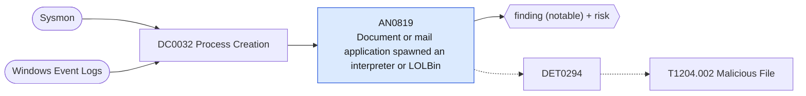

# AN0819 Document or mail application spawned an interpreter or LOLBin

[ATT&CK analytic](https://attack.mitre.org/detectionstrategies/DET0294#AN0819) · DET0294 User Execution – Malicious File via download/open → spawn chain (T1204.002) · [T1204.002 Malicious File](https://attack.mitre.org/techniques/T1204/002) · tactics: execution · platforms: Windows

**Content type:** ttp → finding (notable) + risk · **Severity:** high · **Status:** implemented · **Technique prevalence score:** 296

An Office application, Outlook, a PDF reader or an archive tool starts PowerShell, cmd, a script host or a proxy-execution utility (mshta, regsvr32, rundll32, msiexec, certutil, bitsadmin). This is the spawn step of a malicious attachment or lure document.



## What ATT&CK asks for

> User opens a file delivered by email, web, chat, or share. The handler application (Word/PDF reader/archiver) creates a file in user-controlled paths (Downloads, Temp, Desktop) and then spawns a new or unusual child process (e.g., powershell.exe, wscript.exe, cmd.exe, regsvr32.exe, rundll32.exe, msiexec.exe). Optional precursors include FileStreamCreated (URL/UNC) and Office → system32 batch writes.

## What this implementation detects

An Office application, Outlook, a PDF reader or an archive tool starts PowerShell, cmd, a script host or a proxy-execution utility (mshta, regsvr32, rundll32, msiexec, certutil, bitsadmin). This is the spawn step of a malicious attachment or lure document.

**Not covered:** The preceding file write to Downloads/Temp/Desktop, the Zone.Identifier stream (Sysmon 15) and the SuspiciousExtensions, UserPaths and SignerAllowList elements are not evaluated.

## Tuning

ATT&CK mutable elements and where each is bound. Edit macros in `local/macros.conf` and lookups in place; do not edit the search.

| Mutable element | ATT&CK guidance | Bound to | Default |
|---|---|---|---|
| TimeWindow | Seconds/minutes to correlate file write to child spawn (e.g., 0–5m). | filter macro `mitre_an0819_filter` (not bound separately) | `search *` |
| SuspiciousExtensions | Extensions and double-extension patterns to flag (exe,scr,lnk,pif,cpl,js,vbs,bat,cmd,ps1,hta,iso,lnk->cmd,docm,xlsm,pdf->exe, etc.). | filter macro `mitre_an0819_filter` (not bound separately) | `search *` |
| UserPaths | Paths considered user-controlled (Downloads, Temp, Desktop, profile AppData staging). | filter macro `mitre_an0819_filter` (not bound separately) | `search *` |
| ParentApps | List of user-facing apps that commonly open attachments for your org (reduce FPs or add weight). | macro `mitre_an0819_parent_apps` | `Processes.parent_process_name IN ("winword.exe", "excel.exe", "powerpnt.exe", "outlook.exe", "msaccess.exe", "mspub.exe", "visio.exe", "onenote.exe", "eqnedt32.exe", "acrord32.exe", "acrobat.exe", "foxitpdfreader.exe", "winrar.exe", "7zfm.exe", "7zg.exe")` |
| SignerAllowList | Trusted code signers/publishers to suppress benign admin tools. | filter macro `mitre_an0819_filter` (not bound separately) | `search *` |

## Splunk

Stanza `[MITRE - AN0819 - Document or mail application spawned an interpreter or LOLBin - Rule]` in `DA-ESS-mitre-attack-detections`. Schedule `9-59/15 * * * *`, window `-20m@m` to `-5m@m`. Ships disabled.

```spl
| tstats `mitre_summariesonly` count min(_time) as firstTime max(_time) as lastTime
    from `mitre_dc0032_dm` where `mitre_dc0032_dm_where` `mitre_an0819_parent_apps`
    Processes.process_name IN ("powershell.exe", "pwsh.exe", "cmd.exe", "wscript.exe", "cscript.exe", "mshta.exe", "regsvr32.exe", "rundll32.exe", "msiexec.exe", "certutil.exe", "bitsadmin.exe", "schtasks.exe", "wmic.exe", "msbuild.exe", "installutil.exe", "curl.exe")
    by Processes.dest Processes.user Processes.parent_process_name Processes.process_name Processes.process
| `drop_dm_object_name(Processes)`
| `mitre_ctime(firstTime)` | `mitre_ctime(lastTime)`
| `mitre_an0819_filter`
```

Risk: `dest` (system, 60), `user` (user, 60). Threat objects: `process_name`. Message: $parent_process_name$ spawned $process_name$ on $dest$ for $user$

Throttle: dest, user, process_name for 3600s.

Data components: [DC0032](../data-components/DC0032-process-creation.md).

## Sigma

Rule file: `dist/sigma/rules/an0819_document_or_mail_application_spawned_an_interpreter_or_lolbi.yml`.

## Known false positives

- Office add-ins and document-automation macros that shell out; rundll32 launched by Outlook for printing or protocol handlers.
