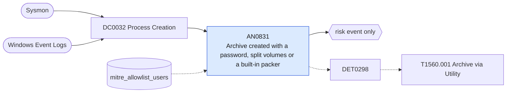

# AN0831 Archive created with a password, split volumes or a built-in packer

[ATT&CK analytic](https://attack.mitre.org/detectionstrategies/DET0298#AN0831) · DET0298 Detect Archiving via Utility (T1560.001) · [T1560.001 Archive via Utility](https://attack.mitre.org/techniques/T1560/001) · tactics: collection · platforms: Windows

**Content type:** anomaly → risk event only · **Severity:** low · **Status:** implemented · **Technique prevalence score:** 140

7-Zip or WinRAR adds files to an archive with a password or volume-split switch; makecab or diantz is run; PowerShell Compress-Archive is used; or tar.exe creates an archive. These are the common staging steps before exfiltration.



## What ATT&CK asks for

> Detects adversarial archiving using built-in or third-party utilities (makecab, diantz, xcopy, certutil, 7z, WinRAR, WinZip). Correlates suspicious process creation events with command-line arguments for compression/encoding, followed by creation of archive files (.cab, .zip, .7z, .rar). Identifies anomalous loading of crypt32.dll for encryption operations or execution of diantz.exe to compress remotely staged files.

## What this implementation detects

7-Zip or WinRAR adds files to an archive with a password or volume-split switch; makecab or diantz is run; PowerShell Compress-Archive is used; or tar.exe creates an archive. These are the common staging steps before exfiltration.

**Not covered:** The resulting archive file creation, crypt32.dll loads and the FileSizeThresholdMB element are not evaluated.

## Tuning

ATT&CK mutable elements and where each is bound. Edit macros in `local/macros.conf` and lookups in place; do not edit the search.

| Mutable element | ATT&CK guidance | Bound to | Default |
|---|---|---|---|
| SuspiciousExtensions | List of archive extensions considered high risk (.cab, .zip, .7z, .rar). | macro `mitre_an0831_patterns` | `((Processes.process_name IN ("7z.exe", "7za.exe", "7zr.exe", "rar.exe", "winrar.exe") Processes.process="* a *" Processes.process IN ("* -p*", "* -hp*", "* -v*")) OR Processes.process_name IN ("makecab.exe", "diantz.exe") OR (Processes.process_name IN ("powershell.exe", "pwsh.exe") Processes.process="*compress-archive*") OR (Processes.process_name="tar.exe" Processes.process IN ("* -c*", "* -a *", "*--create*")))` |
| ProcessAllowlist | Known business utilities allowed to create archives without alerting. | lookup `mitre_allowlist_users` — Backup and packaging service accounts (allow-listing by user is more precise than by utility name). |  |
| FileSizeThresholdMB | Minimum archive size threshold to filter out benign small compressions. | filter macro `mitre_an0831_filter` (not bound separately) | `search *` |

## Splunk

Stanza `[MITRE - AN0831 - Archive created with a password, split volumes or a built-in packer - Rule]` in `DA-ESS-mitre-attack-detections`. Schedule `0-59/15 * * * *`, window `-20m@m` to `-5m@m`. Ships disabled.

```spl
| tstats `mitre_summariesonly` count min(_time) as firstTime max(_time) as lastTime
    from `mitre_dc0032_dm` where `mitre_dc0032_dm_where` `mitre_an0831_patterns`
    by Processes.dest Processes.user Processes.parent_process_name Processes.process_name Processes.process
| `drop_dm_object_name(Processes)`
| search `mitre_not_allowlisted_user`
| `mitre_ctime(firstTime)` | `mitre_ctime(lastTime)`
| `mitre_an0831_filter`
```

Risk: `dest` (system, 25), `user` (user, 25). Threat objects: `process_name`. Message: Data archived with $process_name$ on $dest$ by $user$

Throttle: dest, user, process_name for 3600s.

Data components: [DC0032](../data-components/DC0032-process-creation.md).

## Sigma

Rule file: `dist/sigma/rules/an0831_archive_created_with_a_password_split_volumes_or_a_built_in_.yml`.

## Known false positives

- Backup jobs, software packaging and users compressing files for mail.
