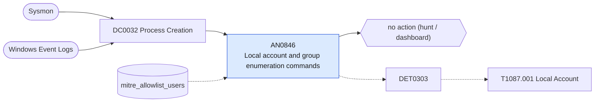

# AN0846 Local account and group enumeration commands

[ATT&CK analytic](https://attack.mitre.org/detectionstrategies/DET0303#AN0846) · DET0303 Local Account Enumeration Across Host Platforms · [T1087.001 Local Account](https://attack.mitre.org/techniques/T1087/001) · tactics: discovery · platforms: Windows

**Content type:** hunting → no action (hunt / dashboard) · **Severity:** informational · **Status:** implemented · **Technique prevalence score:** 87

Lists net user and net localgroup without /domain, wmic useraccount and group, and the Get-LocalUser / Get-LocalGroupMember cmdlets, in ten-minute buckets per host and user.



## What ATT&CK asks for

> Adversary enumeration of local user accounts using Net.exe, WMI, or PowerShell.

## What this implementation detects

Lists net user and net localgroup without /domain, wmic useraccount and group, and the Get-LocalUser / Get-LocalGroupMember cmdlets, in ten-minute buckets per host and user.

**Not covered:** Domain enumeration is AN0363. The 4798/4799 enumeration events (Group Enumeration) would add API-level visibility and are a candidate second leg. No finding or risk.

## Tuning

ATT&CK mutable elements and where each is bound. Edit macros in `local/macros.conf` and lookups in place; do not edit the search.

| Mutable element | ATT&CK guidance | Bound to | Default |
|---|---|---|---|
| CommandLinePattern | Detects variations of 'net user', 'net localgroup', 'Get-LocalUser'. | filter macro `mitre_an0846_filter` |  |
| UserContext | Restrict monitoring to low-privileged or unexpected users executing enumeration. | lookup `mitre_allowlist_users` |  |
| TimeWindow | Tune for bursts of enumeration commands in short succession. | filter macro `mitre_an0846_filter` — Bucket fixed at 10 minutes. |  |

## Splunk

Stanza `[MITRE - AN0846 - Local account and group enumeration commands - Rule]` in `DA-ESS-mitre-attack-detections`. Schedule `3-59/15 * * * *`, window `-20m@m` to `-5m@m`. Ships disabled.

```spl
| tstats `mitre_summariesonly` count from `mitre_dc0032_dm` where `mitre_dc0032_dm_where`
    (((Processes.process_name IN ("net.exe", "net1.exe") Processes.process IN ("* user*", "* localgroup*")) NOT Processes.process="* /do*")
      OR (Processes.process_name="wmic.exe" Processes.process IN ("*useraccount*", "* group*"))
      OR (Processes.process_name IN ("powershell.exe", "pwsh.exe") Processes.process IN ("*get-localuser*", "*get-localgroup*", "*win32_useraccount*")))
    by Processes.dest Processes.user Processes.parent_process_name Processes.process _time span=10m
| `drop_dm_object_name(Processes)`
| search `mitre_not_allowlisted_user`
| stats sum(count) as count dc(process) as distinct_commands values(process) as process values(parent_process_name) as parent_process_name by dest user _time
| sort - distinct_commands
| `mitre_an0846_filter`
```

Data components: [DC0032](../data-components/DC0032-process-creation.md).

## Sigma

Rule file: `dist/sigma/rules/an0846_local_account_and_group_enumeration_commands.yml`.

## Known false positives

- Administrators, provisioning scripts and compliance scanners.
