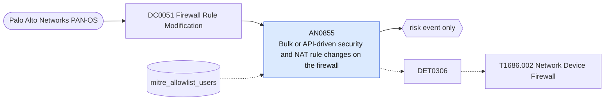

# AN0855 Bulk or API-driven security and NAT rule changes on the firewall

[ATT&CK analytic](https://attack.mitre.org/detectionstrategies/DET0306#AN0855) · DET0306 Detection of Unauthorized Network Firewall Rule Modification · [T1686.002 Network Device Firewall](https://attack.mitre.org/techniques/T1686/002) · tactics: defense-impairment · platforms: Network Devices

**Content type:** anomaly → risk event only · **Severity:** medium · **Status:** implemented · **Technique prevalence score:** 8

An administrator changes many security or NAT rules on a Palo Alto firewall within ten minutes, or changes them through the XML or REST API rather than the web UI or CLI. ATT&CK calls out bulk rule changes and non-console channels as the signs of rule tampering.



## What ATT&CK asks for

> Defender observes configuration changes on firewall/network appliance involving rule creation, modification, or deletion from abnormal management IPs or non-console channels (e.g., remote CLI, API). These are often correlated with a spike in previously blocked outbound traffic, unexpected allow-all rules, or bulk rule deletions. Behavior often follows unauthorized login, privilege escalation, or API abuse.

## What this implementation detects

An administrator changes many security or NAT rules on a Palo Alto firewall within ten minutes, or changes them through the XML or REST API rather than the web UI or CLI. ATT&CK calls out bulk rule changes and non-console channels as the signs of rule tampering.

**Not covered:** The outbound-traffic spike through newly allowed ports is not correlated; rule content is not visible with the current add-on.

## Tuning

ATT&CK mutable elements and where each is bound. Edit macros in `local/macros.conf` and lookups in place; do not edit the search.

| Mutable element | ATT&CK guidance | Bound to | Default |
|---|---|---|---|
| TrustedAdminIPs | Allowlisted IPs/subnets where administrative access is expected (e.g., jump box, VPN mgmt) | lookup `mitre_allowlist_users` — Automation accounts that manage rules through the API. |  |
| ConfigChangeWindow | Expected maintenance window (e.g., 02:00–04:00 UTC) to filter benign changes | filter macro `mitre_an0855_filter` |  |
| RuleScopeThreshold | Number of rules affected or port ranges modified to determine severity | macro `mitre_an0855_threshold` — Rule changes per administrator per firewall per 10 minutes. | `10` |
| NewUserPrivilegeThreshold | Flag new users making changes without observed privilege elevation path | filter macro `mitre_an0855_filter` (not bound separately) | `search *` |

## Splunk

Stanza `[MITRE - AN0855 - Bulk or API-driven security and NAT rule changes on the firewall - Rule]` in `DA-ESS-mitre-attack-detections`. Schedule `1-59/15 * * * *`, window `-20m@m` to `-5m@m`. Ships disabled.

```spl
`mitre_dc0051_palo_alto` `mitre_st_palo_alto_config` path IN ("*rulebase*security*", "*rulebase*nat*")
| `mitre_normalize_pan`
| eval dest=coalesce(dvc_name, dest, host), api=if(match(client, "(?i)api|xml|rest"), 1, 0)
| search `mitre_not_allowlisted_user`
| bin _time span=10m
| stats count as rule_changes max(api) as via_api min(_time) as firstTime max(_time) as lastTime values(cmd) as config_action values(client) as client by dest user _time
| where rule_changes >= `mitre_an0855_threshold` OR via_api=1
| `mitre_ctime(firstTime)` | `mitre_ctime(lastTime)`
| `mitre_an0855_filter`
```

Risk: `dest` (system, 35), `user` (user, 35). Message: $rule_changes$ rule changes on firewall $dest$ by $user$ (API $via_api$)

Throttle: dest, user for 3600s.

Data components: [DC0051](../data-components/DC0051-firewall-rule-modification.md).

## Sigma

Rule file: `dist/sigma/rules/an0855_bulk_or_api_driven_security_and_nat_rule_changes_on_the_fire.yml`.

## Known false positives

- Automation (Terraform, Ansible, Panorama) that changes rules through the API; allow-list its service account.
