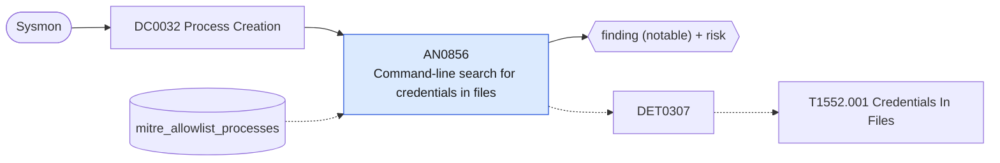

# AN0856 Command-line search for credentials in files

[ATT&CK analytic](https://attack.mitre.org/detectionstrategies/DET0307#AN0856) · DET0307 Detect Access to Unsecured Credential Files Across Platforms · [T1552.001 Credentials In Files](https://attack.mitre.org/techniques/T1552/001) · tactics: credential-access · platforms: Windows

**Content type:** ttp → finding (notable) + risk · **Severity:** medium · **Status:** implemented · **Technique prevalence score:** 63

findstr or Select-String searching for password, cpassword or credential strings, or a shell, script host or copy utility touching well-known credential files (unattend.xml, sysprep, Group Policy Preferences XML, web.config, KeePass databases, SSH private keys, cloud CLI credential files).



## What ATT&CK asks for

> Correlated file access to insecure credential files (e.g., *.env, *.xml, *.ps1) followed by suspicious process execution or authentication using retrieved credentials. Detected through Sysmon logs and Windows Security Event logs.

## What this implementation detects

findstr or Select-String searching for password, cpassword or credential strings, or a shell, script host or copy utility touching well-known credential files (unattend.xml, sysprep, Group Policy Preferences XML, web.config, KeePass databases, SSH private keys, cloud CLI credential files).

**Not covered:** Reads by the adversary's own tooling through file APIs need Security 4663 with SACLs on the files; the follow-on use of found credentials (4624/4648) is left to the logon analytics and the risk correlation.

## Tuning

ATT&CK mutable elements and where each is bound. Edit macros in `local/macros.conf` and lookups in place; do not edit the search.

| Mutable element | ATT&CK guidance | Bound to | Default |
|---|---|---|---|
| FileNamePattern | Patterns like *.env, *credential* can be tuned to reduce noise or catch custom implementations | macro `mitre_an0856_commands` | `((Image="*\\findstr.exe" CommandLine IN ("*password*", "*passwd*", "*cpassword*", "*pwd=*", "*credential*")) OR (CommandLine="*Select-String*" CommandLine IN ("*password*", "*cpassword*", "*credential*")) OR (Image IN ("*\\cmd.exe", "*\\powershell.exe", "*\\pwsh.exe", "*\\findstr.exe", "*\\more.com", "*\\xcopy.exe", "*\\robocopy.exe", "*\\certutil.exe") CommandLine IN ("*unattend.xml*", "*sysprep.xml*", "*sysprep.inf*", "*\\Groups.xml*", "*\\Services.xml*", "*\\ScheduledTasks.xml*", "*\\DataSources.xml*", "*\\.aws\\credentials*", "*\\.azure\\accessTokens.json*", "*.kdbx*", "*\\.ssh\\id_*", "*web.config*", "*\\.git-credentials*")))` |
| ProcessAccessScope | Defines scope of access (e.g., only untrusted parent processes or high-risk processes) | lookup `mitre_allowlist_processes` — Configuration-management and audit tools that grep configs for secrets on purpose. |  |
| TimeWindow | Time delta between credential file access and use in logon attempt | filter macro `mitre_an0856_filter` |  |

## Splunk

Stanza `[MITRE - AN0856 - Command-line search for credentials in files - Rule]` in `DA-ESS-mitre-attack-detections`. Schedule `4-59/15 * * * *`, window `-20m@m` to `-5m@m`. Ships disabled.

```spl
`mitre_dc0032_sysmon` EventCode=1 `mitre_an0856_commands`
| `mitre_normalize_host`
| eval process_name=lower(replace(Image, "^.*\\\\", "")), parent_process_name=lower(replace(ParentImage, "^.*\\\\", ""))
| search `mitre_not_allowlisted_process`
| stats count min(_time) as firstTime max(_time) as lastTime values(CommandLine) as process values(parent_process_name) as parent_process_name by dest user process_name
| eval process=mvindex(process, 0, 9)
| `mitre_ctime(firstTime)` | `mitre_ctime(lastTime)`
| `mitre_an0856_filter`
```

Risk: `dest` (system, 40), `user` (user, 50). Threat objects: `process_name`. Message: $user$ searched for credentials in files on $dest$ with $process_name$

Throttle: dest, user for 86400s.

Data components: [DC0032](../data-components/DC0032-process-creation.md).

## Sigma

Rule file: `dist/sigma/rules/an0856_command_line_search_for_credentials_in_files.yml`.

## Known false positives

- Administrators and auditors hunting for plaintext secrets; deployment scripts that template unattend.xml or web.config.
