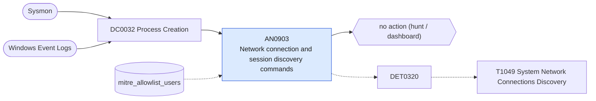

# AN0903 Network connection and session discovery commands

[ATT&CK analytic](https://attack.mitre.org/detectionstrategies/DET0320#AN0903) · DET0320 Detection of System Network Connections Discovery Across Platforms · [T1049 System Network Connections Discovery](https://attack.mitre.org/techniques/T1049) · tactics: discovery · platforms: Windows

**Content type:** hunting → no action (hunt / dashboard) · **Severity:** informational · **Status:** implemented · **Technique prevalence score:** 137

Lists hosts and users enumerating connections and sessions: netstat, net session, net use, Get-NetTCPConnection, Get-NetUDPEndpoint, Get-SmbSession, Get-SmbConnection, with parent process.



## What ATT&CK asks for

> Detects usage of commands or binaries (e.g., netstat, PowerShell Get-NetTCPConnection) and WMI or API calls to enumerate local or remote network connections.

## What this implementation detects

Lists hosts and users enumerating connections and sessions: netstat, net session, net use, Get-NetTCPConnection, Get-NetUDPEndpoint, Get-SmbSession, Get-SmbConnection, with parent process.

**Not covered:** PowerShell script-block content and API-level enumeration are not included. No finding or risk.

## Tuning

ATT&CK mutable elements and where each is bound. Edit macros in `local/macros.conf` and lookups in place; do not edit the search.

| Mutable element | ATT&CK guidance | Bound to | Default |
|---|---|---|---|
| SuspiciousParentProcesses | Non-standard binaries launching PowerShell or netstat (e.g., winword.exe spawning powershell.exe). | filter macro `mitre_an0903_filter` — e.g. search parent_process_name IN ("winword.exe", "wscript.exe", "mshta.exe", "w3wp.exe"). |  |
| TimeWindow | Correlates discovery behavior before lateral movement or credential access. | filter macro `mitre_an0903_filter` (not bound separately) | `search *` |
| CommandPatternList | Regex or keyword patterns to match discovery utilities (e.g., `netstat`, `Get-NetTCPConnection`). | lookup `mitre_allowlist_users` — Monitoring accounts that poll connections. |  |

## Splunk

Stanza `[MITRE - AN0903 - Network connection and session discovery commands - Rule]` in `DA-ESS-mitre-attack-detections`. Schedule `7-59/15 * * * *`, window `-20m@m` to `-5m@m`. Ships disabled.

```spl
| tstats `mitre_summariesonly` count from `mitre_dc0032_dm` where `mitre_dc0032_dm_where`
    (Processes.process_name="netstat.exe"
      OR (Processes.process_name IN ("net.exe", "net1.exe") Processes.process IN ("* session*", "* use*"))
      OR (Processes.process_name IN ("powershell.exe", "pwsh.exe") Processes.process IN ("*get-nettcpconnection*", "*get-netudpendpoint*", "*get-smbsession*", "*get-smbconnection*")))
    by Processes.dest Processes.user Processes.parent_process_name Processes.process _time span=10m
| `drop_dm_object_name(Processes)`
| search `mitre_not_allowlisted_user`
| stats sum(count) as count dc(process) as distinct_commands values(process) as process by dest user parent_process_name _time
| sort - count
| `mitre_an0903_filter`
```

Data components: [DC0032](../data-components/DC0032-process-creation.md).

## Sigma

Rule file: `dist/sigma/rules/an0903_network_connection_and_session_discovery_commands.yml`.

## Known false positives

- Monitoring agents, VPN clients and administrators.
