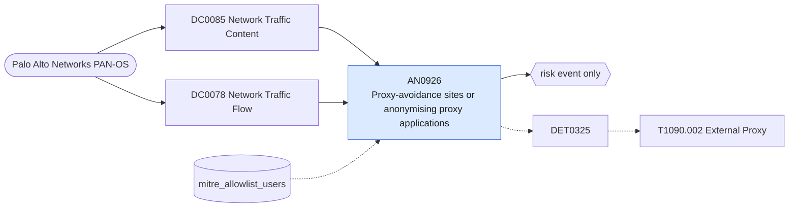

# AN0926 Proxy-avoidance sites or anonymising proxy applications

[ATT&CK analytic](https://attack.mitre.org/detectionstrategies/DET0325#AN0926) · DET0325 External Proxy Behavior via Outbound Relay to Intermediate Infrastructure · [T1090.002 External Proxy](https://attack.mitre.org/techniques/T1090/002) · tactics: command-and-control · platforms: Network Devices

**Content type:** anomaly → risk event only · **Severity:** medium · **Status:** implemented · **Technique prevalence score:** 39

Palo Alto URL filtering logs in the proxy-avoidance-and-anonymizers category, or traffic App-IDs for anonymising proxies and personal VPN services (Psiphon, Ultrasurf, Hotspot Shield and similar), from an internal source.



## What ATT&CK asks for

> Changes to NAT/firewall policies enabling outbound port forwarding from internal IPs to Internet-based proxy endpoints. Log spikes in outbound flows to CDN, VPS, or anomalous ASNs with few return packets.

## What this implementation detects

Palo Alto URL filtering logs in the proxy-avoidance-and-anonymizers category, or traffic App-IDs for anonymising proxies and personal VPN services (Psiphon, Ultrasurf, Hotspot Shield and similar), from an internal source.

**Not covered:** NAT and port-forwarding rule changes that create proxies on the firewall itself are covered by AN1233; outbound-flow spikes to VPS address space are not modelled (no ASN enrichment).

## Tuning

ATT&CK mutable elements and where each is bound. Edit macros in `local/macros.conf` and lookups in place; do not edit the search.

| Mutable element | ATT&CK guidance | Bound to | Default |
|---|---|---|---|
| FlowThreshold | Number of flows or bytes transferred per minute—flag surges to unrecognized ASNs. | macro `mitre_an0926_apps` — App-ID names of anonymising proxies and consumer VPNs; trim to what policy forbids. | `app IN ("psiphon", "ultrasurf", "hotspot-shield", "your-freedom", "hola-unblocker", "zenmate", "windscribe", "opera-vpn", "browsec", "urban-vpn")` |
| DestinationIPCategory | Proxy destination categories: CDN, TOR exit node, anonymous hosting. | macro `mitre_an0926_categories` | `url_category IN ("proxy-avoidance-and-anonymizers", "*proxy-avoidance*")` |
| ConfigChangeUser | Track if unexpected user or automation changed NAT/forwarding rules. | lookup `mitre_allowlist_users` |  |

## Splunk

Stanza `[MITRE - AN0926 - Proxy-avoidance sites or anonymising proxy applications - Rule]` in `DA-ESS-mitre-attack-detections`. Schedule `12-59/15 * * * *`, window `-20m@m` to `-5m@m`. Ships disabled.

```spl
(`mitre_dc0085_palo_alto` `mitre_st_palo_alto_threat` log_subtype=url) OR (`mitre_dc0078_palo_alto` `mitre_st_palo_alto_traffic` `mitre_an0926_apps`)
| `mitre_normalize_pan`
| search `mitre_an0926_categories` OR sourcetype="pan:traffic"
| search `mitre_not_allowlisted_user`
| stats count min(_time) as firstTime max(_time) as lastTime values(url) as url values(app) as app values(action) as action values(url_category) as url_category by src user
| eval url=mvindex(url, 0, 9)
| `mitre_ctime(firstTime)` | `mitre_ctime(lastTime)`
| `mitre_an0926_filter`
```

Risk: `src` (system, 30), `user` (user, 30). Message: $src$ reached an anonymising proxy or proxy-avoidance site

Throttle: src for 14400s.

Data components: [DC0085](../data-components/DC0085-network-traffic-content.md), [DC0078](../data-components/DC0078-network-traffic-flow.md).

## Sigma

Rule file: `dist/sigma/rules/an0926_proxy_avoidance_sites_or_anonymising_proxy_applications.yml`.

## Known false positives

- Users trying to bypass web filtering for non-malicious reasons; travellers using personal VPNs on corporate devices.
