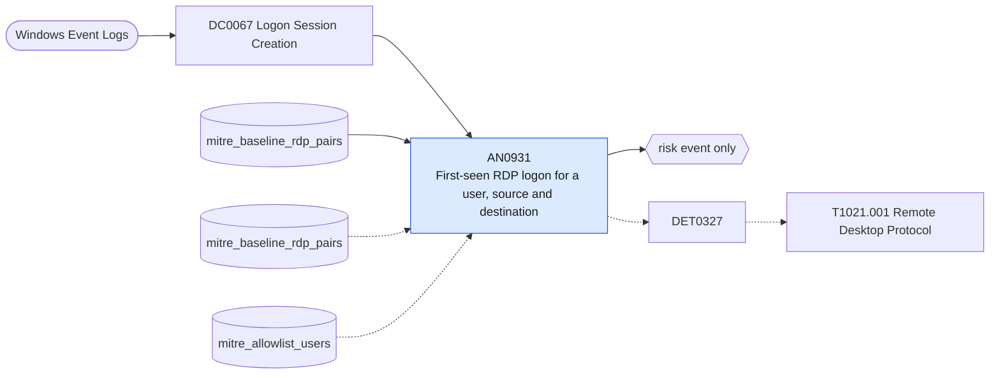

# AN0931 First-seen RDP logon for a user, source and destination

[ATT&CK analytic](https://attack.mitre.org/detectionstrategies/DET0327#AN0931) · DET0327 Multi-event Detection Strategy for RDP-Based Remote Logins and Post-Access Activity · [T1021.001 Remote Desktop Protocol](https://attack.mitre.org/techniques/T1021/001) · tactics: lateral-movement · platforms: Windows

**Content type:** anomaly → risk event only · **Severity:** medium · **Status:** implemented · **Technique prevalence score:** 114

A RemoteInteractive logon (4624 type 10) for a user, source address and destination host combination that is not in the 30-day baseline of RDP logons. The baseline is built daily by an attached search.



## What ATT&CK asks for

> Remote Desktop (RDP) logon by a user followed by unusual process execution, file access, or lateral movement activity within a short timeframe.

## What this implementation detects

A RemoteInteractive logon (4624 type 10) for a user, source address and destination host combination that is not in the 30-day baseline of RDP logons. The baseline is built daily by an attached search.

**Not covered:** Post-logon process, file and network activity is not correlated in this search; pair the risk event with other analytics on the same host in the detection strategy. Session reconnects (4778) are not used.

## Tuning

ATT&CK mutable elements and where each is bound. Edit macros in `local/macros.conf` and lookups in place; do not edit the search.

| Mutable element | ATT&CK guidance | Bound to | Default |
|---|---|---|---|
| TimeWindow | Temporal threshold to correlate login with post-login activity (e.g., 5 minutes) | filter macro `mitre_an0931_filter` (not bound separately) | `search *` |
| UserContext | Tune for non-admin users or service accounts expected to use RDP | lookup `mitre_allowlist_users` — Accounts expected to RDP widely (jump-host admins). |  |
| ProcessList | Define suspicious post-login processes such as cmd.exe, powershell.exe, certutil.exe | filter macro `mitre_an0931_filter` (not bound separately) | `search *` |
| HostAccessPatterns | Scope detection to uncommon or first-time access between source and destination hosts | lookup `mitre_baseline_rdp_pairs` — Written by the baseline search; do not edit by hand. Shorten or lengthen history with the baseline's dispatch.earliest_time. |  |

## Splunk

Stanza `[MITRE - AN0931 - First-seen RDP logon for a user, source and destination - Rule]` in `DA-ESS-mitre-attack-detections`. Schedule `1-59/15 * * * *`, window `-20m@m` to `-5m@m`. Ships disabled.

```spl
`mitre_dc0067_wineventlog` EventCode=4624 LogonType=10
| `mitre_normalize_host`
| eval src=IpAddress, user=TargetUserName
| search NOT src IN ("-", "127.0.0.1", "::1") `mitre_not_allowlisted_user`
| lookup mitre_baseline_rdp_pairs user src dest OUTPUT first_seen
| where isnull(first_seen)
| stats count min(_time) as firstTime max(_time) as lastTime by dest user src
| `mitre_ctime(firstTime)` | `mitre_ctime(lastTime)`
| `mitre_an0931_filter`
```

Risk: `dest` (system, 35), `user` (user, 35). Threat objects: `src`. Message: First-seen RDP logon to $dest$ by $user$ from $src$

Throttle: dest, user, src for 86400s.

### Baseline: RDP logon pairs

User, source and destination combinations seen in RemoteInteractive logons. Writes `mitre_baseline_rdp_pairs`; schedule `17 3 * * *` over `-30d@d`. Enable and run it before the detection.

```spl
`mitre_dc0067_wineventlog` EventCode=4624 LogonType=10
| `mitre_normalize_host`
| eval src=IpAddress, user=TargetUserName
| stats min(_time) as first_seen max(_time) as last_seen count by user src dest
| outputlookup mitre_baseline_rdp_pairs
```

Data components: [DC0067](../data-components/DC0067-logon-session-creation.md).

## Sigma

Rule file: `dist/sigma/rules/an0931_first_seen_rdp_logon_for_a_user_source_and_destination.yml`.

Sigma has no state, so the rule matches every RDP logon; apply the first-seen condition in the SIEM.

## Known false positives

- New administrators, new jump hosts, DHCP address changes on the source.
