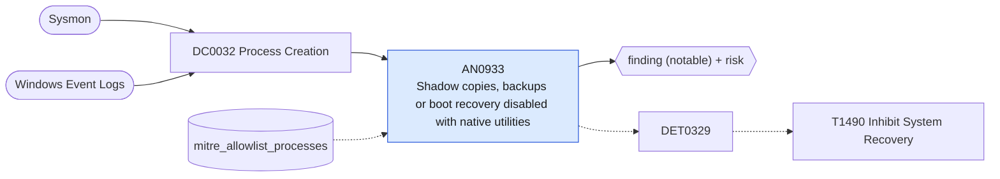

# AN0933 Shadow copies, backups or boot recovery disabled with native utilities

[ATT&CK analytic](https://attack.mitre.org/detectionstrategies/DET0329#AN0933) · DET0329 Behavioral Detection for T1490 - Inhibit System Recovery · [T1490 Inhibit System Recovery](https://attack.mitre.org/techniques/T1490) · tactics: impact · platforms: Windows

**Content type:** ttp → finding (notable) + risk · **Severity:** high · **Status:** implemented · **Technique prevalence score:** 65

vssadmin, wbadmin, wmic, diskshadow, bcdedit, REAgentC or PowerShell is run with arguments that delete volume shadow copies, remove backup catalogs or disable Windows recovery. This is the standard pre-encryption step of ransomware.



## What ATT&CK asks for

> Process chains that use native utilities (vssadmin, wbadmin, diskshadow, bcdedit, REAgentC, wmic) with arguments to delete shadow copies, disable recovery, or remove backup catalogs

## What this implementation detects

vssadmin, wbadmin, wmic, diskshadow, bcdedit, REAgentC or PowerShell is run with arguments that delete volume shadow copies, remove backup catalogs or disable Windows recovery. This is the standard pre-encryption step of ransomware.

**Not covered:** Backup-catalog deletion events, service state changes and the registry leg are not included; the command line alone is high fidelity.

## Tuning

ATT&CK mutable elements and where each is bound. Edit macros in `local/macros.conf` and lookups in place; do not edit the search.

| Mutable element | ATT&CK guidance | Bound to | Default |
|---|---|---|---|
| TimeWindow | Used to track rapid recovery feature changes over short intervals | filter macro `mitre_an0933_filter` (not bound separately) | `search *` |
| CommandLinePattern | Can be tuned to catch variations in destructive flags (/all, /quiet, -delete) | macro `mitre_an0933_patterns` | `((Processes.process_name="vssadmin.exe" Processes.process IN ("*delete*shadows*", "*resize*shadowstorage*")) OR (Processes.process_name="wbadmin.exe" Processes.process IN ("*delete*catalog*", "*delete*systemstatebackup*", "*delete*backup*")) OR (Processes.process_name="wmic.exe" Processes.process="*shadowcopy*delete*") OR (Processes.process_name="diskshadow.exe" Processes.process IN ("*delete*shadows*", "*/s *")) OR (Processes.process_name="bcdedit.exe" Processes.process IN ("*recoveryenabled*no*", "*bootstatuspolicy*ignoreallfailures*")) OR (Processes.process_name="reagentc.exe" Processes.process="*/disable*") OR (Processes.process_name IN ("powershell.exe", "pwsh.exe") Processes.process IN ("*win32_shadowcopy*delete*", "*win32_shadowcopy*remove-*")))` |
| ParentProcessContext | Tune based on common parent-child chains (e.g., powershell → diskshadow) | lookup `mitre_allowlist_processes` — Backup products that prune shadow copies (process_name column matches the utility; prefer the filter macro to scope by parent). |  |

## Splunk

Stanza `[MITRE - AN0933 - Shadow copies, backups or boot recovery disabled with native utilities - Rule]` in `DA-ESS-mitre-attack-detections`. Schedule `5-59/15 * * * *`, window `-20m@m` to `-5m@m`. Ships disabled.

```spl
| tstats `mitre_summariesonly` count min(_time) as firstTime max(_time) as lastTime
    from `mitre_dc0032_dm` where `mitre_dc0032_dm_where` `mitre_an0933_patterns`
    by Processes.dest Processes.user Processes.parent_process_name Processes.process_name Processes.process
| `drop_dm_object_name(Processes)`
| search `mitre_not_allowlisted_process`
| `mitre_ctime(firstTime)` | `mitre_ctime(lastTime)`
| `mitre_an0933_filter`
```

Risk: `dest` (system, 80), `user` (user, 60). Threat objects: `process_name`. Message: System recovery inhibited with $process_name$ on $dest$

Throttle: dest, process_name for 3600s.

Data components: [DC0032](../data-components/DC0032-process-creation.md).

## Sigma

Rule file: `dist/sigma/rules/an0933_shadow_copies_backups_or_boot_recovery_disabled_with_native_.yml`.

## Known false positives

- Backup software resizing shadow storage; administrators running diskshadow scripts.
