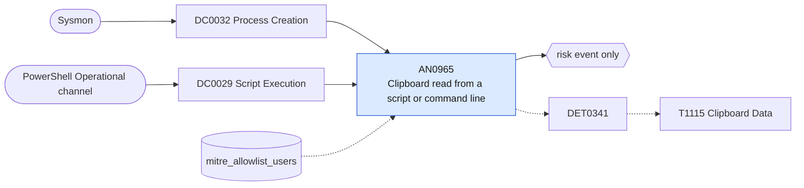

# AN0965 Clipboard read from a script or command line

[ATT&CK analytic](https://attack.mitre.org/detectionstrategies/DET0341#AN0965) · DET0341 Clipboard Data Access with Anomalous Context · [T1115 Clipboard Data](https://attack.mitre.org/techniques/T1115) · tactics: collection · platforms: Windows

**Content type:** anomaly → risk event only · **Severity:** low · **Status:** implemented · **Technique prevalence score:** 51

Get-Clipboard, the .NET Windows.Forms Clipboard GetText/GetDataObject calls, or the user32 GetClipboardData API referenced from a PowerShell script block (4104) or a process command line. Clipboard stealers and crypto wallet swappers read the clipboard on a loop.



## What ATT&CK asks for

> Detection of clipboard access via OS utilities (e.g., clip.exe, Get-Clipboard) by non-interactive or abnormal parent processes, potentially chained with staging or exfiltration commands.

## What this implementation detects

Get-Clipboard, the .NET Windows.Forms Clipboard GetText/GetDataObject calls, or the user32 GetClipboardData API referenced from a PowerShell script block (4104) or a process command line. Clipboard stealers and crypto wallet swappers read the clipboard on a loop.

**Not covered:** Native code calling GetClipboardData without PowerShell is invisible (needs EDR API telemetry); Sysmon 24 (ClipboardChange) archives contents and is not enabled in most configs.

## Tuning

ATT&CK mutable elements and where each is bound. Edit macros in `local/macros.conf` and lookups in place; do not edit the search.

| Mutable element | ATT&CK guidance | Bound to | Default |
|---|---|---|---|
| TimeWindow | Defines how far back to look for parent-child relationships and follow-on network activity. | filter macro `mitre_an0965_filter` |  |
| UserContext | Filters based on service vs interactive users to reduce noise. | lookup `mitre_allowlist_users` — Accounts running sanctioned clipboard-automation scripts. |  |
| ParentProcessName | Tunable list of expected/benign clipboard accessors. | macro `mitre_an0965_patterns` | `("*Get-Clipboard*", "*Clipboard]::GetText*", "*Clipboard]::GetDataObject*", "*Clipboard]::GetImage*", "*GetClipboardData*", "*Clipboard]::ContainsText*")` |

## Splunk

Stanza `[MITRE - AN0965 - Clipboard read from a script or command line - Rule]` in `DA-ESS-mitre-attack-detections`. Schedule `1-59/15 * * * *`, window `-20m@m` to `-5m@m`. Ships disabled.

```spl
(`mitre_dc0032_sysmon` EventCode=1 CommandLine IN `mitre_an0965_patterns`)
OR (`mitre_dc0029_powershell_logging` EventCode=4104 ScriptBlockText IN `mitre_an0965_patterns`)
| `mitre_normalize_host`
| eval process_name=lower(replace(coalesce(Image, "powershell.exe"), "^.*\\\\", "")), evidence=substr(coalesce(CommandLine, ScriptBlockText), 1, 300)
| search `mitre_not_allowlisted_user`
| stats count min(_time) as firstTime max(_time) as lastTime values(evidence) as evidence values(process_name) as process_name by dest user
| eval evidence=mvindex(evidence, 0, 4)
| `mitre_ctime(firstTime)` | `mitre_ctime(lastTime)`
| `mitre_an0965_filter`
```

Risk: `dest` (system, 25), `user` (user, 20). Threat objects: `process_name`. Message: Clipboard read by script on $dest$ as $user$

Throttle: dest, user for 86400s.

Data components: [DC0032](../data-components/DC0032-process-creation.md), [DC0029](../data-components/DC0029-script-execution.md).

## Sigma

Rule file: `dist/sigma/rules/an0965_clipboard_read_from_a_script_or_command_line.yml`.

## Known false positives

- Helpdesk and productivity scripts that paste into forms; PowerShell modules that wrap the clipboard.
