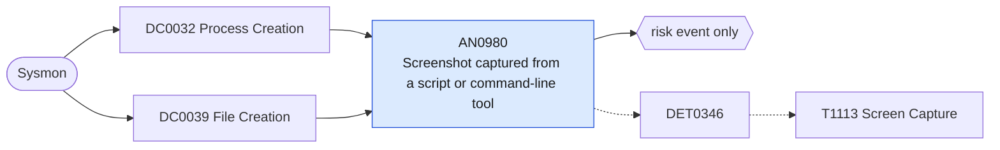

# AN0980 Screenshot captured from a script or command-line tool

[ATT&CK analytic](https://attack.mitre.org/detectionstrategies/DET0346#AN0980) · DET0346 Detect Screen Capture via Commands and API Calls · [T1113 Screen Capture](https://attack.mitre.org/techniques/T1113) · tactics: collection · platforms: Windows

**Content type:** anomaly → risk event only · **Severity:** medium · **Status:** implemented · **Technique prevalence score:** 192

A command line uses the .NET screen-capture API (CopyFromScreen, System.Drawing bitmaps) or a screenshot utility (NirCmd savescreenshot, Problem Steps Recorder with output), or a script host, PowerShell or LOLBin writes an image file into a staging path (Sysmon 11).



## What ATT&CK asks for

> Unusual use of screen capture APIs (e.g., CopyFromScreen) or command-line tools to write image files to disk.

## What this implementation detects

A command line uses the .NET screen-capture API (CopyFromScreen, System.Drawing bitmaps) or a screenshot utility (NirCmd savescreenshot, Problem Steps Recorder with output), or a script host, PowerShell or LOLBin writes an image file into a staging path (Sysmon 11).

**Not covered:** API use from compiled malware (no telling command line) and image writes by unusual binaries outside the interpreter list are not seen; module loads of GDI libraries are too common to use.

## Tuning

ATT&CK mutable elements and where each is bound. Edit macros in `local/macros.conf` and lookups in place; do not edit the search.

| Mutable element | ATT&CK guidance | Bound to | Default |
|---|---|---|---|
| ParentProcessName | Depends on allowed parent process behaviors in the environment (e.g., explorer.exe vs powershell.exe) | filter macro `mitre_an0980_filter` |  |
| TimeWindow | Can tune alert thresholds for rapid or scheduled screenshots (e.g., interval-based screen capture) | filter macro `mitre_an0980_filter` — Interval-based capture shows as a high count per process. |  |
| ImageExtension | To detect file writes (e.g., .bmp, .png) that deviate from typical user activity | macro `mitre_an0980_image_writes` | `TargetFilename IN ("*.png", "*.jpg", "*.jpeg", "*.bmp", "*.gif") TargetFilename IN ("*\\AppData\\Local\\Temp\\*", "*\\Windows\\Temp\\*", "*\\Users\\Public\\*", "*\\ProgramData\\*", "*\\PerfLogs\\*")` |

## Splunk

Stanza `[MITRE - AN0980 - Screenshot captured from a script or command-line tool - Rule]` in `DA-ESS-mitre-attack-detections`. Schedule `13-59/15 * * * *`, window `-20m@m` to `-5m@m`. Ships disabled.

```spl
(`mitre_dc0032_sysmon` EventCode=1 (CommandLine IN ("*CopyFromScreen*", "*System.Drawing.Bitmap*", "*Graphics]::FromImage*", "*savescreenshot*") OR (Image="*\\psr.exe" CommandLine="*/output*")))
  OR (`mitre_dc0039_sysmon` EventCode=11 Image IN ("*\\powershell.exe", "*\\pwsh.exe", "*\\wscript.exe", "*\\cscript.exe", "*\\mshta.exe", "*\\rundll32.exe", "*\\regsvr32.exe", "*\\cmd.exe") `mitre_an0980_image_writes`)
| `mitre_normalize_host`
| eval signal=if(EventCode==11, "interpreter_wrote_image", "capture_command"), process_name=replace(Image, "^.*\\\\", "")
| stats count min(_time) as firstTime max(_time) as lastTime values(signal) as signals values(CommandLine) as process values(TargetFilename) as file_path by dest user process_name
| `mitre_ctime(firstTime)` | `mitre_ctime(lastTime)`
| `mitre_an0980_filter`
```

Risk: `dest` (system, 40), `user` (user, 40). Threat objects: `process_name`. Message: Screen capture activity by $process_name$ on $dest$

Throttle: dest, process_name for 3600s.

Data components: [DC0032](../data-components/DC0032-process-creation.md), [DC0039](../data-components/DC0039-file-creation.md).

## Sigma

Rule file: `dist/sigma/rules/an0980_screenshot_captured_from_a_script_or_command_line_tool.yml`.

## Known false positives

- Support tooling that captures screenshots, Problem Steps Recorder sessions requested by help desk.
