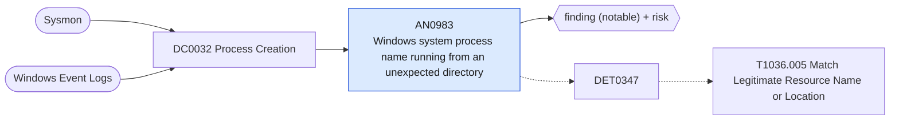

# AN0983 Windows system process name running from an unexpected directory

[ATT&CK analytic](https://attack.mitre.org/detectionstrategies/DET0347#AN0983) · DET0347 Detection Strategy for Masquerading via Legitimate Resource Name or Location · [T1036.005 Match Legitimate Resource Name or Location](https://attack.mitre.org/techniques/T1036/005) · tactics: stealth · platforms: Windows

**Content type:** ttp → finding (notable) + risk · **Severity:** medium · **Status:** implemented · **Technique prevalence score:** 307

A process named like a core Windows binary (svchost, lsass, services, csrss, smss, wininit, winlogon, explorer, spoolsv, taskhostw, dllhost, conhost, rundll32, RuntimeBroker, sihost, ctfmon, dwm, fontdrvhost) whose image path is outside System32, SysWOW64, WinSxS and the other expected locations.



## What ATT&CK asks for

> Detects processes or binaries executed from trusted directories (e.g., System32) or using trusted names (e.g., svchost.exe) where the metadata, hash, or parent process does not align with legitimate activity patterns.

## What this implementation detects

A process named like a core Windows binary (svchost, lsass, services, csrss, smss, wininit, winlogon, explorer, spoolsv, taskhostw, dllhost, conhost, rundll32, RuntimeBroker, sihost, ctfmon, dwm, fontdrvhost) whose image path is outside System32, SysWOW64, WinSxS and the other expected locations.

**Not covered:** Hash, signer and file-age (process_baseline_age) comparisons and the file-creation leg are not evaluated. Requires process_path to be populated in the Endpoint data model.

## Tuning

ATT&CK mutable elements and where each is bound. Edit macros in `local/macros.conf` and lookups in place; do not edit the search.

| Mutable element | ATT&CK guidance | Bound to | Default |
|---|---|---|---|
| trusted_directory_list | Paths such as C:\Windows\System32 that adversaries may abuse | macro `mitre_an0983_trusted_paths` | `Processes.process_path IN ("c:\\windows\\system32\\*", "c:\\windows\\syswow64\\*", "c:\\windows\\explorer.exe", "c:\\windows\\winsxs\\*", "c:\\windows\\servicing\\*", "c:\\windows\\systemapps\\*", "c:\\windows\\immersivecontrolpanel\\*", "\\device\\harddiskvolume*\\windows\\system32\\*")` |
| process_baseline_age | Time window to determine process novelty (e.g., 30 days) | filter macro `mitre_an0983_filter` (not bound separately) | `search *` |

## Splunk

Stanza `[MITRE - AN0983 - Windows system process name running from an unexpected directory - Rule]` in `DA-ESS-mitre-attack-detections`. Schedule `7-59/15 * * * *`, window `-20m@m` to `-5m@m`. Ships disabled.

```spl
| tstats `mitre_summariesonly` count min(_time) as firstTime max(_time) as lastTime
    from `mitre_dc0032_dm` where `mitre_dc0032_dm_where`
    Processes.process_name IN ("svchost.exe", "lsass.exe", "services.exe", "csrss.exe", "smss.exe", "wininit.exe", "winlogon.exe", "explorer.exe", "spoolsv.exe", "taskhostw.exe", "dllhost.exe", "conhost.exe", "rundll32.exe", "runtimebroker.exe", "sihost.exe", "ctfmon.exe", "dwm.exe", "fontdrvhost.exe")
    Processes.process_path="*\\*" NOT `mitre_an0983_trusted_paths`
    by Processes.dest Processes.user Processes.parent_process_name Processes.process_name Processes.process_path
| `drop_dm_object_name(Processes)`
| `mitre_ctime(firstTime)` | `mitre_ctime(lastTime)`
| `mitre_an0983_filter`
```

Risk: `dest` (system, 55), `user` (user, 35). Threat objects: `process_path`. Message: $process_name$ ran from $process_path$ on $dest$

Throttle: dest, process_path for 86400s.

Data components: [DC0032](../data-components/DC0032-process-creation.md).

## Sigma

Rule file: `dist/sigma/rules/an0983_windows_system_process_name_running_from_an_unexpected_direc.yml`.

## Known false positives

- Windows upgrade staging directories ($WINDOWS.~BT), container or WSL images, and software that ships its own conhost or rundll32.
