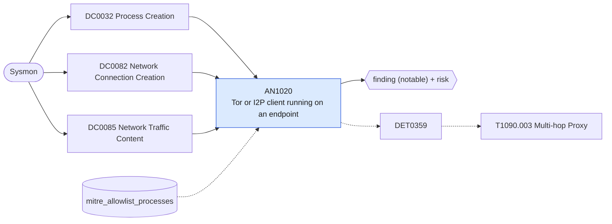

# AN1020 Tor or I2P client running on an endpoint

[ATT&CK analytic](https://attack.mitre.org/detectionstrategies/DET0359#AN1020) · DET0359 Multi-hop Proxy Behavior via Relay Node Chaining, Onion Routing, and Network Tunneling · [T1090.003 Multi-hop Proxy](https://attack.mitre.org/techniques/T1090/003) · tactics: command-and-control · platforms: Windows

**Content type:** ttp → finding (notable) + risk · **Severity:** medium · **Status:** implemented · **Technique prevalence score:** 65

A Tor or I2P client process starts, a process connects to a local Tor SOCKS port (9050, 9150) or out to Tor relay ports (9001, 9030), or a host resolves an .onion or .i2p name. Anonymity networks on a managed endpoint are either policy violations or C2 hiding behind multi-hop relays.



## What ATT&CK asks for

> Suspicious processes (e.g., Tor clients, relays, unknown binaries) launch with sustained encrypted outbound traffic to known anonymity infrastructure (e.g., Tor, I2P), and may relay to additional internal systems via reverse proxying, ICMP tunneling, or socket forwarding.

## What this implementation detects

A Tor or I2P client process starts, a process connects to a local Tor SOCKS port (9050, 9150) or out to Tor relay ports (9001, 9030), or a host resolves an .onion or .i2p name. Anonymity networks on a managed endpoint are either policy violations or C2 hiding behind multi-hop relays.

**Not covered:** Pluggable transports (obfs4, meek, snowflake) use 443 and are only caught by the process leg; renamed Tor binaries need the OriginalFileName or hash. The network sensor view is AN1024.

## Tuning

ATT&CK mutable elements and where each is bound. Edit macros in `local/macros.conf` and lookups in place; do not edit the search.

| Mutable element | ATT&CK guidance | Bound to | Default |
|---|---|---|---|
| DomainCategory | Can be tuned to `.onion`, I2P, or suspicious CDN domains. | lookup `mitre_allowlist_processes` — Security research or threat-intelligence workstations allowed to use Tor. |  |
| ProcessParent | Detect known-good vs. abnormal launching binaries (e.g., mshta spawning Tor). | macro `mitre_an1020_clients` | `(Image IN ("*\\tor.exe", "*\\Tor Browser\\*", "*\\i2p.exe", "*\\i2psvc.exe", "*\\obfs4proxy.exe", "*\\snowflake-client.exe", "*\\lyrebird.exe") OR OriginalFileName IN ("tor.exe", "i2p.exe"))` |
| ConnectionDuration | Threshold for persistent connections over known relay ports (e.g., 9050). | macro `mitre_an1020_ports` | `((DestinationPort IN (9050, 9150, 4444, 7656) DestinationIp IN ("127.0.0.1", "::1")) OR DestinationPort IN (9001, 9030))` |

## Splunk

Stanza `[MITRE - AN1020 - Tor or I2P client running on an endpoint - Rule]` in `DA-ESS-mitre-attack-detections`. Schedule `14-59/15 * * * *`, window `-20m@m` to `-5m@m`. Ships disabled.

```spl
(`mitre_dc0032_sysmon` EventCode=1 `mitre_an1020_clients`)
OR (`mitre_dc0082_sysmon` EventCode=3 Initiated="true" `mitre_an1020_ports`)
OR (`mitre_dc0085_sysmon` EventCode=22 QueryName IN ("*.onion", "*.i2p"))
| `mitre_normalize_host`
| eval process_name=lower(replace(Image, "^.*\\\\", "")), signal=case(EventCode==1, "client started: ".CommandLine, EventCode==3, "connection to ".DestinationIp.":".DestinationPort, EventCode==22, "lookup ".QueryName)
| search `mitre_not_allowlisted_process`
| stats count min(_time) as firstTime max(_time) as lastTime values(signal) as signal values(process_name) as process_name values(user) as user by dest
| eval signal=mvindex(signal, 0, 9)
| `mitre_ctime(firstTime)` | `mitre_ctime(lastTime)`
| `mitre_an1020_filter`
```

Risk: `dest` (system, 50), `user` (user, 40). Threat objects: `process_name`. Message: Anonymity network client activity on $dest$ ($process_name$)

Throttle: dest for 86400s.

Data components: [DC0032](../data-components/DC0032-process-creation.md), [DC0082](../data-components/DC0082-network-connection-creation.md), [DC0085](../data-components/DC0085-network-traffic-content.md).

## Sigma

Rule file: `dist/sigma/rules/an1020_tor_or_i2p_client_running_on_an_endpoint.yml`.

## Known false positives

- Sanctioned research use; other software that happens to use port 9001 outbound (check the process before allow-listing).
