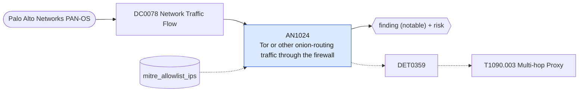

# AN1024 Tor or other onion-routing traffic through the firewall

[ATT&CK analytic](https://attack.mitre.org/detectionstrategies/DET0359#AN1024) · DET0359 Multi-hop Proxy Behavior via Relay Node Chaining, Onion Routing, and Network Tunneling · [T1090.003 Multi-hop Proxy](https://attack.mitre.org/techniques/T1090/003) · tactics: command-and-control · platforms: Network Devices

**Content type:** ttp → finding (notable) + risk · **Severity:** high · **Status:** implemented · **Technique prevalence score:** 65

Palo Alto traffic logs where App-ID identifies an onion-routing or multi-hop anonymity network (Tor, Tor2web, I2P, Freenet). Enterprise hosts have little reason to relay through these, and implants use them to hide C2.



## What ATT&CK asks for

> Encrypted traffic or ICMP tunneling from border routers to internal routers or unknown external IPs. Forwarded traffic shows consistent hop-to-hop relaying without matching configured VPN or expected network topology.

## What this implementation detects

Palo Alto traffic logs where App-ID identifies an onion-routing or multi-hop anonymity network (Tor, Tor2web, I2P, Freenet). Enterprise hosts have little reason to relay through these, and implants use them to hide C2.

**Not covered:** Tor over pluggable transports (obfs4, meek) may not be identified as tor by App-ID; router-to-router relaying and ICMP tunnelling between network devices are not covered.

## Tuning

ATT&CK mutable elements and where each is bound. Edit macros in `local/macros.conf` and lookups in place; do not edit the search.

| Mutable element | ATT&CK guidance | Bound to | Default |
|---|---|---|---|
| VPNConfigWhitelist | Define allowed internal router communication paths. | lookup `mitre_allowlist_ips` — Research or threat-intel hosts allowed to use Tor (cidr column). |  |
| ICMPPayloadEntropy | High entropy ICMP payloads may indicate tunneling activity. | filter macro `mitre_an1024_filter` (not bound separately) | `search *` |
| RelayChainSignature | Track known multi-hop pattern signatures or port hopping techniques. | macro `mitre_an1024_apps` — Palo Alto App-ID names. | `app IN ("tor", "tor2web", "i2p", "freenet", "zeronet", "tor-*")` |

## Splunk

Stanza `[MITRE - AN1024 - Tor or other onion-routing traffic through the firewall - Rule]` in `DA-ESS-mitre-attack-detections`. Schedule `14-59/15 * * * *`, window `-20m@m` to `-5m@m`. Ships disabled.

```spl
`mitre_dc0078_palo_alto` `mitre_st_palo_alto_traffic` `mitre_an1024_apps`
| `mitre_normalize_pan`
| lookup mitre_allowlist_ips cidr AS src OUTPUT reason AS allow_reason
| where isnull(allow_reason)
| stats count min(_time) as firstTime max(_time) as lastTime sum(bytes_out) as bytes_out sum(bytes_in) as bytes_in values(app) as app values(action) as action dc(dest) as distinct_destinations by src user
| `mitre_ctime(firstTime)` | `mitre_ctime(lastTime)`
| `mitre_an1024_filter`
```

Risk: `src` (system, 60), `user` (user, 40). Message: $src$ used an anonymity network ($app$) through the firewall

Throttle: src for 14400s.

Data components: [DC0078](../data-components/DC0078-network-traffic-flow.md).

## Sigma

Rule file: `dist/sigma/rules/an1024_tor_or_other_onion_routing_traffic_through_the_firewall.yml`.

## Known false positives

- Security research and threat-intelligence workstations; allow-list their addresses.
