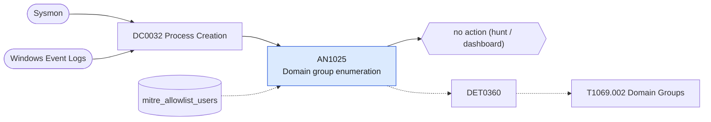

# AN1025 Domain group enumeration

[ATT&CK analytic](https://attack.mitre.org/detectionstrategies/DET0360#AN1025) · DET0360 Behavioral Detection of Domain Group Discovery · [T1069.002 Domain Groups](https://attack.mitre.org/techniques/T1069/002) · tactics: discovery · platforms: Windows

**Content type:** hunting → no action (hunt / dashboard) · **Severity:** informational · **Status:** implemented · **Technique prevalence score:** 54

Lists domain group queries: net group /domain, Get-ADGroup and Get-ADGroupMember, PowerView Get-DomainGroup and Get-NetGroup, dsquery group, and AdFind group filters, in ten-minute buckets per host, user and parent.



## What ATT&CK asks for

> Detection of domain group enumeration through command-line utilities such as 'net group /domain' or PowerShell cmdlets, followed by suspicious access to API calls or LSASS memory.

## What this implementation detects

Lists domain group queries: net group /domain, Get-ADGroup and Get-ADGroupMember, PowerView Get-DomainGroup and Get-NetGroup, dsquery group, and AdFind group filters, in ten-minute buckets per host, user and parent.

**Not covered:** LDAP queries from tooling with no command line (SharpHound, BloodHound collectors, in-memory PowerView) are invisible; LDAP query auditing on domain controllers (event 1644) or Corelight ldap.log would catch them. No finding or risk.

## Tuning

ATT&CK mutable elements and where each is bound. Edit macros in `local/macros.conf` and lookups in place; do not edit the search.

| Mutable element | ATT&CK guidance | Bound to | Default |
|---|---|---|---|
| TimeWindow | Adjustable window to track chained discovery activity (e.g., 5-10 minutes). | filter macro `mitre_an1025_filter` (not bound separately) | `search *` |
| UserContext | Tune to focus on non-admin users or service accounts performing enumeration. | lookup `mitre_allowlist_users` — Identity-management and audit accounts. |  |
| ProcessLineageDepth | How far back the parent-child process chain is correlated. | filter macro `mitre_an1025_filter` |  |

## Splunk

Stanza `[MITRE - AN1025 - Domain group enumeration - Rule]` in `DA-ESS-mitre-attack-detections`. Schedule `11-59/15 * * * *`, window `-20m@m` to `-5m@m`. Ships disabled.

```spl
| tstats `mitre_summariesonly` count from `mitre_dc0032_dm` where `mitre_dc0032_dm_where`
    ((Processes.process_name IN ("net.exe", "net1.exe") Processes.process="*group*" Processes.process="*/do*")
      OR (Processes.process_name IN ("powershell.exe", "pwsh.exe") Processes.process IN ("*Get-ADGroup*", "*Get-DomainGroup*", "*Get-NetGroup*", "*Get-ADPrincipalGroupMembership*"))
      OR (Processes.process_name="dsquery.exe" Processes.process="*group*")
      OR (Processes.process_name IN ("adfind.exe", "AdFind.exe") Processes.process="*group*"))
    by Processes.dest Processes.user Processes.parent_process_name Processes.process _time span=10m
| `drop_dm_object_name(Processes)`
| search `mitre_not_allowlisted_user`
| stats sum(count) as count dc(process) as distinct_commands values(process) as process by dest user parent_process_name _time
| sort - distinct_commands
| `mitre_an1025_filter`
```

Data components: [DC0032](../data-components/DC0032-process-creation.md).

## Sigma

Rule file: `dist/sigma/rules/an1025_domain_group_enumeration.yml`.

## Known false positives

- Helpdesk and identity administrators checking memberships.
