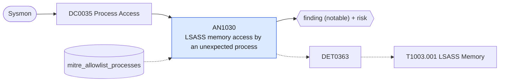

# AN1030 LSASS memory access by an unexpected process

[ATT&CK analytic](https://attack.mitre.org/detectionstrategies/DET0363#AN1030) · DET0363 Detection of Credential Dumping from LSASS Memory via Access and Dump Sequence · [T1003.001 LSASS Memory](https://attack.mitre.org/techniques/T1003/001) · tactics: credential-access · platforms: Windows

**Content type:** ttp → finding (notable) + risk · **Severity:** high · **Status:** implemented · **Technique prevalence score:** 132

A process outside the Windows system and security-product set opens lsass.exe with an access mask that permits reading process memory (Sysmon EventCode 10). This is the handle acquisition step of Mimikatz, comsvcs MiniDump, procdump and similar credential dumpers.



## What ATT&CK asks for

> A non-privileged or abnormal process attempts to open a handle with full access (0x1F0FFF) to lsass.exe and subsequently invokes memory dump, file creation, or registry modification indicative of credential scraping. This behavior chain reflects staged credential theft activity.

## What this implementation detects

A process outside the Windows system and security-product set opens lsass.exe with an access mask that permits reading process memory (Sysmon EventCode 10). This is the handle acquisition step of Mimikatz, comsvcs MiniDump, procdump and similar credential dumpers.

**Not covered:** The follow-on steps in ATT&CK's chain (dump file creation, 4673 privilege use, registry changes) are not correlated here; they are left to the detection strategy layer. Requires a Sysmon ProcessAccess rule scoped to lsass.exe.

## Tuning

ATT&CK mutable elements and where each is bound. Edit macros in `local/macros.conf` and lookups in place; do not edit the search.

| Mutable element | ATT&CK guidance | Bound to | Default |
|---|---|---|---|
| AccessMask | Set to 0x1F0FFF to detect full memory access attempts; can be scoped down to reduce noise. | macro `mitre_an1030_access_mask` — Masks that include PROCESS_VM_READ. Narrow to 0x1f0fff-style full access to cut noise. | `GrantedAccess IN ("0x1010", "0x1410", "0x1438", "0x143a", "0x1418", "0x1f0fff", "0x1f1fff", "0x1f2fff", "0x1f3fff", "0x1fffff")` |
| TimeWindow | Defines time between LSASS access and dump file creation or registry modification (e.g., 5 minutes). | filter macro `mitre_an1030_filter` (not bound separately) | `search *` |
| ParentProcessName | Allowlist known legitimate tools (e.g., AV/EDR) accessing lsass.exe. | lookup `mitre_allowlist_processes` — Add EDR, AV and backup agents that legitimately read LSASS (process_name column). |  |
| DumpFilePath | Paths where memory dumps are written, e.g., %TEMP%, C:\Windows\Temp. | filter macro `mitre_an1030_filter` (not bound separately) | `search *` |
| CommandLinePattern | Common dumping syntax like rundll32, procdump, comsvcs.dll, Invoke-Mimikatz. | filter macro `mitre_an1030_filter` (not bound separately) | `search *` |

## Splunk

Stanza `[MITRE - AN1030 - LSASS memory access by an unexpected process - Rule]` in `DA-ESS-mitre-attack-detections`. Schedule `14-59/15 * * * *`, window `-20m@m` to `-5m@m`. Ships disabled.

```spl
`mitre_dc0035_sysmon` EventCode=10 TargetImage="*\\lsass.exe" `mitre_an1030_access_mask`
    NOT SourceImage IN ("C:\\Windows\\System32\\wbem\\WmiPrvSE.exe", "C:\\Windows\\System32\\svchost.exe", "C:\\Windows\\System32\\csrss.exe", "C:\\Windows\\System32\\wininit.exe", "C:\\Windows\\System32\\lsm.exe", "C:\\Windows\\System32\\MRT.exe", "C:\\ProgramData\\Microsoft\\Windows Defender\\*", "C:\\Program Files\\Windows Defender\\*", "C:\\Program Files\\Windows Defender Advanced Threat Protection\\*")
| `mitre_normalize_host`
| eval process_name=replace(SourceImage, "^.*\\\\", ""), user=coalesce(SourceUser, user)
| search `mitre_not_allowlisted_process`
| stats count min(_time) as firstTime max(_time) as lastTime values(GrantedAccess) as granted_access values(CallTrace) as call_trace by dest user SourceImage process_name
| `mitre_ctime(firstTime)` | `mitre_ctime(lastTime)`
| `mitre_an1030_filter`
```

Risk: `dest` (system, 70), `user` (user, 70). Threat objects: `process_name`. Message: LSASS memory opened by $process_name$ on $dest$

Throttle: dest, process_name for 3600s.

Data components: [DC0035](../data-components/DC0035-process-access.md).

## Sigma

Rule file: `dist/sigma/rules/an1030_lsass_memory_access_by_an_unexpected_process.yml`.

## Known false positives

- EDR, antivirus, vulnerability scanners and some backup or monitoring agents read LSASS; add them to mitre_allowlist_processes.
