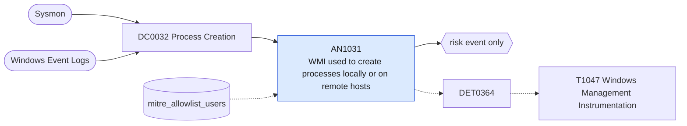

# AN1031 WMI used to create processes locally or on remote hosts

[ATT&CK analytic](https://attack.mitre.org/detectionstrategies/DET0364#AN1031) · DET0364 Behavioral Detection Strategy for WMI Execution Abuse on Windows · [T1047 Windows Management Instrumentation](https://attack.mitre.org/techniques/T1047) · tactics: execution · platforms: Windows

**Content type:** anomaly → risk event only · **Severity:** medium · **Status:** implemented · **Technique prevalence score:** 204

WMI process creation from the command line (wmic process call create, Invoke-WmiMethod or Invoke-CimMethod on Win32_Process), WMI-launched shells and LOLBins (WmiPrvSE as parent, the target side of remote WMI execution), and one host directing wmic /node at several remote systems.



## What ATT&CK asks for

> Detects adversarial abuse of WMI to execute local or remote commands via WMIC, PowerShell, or COM API through a multi-event chain: process creation, command execution, and corresponding network connection if remote.

## What this implementation detects

WMI process creation from the command line (wmic process call create, Invoke-WmiMethod or Invoke-CimMethod on Win32_Process), WMI-launched shells and LOLBins (WmiPrvSE as parent, the target side of remote WMI execution), and one host directing wmic /node at several remote systems.

**Not covered:** WMI-Activity operational events (5857-5861) and the network leg (DCOM/WinRM connections) are not correlated; COM-API use without a command line is invisible here.

## Tuning

ATT&CK mutable elements and where each is bound. Edit macros in `local/macros.conf` and lookups in place; do not edit the search.

| Mutable element | ATT&CK guidance | Bound to | Default |
|---|---|---|---|
| WMIQueryScope | Restrict detection scope to suspicious WMI namespaces like `\root\cimv2`, `\root\subscription`. | filter macro `mitre_an1031_filter` |  |
| TimeWindow | Set maximum allowable time window to correlate WMI process creation and remote connections. | filter macro `mitre_an1031_filter` (not bound separately) | `search *` |
| UserContext | Tune based on interactive vs. system-level execution (e.g., via SYSTEM or low-privileged users). | lookup `mitre_allowlist_users` — Management accounts (SCCM, monitoring) that use WMI execution. |  |
| RemoteDestinationThreshold | Number of unique remote hosts contacted using WMI within a time window. | macro `mitre_an1031_remote_threshold` — Distinct /node targets from one host and user in the search window. | `3` |
| SuspiciousCommandPatterns | Regex patterns to identify adversary-like usage (e.g., `wmic process call`, `powershell Invoke-WmiMethod`). | macro `mitre_an1031_patterns` | `((Processes.process_name="wmic.exe" Processes.process IN ("*process*call*create*", "*/node:*")) OR (Processes.process_name IN ("powershell.exe", "pwsh.exe") Processes.process IN ("*invoke-wmimethod*", "*invoke-cimmethod*", "*win32_process*create*", "*[wmiclass]*")) OR (Processes.parent_process_name="wmiprvse.exe" Processes.process_name IN ("cmd.exe", "powershell.exe", "pwsh.exe", "rundll32.exe", "regsvr32.exe", "mshta.exe", "wscript.exe", "cscript.exe", "certutil.exe")))` |

## Splunk

Stanza `[MITRE - AN1031 - WMI used to create processes locally or on remote hosts - Rule]` in `DA-ESS-mitre-attack-detections`. Schedule `9-59/15 * * * *`, window `-20m@m` to `-5m@m`. Ships disabled.

```spl
| tstats `mitre_summariesonly` count min(_time) as firstTime max(_time) as lastTime
    from `mitre_dc0032_dm` where `mitre_dc0032_dm_where` `mitre_an1031_patterns`
    by Processes.dest Processes.user Processes.parent_process_name Processes.process_name Processes.process
| `drop_dm_object_name(Processes)`
| rex field=process "(?i)/node:\"?(?<wmi_target>[^\s\",]+)"
| eval exec=if(match(process, "(?i)call\s+create|invoke-wmimethod|invoke-cimmethod|win32_process|\[wmiclass\]") OR parent_process_name=="wmiprvse.exe", 1, 0)
| search `mitre_not_allowlisted_user`
| stats sum(count) as count min(firstTime) as firstTime max(lastTime) as lastTime max(exec) as exec dc(wmi_target) as remote_targets values(wmi_target) as wmi_target values(parent_process_name) as parent_process_name values(process) as process by dest user
| where exec=1 OR remote_targets >= `mitre_an1031_remote_threshold`
| `mitre_ctime(firstTime)` | `mitre_ctime(lastTime)`
| `mitre_an1031_filter`
```

Risk: `dest` (system, 35), `user` (user, 35). Message: WMI process execution on $dest$ by $user$

Throttle: dest, user for 3600s.

Data components: [DC0032](../data-components/DC0032-process-creation.md).

## Sigma

Rule file: `dist/sigma/rules/an1031_wmi_used_to_create_processes_locally_or_on_remote_hosts.yml`.

## Known false positives

- Configuration Manager, monitoring products and administrators using WMI remoting.
