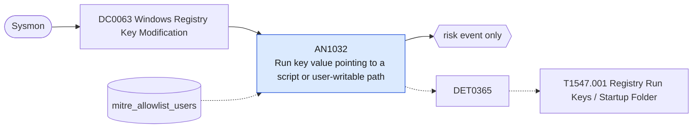

# AN1032 Run key value pointing to a script or user-writable path

[ATT&CK analytic](https://attack.mitre.org/detectionstrategies/DET0365#AN1032) · DET0365 Detect Registry and Startup Folder Persistence (Windows) · [T1547.001 Registry Run Keys / Startup Folder](https://attack.mitre.org/techniques/T1547/001) · tactics: persistence, privilege-escalation · platforms: Windows

**Content type:** anomaly → risk event only · **Severity:** medium · **Status:** implemented · **Technique prevalence score:** 329

A value is written under a Run, RunOnce, RunOnceEx, Policies\Explorer\Run or Startup shell-folder registry key and its data references a script interpreter or a binary in AppData, Users\Public, Temp or ProgramData.



## What ATT&CK asks for

> Correlation of Registry key creation/modification events under known Run/Startup keys with new or unusual binary paths or script-based payloads. Multi-event detection includes registry modification followed by process execution from non-standard directories or abnormal parent-child process relationships.

## What this implementation detects

A value is written under a Run, RunOnce, RunOnceEx, Policies\Explorer\Run or Startup shell-folder registry key and its data references a script interpreter or a binary in AppData, Users\Public, Temp or ProgramData.

**Not covered:** Startup-folder file drops and the follow-on process execution within the TimeWindow are not correlated. Much legitimate per-user software autostarts from AppData, so this is scored as an anomaly.

## Tuning

ATT&CK mutable elements and where each is bound. Edit macros in `local/macros.conf` and lookups in place; do not edit the search.

| Mutable element | ATT&CK guidance | Bound to | Default |
|---|---|---|---|
| ImagePath | Full path of the binary/script being registered in Run keys. Tunable to exclude known software baselines. | macro `mitre_an1032_suspicious_data` | `Registry.registry_value_data IN ("*\\appdata\\*", "*\\users\\public\\*", "*\\temp\\*", "*\\programdata\\*", "*powershell*", "*pwsh*", "*cmd.exe*", "*cmd /c*", "*wscript*", "*cscript*", "*mshta*", "*rundll32*", "*regsvr32*", "*http://*", "*https://*")` |
| RegistryKeyPath | Tunable list of startup-related registry keys to monitor more/less aggressively based on enterprise software context. | macro `mitre_an1032_run_keys` | `Registry.registry_path IN ("*\\currentversion\\run\\*", "*\\currentversion\\runonce\\*", "*\\currentversion\\runonceex\\*", "*\\currentversion\\policies\\explorer\\run\\*", "*\\explorer\\shell folders\\startup", "*\\explorer\\user shell folders\\startup")` |
| TimeWindow | Correlate registry key creation and process execution within this window. Defaults between 5–10 minutes. | filter macro `mitre_an1032_filter` (not bound separately) | `search *` |
| UserContext | Filter for specific user SIDs or exclude known admin/script accounts. | lookup `mitre_allowlist_users` |  |

## Splunk

Stanza `[MITRE - AN1032 - Run key value pointing to a script or user-writable path - Rule]` in `DA-ESS-mitre-attack-detections`. Schedule `7-59/15 * * * *`, window `-20m@m` to `-5m@m`. Ships disabled.

```spl
| tstats `mitre_summariesonly` count min(_time) as firstTime max(_time) as lastTime
    from `mitre_dc0063_dm` where `mitre_dc0063_dm_where` `mitre_an1032_run_keys` `mitre_an1032_suspicious_data`
    by Registry.dest Registry.user Registry.registry_path Registry.registry_value_name Registry.registry_value_data
| `drop_dm_object_name(Registry)`
| search `mitre_not_allowlisted_user`
| `mitre_ctime(firstTime)` | `mitre_ctime(lastTime)`
| `mitre_an1032_filter`
```

Risk: `dest` (system, 30), `user` (user, 30). Threat objects: `registry_path`, `registry_value_data`. Message: Autostart registry value set on $dest$ pointing to $registry_value_data$

Throttle: dest, registry_path for 86400s.

Data components: [DC0063](../data-components/DC0063-windows-registry-key-modification.md).

## Sigma

Rule file: `dist/sigma/rules/an1032_run_key_value_pointing_to_a_script_or_user_writable_path.yml`.

## Known false positives

- Collaboration clients, updaters and other per-user software that autostart from AppData.
