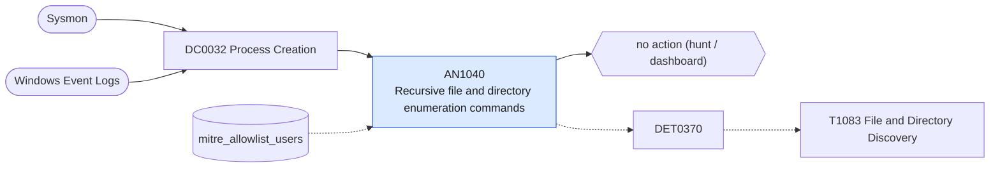

# AN1040 Recursive file and directory enumeration commands

[ATT&CK analytic](https://attack.mitre.org/detectionstrategies/DET0370#AN1040) · DET0370 Recursive Enumeration of Files and Directories Across Privilege Contexts · [T1083 File and Directory Discovery](https://attack.mitre.org/techniques/T1083) · tactics: discovery · platforms: Windows

**Content type:** hunting → no action (hunt / dashboard) · **Severity:** informational · **Status:** implemented · **Technique prevalence score:** 447

Lists hosts and users running recursive listings (dir /s, tree /f, where /r, forfiles /s, Get-ChildItem -Recurse) in ten-minute buckets with the distinct commands seen.



## What ATT&CK asks for

> Execution of file enumeration commands (e.g., 'dir', 'tree') from non-standard processes or unusual user contexts, followed by recursive directory traversal or access to sensitive locations.

## What this implementation detects

Lists hosts and users running recursive listings (dir /s, tree /f, where /r, forfiles /s, Get-ChildItem -Recurse) in ten-minute buckets with the distinct commands seen.

**Not covered:** Access to sensitive locations after the listing and the File Creation leg ATT&CK mentions are not evaluated. No finding or risk is produced.

## Tuning

ATT&CK mutable elements and where each is bound. Edit macros in `local/macros.conf` and lookups in place; do not edit the search.

| Mutable element | ATT&CK guidance | Bound to | Default |
|---|---|---|---|
| CommandLineRegex | Allows tuning based on tools/scripts used for enumeration (e.g., tree, dir /s /b) | filter macro `mitre_an1040_filter` |  |
| UserContext | Scoping for standard vs elevated or service accounts | lookup `mitre_allowlist_users` |  |
| TimeWindow | Defines burst activity over short periods (e.g., >50 directory queries in 30s) | filter macro `mitre_an1040_filter` — Bucket fixed at 10 minutes; add e.g. where distinct_commands >= 3 in the filter macro. |  |

## Splunk

Stanza `[MITRE - AN1040 - Recursive file and directory enumeration commands - Rule]` in `DA-ESS-mitre-attack-detections`. Schedule `0-59/15 * * * *`, window `-20m@m` to `-5m@m`. Ships disabled.

```spl
| tstats `mitre_summariesonly` count from `mitre_dc0032_dm` where `mitre_dc0032_dm_where`
    ((Processes.process_name="cmd.exe" Processes.process IN ("*dir */s*", "*dir/s*", "*tree */f*", "*tree/f*"))
      OR (Processes.process_name="tree.com")
      OR (Processes.process_name="where.exe" Processes.process="* /r *")
      OR (Processes.process_name="forfiles.exe" Processes.process="* /s*")
      OR (Processes.process_name IN ("powershell.exe", "pwsh.exe") Processes.process IN ("*get-childitem*-recurse*", "*gci *-recurse*", "*ls *-recurse*", "*dir *-recurse*")))
    by Processes.dest Processes.user Processes.parent_process_name Processes.process _time span=10m
| `drop_dm_object_name(Processes)`
| search `mitre_not_allowlisted_user`
| stats sum(count) as count dc(process) as distinct_commands values(process) as process values(parent_process_name) as parent_process_name by dest user _time
| sort - distinct_commands
| `mitre_an1040_filter`
```

Data components: [DC0032](../data-components/DC0032-process-creation.md).

## Sigma

Rule file: `dist/sigma/rules/an1040_recursive_file_and_directory_enumeration_commands.yml`.

## Known false positives

- Administrators, build scripts and backup jobs.
