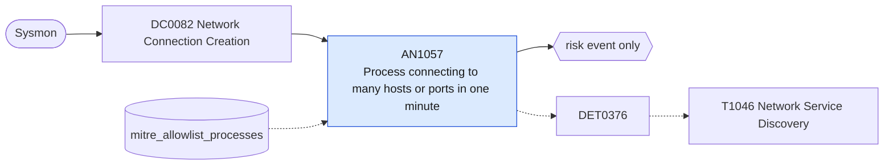

# AN1057 Process connecting to many hosts or ports in one minute

[ATT&CK analytic](https://attack.mitre.org/detectionstrategies/DET0376#AN1057) · DET0376 Behavioral Detection Strategy for Network Service Discovery Across Platforms · [T1046 Network Service Discovery](https://attack.mitre.org/techniques/T1046) · tactics: discovery · platforms: Windows

**Content type:** anomaly → risk event only · **Severity:** medium · **Status:** implemented · **Technique prevalence score:** 118

Sysmon network connections (EventCode 3) where a single process on a host initiates connections to an unusually large number of distinct destination addresses or distinct destination ports within one minute, the footprint of a port scan or service sweep.



## What ATT&CK asks for

> Detects processes performing network enumeration (e.g., port scans, service probing) by correlating process creation, socket connections, and sequential destination IP probing within a time window.

## What this implementation detects

Sysmon network connections (EventCode 3) where a single process on a host initiates connections to an unusually large number of distinct destination addresses or distinct destination ports within one minute, the footprint of a port scan or service sweep.

**Not covered:** Sysmon records established connections, so SYN scans against closed ports are under-counted; the network view (Corelight conn.log with rejected and unanswered states) is the stronger source and can be added through the same data component.

## Tuning

ATT&CK mutable elements and where each is bound. Edit macros in `local/macros.conf` and lookups in place; do not edit the search.

| Mutable element | ATT&CK guidance | Bound to | Default |
|---|---|---|---|
| ScanRateThreshold | Defines the number of unique destination IPs or ports accessed within a time window that may indicate a scan. | macro `mitre_an1057_threshold` — Distinct destination hosts, or distinct destination ports, per process per minute. | `30` |
| KnownScannerExeList | List of binaries allowed to scan or used by IT (e.g., Nmap, Nessus). | lookup `mitre_allowlist_processes` — Vulnerability scanners, discovery agents and monitoring tools (process_name column). |  |
| TimeWindow | Temporal bounds for correlating sequential connections (e.g., 60 seconds). | filter macro `mitre_an1057_filter` — Bucket size is fixed at one minute. |  |

## Splunk

Stanza `[MITRE - AN1057 - Process connecting to many hosts or ports in one minute - Rule]` in `DA-ESS-mitre-attack-detections`. Schedule `6-59/15 * * * *`, window `-20m@m` to `-5m@m`. Ships disabled.

```spl
`mitre_dc0082_sysmon` EventCode=3 Initiated=true
| `mitre_normalize_host`
| eval process_name=replace(Image, "^.*\\\\", "")
| search `mitre_not_allowlisted_process`
| bin _time span=1m
| stats count min(_time) as firstTime max(_time) as lastTime dc(DestinationIp) as distinct_hosts dc(DestinationPort) as distinct_ports by dest user process_name _time
| where distinct_hosts >= `mitre_an1057_threshold` OR distinct_ports >= `mitre_an1057_threshold`
| `mitre_ctime(firstTime)` | `mitre_ctime(lastTime)`
| `mitre_an1057_filter`
```

Risk: `dest` (system, 40), `user` (user, 30). Threat objects: `process_name`. Message: $process_name$ on $dest$ contacted $distinct_hosts$ hosts and $distinct_ports$ ports in one minute

Throttle: dest, process_name for 3600s.

Data components: [DC0082](../data-components/DC0082-network-connection-creation.md).

## Sigma

Rule file: `dist/sigma/rules/an1057_process_connecting_to_many_hosts_or_ports_in_one_minute.yml` (base rule plus a correlation rule).

## Known false positives

- Browsers on busy pages, peer-to-peer and update clients, discovery and monitoring tools.
