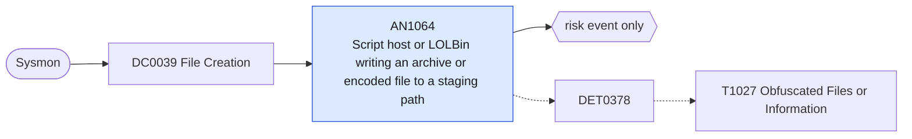

# AN1064 Script host or LOLBin writing an archive or encoded file to a staging path

[ATT&CK analytic](https://attack.mitre.org/detectionstrategies/DET0378#AN1064) · DET0378 Behavioral Detection of Obfuscated Files or Information · [T1027 Obfuscated Files or Information](https://attack.mitre.org/techniques/T1027) · tactics: stealth · platforms: Windows

**Content type:** anomaly → risk event only · **Severity:** low · **Status:** implemented · **Technique prevalence score:** 188

PowerShell, cmd, script hosts, mshta, certutil or rundll32 create an archive or encoded container (zip, 7z, rar, cab, gz, iso, enc, b64, dat) in a user-writable staging path (Sysmon 11).



## What ATT&CK asks for

> Correlates script execution or suspicious parent processes with creation or modification of encoded, compressed, or encrypted file formats (e.g., .zip, .7z, .enc) and abnormal command-line syntax or PowerShell obfuscation.

## What this implementation detects

PowerShell, cmd, script hosts, mshta, certutil or rundll32 create an archive or encoded container (zip, 7z, rar, cab, gz, iso, enc, b64, dat) in a user-writable staging path (Sysmon 11).

**Not covered:** Payload entropy is not measurable from file events. Command-line obfuscation is AN1394; encoded payloads being decoded and run is AN0237.

## Tuning

ATT&CK mutable elements and where each is bound. Edit macros in `local/macros.conf` and lookups in place; do not edit the search.

| Mutable element | ATT&CK guidance | Bound to | Default |
|---|---|---|---|
| PayloadEntropyThreshold | Tune entropy threshold to distinguish obfuscation from legitimate compression | macro `mitre_an1064_containers` — Entropy is not available; container type and location stand in for it. | `TargetFilename IN ("*.zip", "*.7z", "*.rar", "*.cab", "*.gz", "*.iso", "*.enc", "*.b64", "*.dat", "*.bin") TargetFilename IN ("*\\AppData\\Local\\Temp\\*", "*\\Windows\\Temp\\*", "*\\Users\\Public\\*", "*\\ProgramData\\*", "*\\PerfLogs\\*", "*\\Windows\\Tasks\\*")` |
| TimeWindow | Adjust correlation window between script execution and encoded file creation | filter macro `mitre_an1064_filter` |  |
| SuspiciousParentProcessList | Customize based on environment to include LOLBins or admin tools misused for obfuscation | macro `mitre_an1064_writers` | `Image IN ("*\\powershell.exe", "*\\pwsh.exe", "*\\cmd.exe", "*\\wscript.exe", "*\\cscript.exe", "*\\mshta.exe", "*\\certutil.exe", "*\\rundll32.exe", "*\\regsvr32.exe", "*\\makecab.exe", "*\\diantz.exe")` |

## Splunk

Stanza `[MITRE - AN1064 - Script host or LOLBin writing an archive or encoded file to a staging path - Rule]` in `DA-ESS-mitre-attack-detections`. Schedule `0-59/15 * * * *`, window `-20m@m` to `-5m@m`. Ships disabled.

```spl
`mitre_dc0039_sysmon` EventCode=11 `mitre_an1064_writers` `mitre_an1064_containers`
| `mitre_normalize_host`
| eval process_name=replace(Image, "^.*\\\\", "")
| stats count min(_time) as firstTime max(_time) as lastTime values(TargetFilename) as file_path by dest user process_name
| eval file_path=mvindex(file_path, 0, 9)
| `mitre_ctime(firstTime)` | `mitre_ctime(lastTime)`
| `mitre_an1064_filter`
```

Risk: `dest` (system, 25), `user` (user, 20). Threat objects: `process_name`. Message: $process_name$ wrote archive or encoded files to a staging path on $dest$

Throttle: dest, process_name for 3600s.

Data components: [DC0039](../data-components/DC0039-file-creation.md).

## Sigma

Rule file: `dist/sigma/rules/an1064_script_host_or_lolbin_writing_an_archive_or_encoded_file_to_.yml`.

## Known false positives

- Installers and update scripts unpacking archives into Temp; log-collection scripts.
