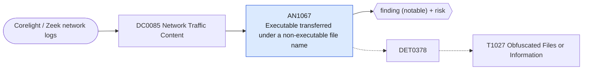

# AN1067 Executable transferred under a non-executable file name

[ATT&CK analytic](https://attack.mitre.org/detectionstrategies/DET0378#AN1067) · DET0378 Behavioral Detection of Obfuscated Files or Information · [T1027 Obfuscated Files or Information](https://attack.mitre.org/techniques/T1027) · tactics: stealth · platforms: Network Devices

**Content type:** ttp → finding (notable) + risk · **Severity:** medium · **Status:** implemented · **Technique prevalence score:** 188

Corelight files.log records a file whose content type is a Windows or Linux executable while its name ends in a document, image, archive or text extension. Disguising payloads this way is how they slip past extension-based filtering in transit.



## What ATT&CK asks for

> Identifies transfer of base64, uuencoded, or high-entropy files over HTTP, FTP, or custom protocols in lateral movement or exfiltration streams.

## What this implementation detects

Corelight files.log records a file whose content type is a Windows or Linux executable while its name ends in a document, image, archive or text extension. Disguising payloads this way is how they slip past extension-based filtering in transit.

**Not covered:** Base64 or encrypted payloads inside HTTP bodies are not identified (no entropy in files.log); files with no name in the protocol are skipped.

## Tuning

ATT&CK mutable elements and where each is bound. Edit macros in `local/macros.conf` and lookups in place; do not edit the search.

| Mutable element | ATT&CK guidance | Bound to | Default |
|---|---|---|---|
| EntropyThreshold | Adjust threshold to reduce false positives in compressed but benign data | macro `mitre_an1067_disguise_ext` | `filename IN ("*.jpg", "*.jpeg", "*.png", "*.gif", "*.bmp", "*.ico", "*.txt", "*.log", "*.pdf", "*.doc", "*.docx", "*.xls", "*.xlsx", "*.csv", "*.dat", "*.tmp", "*.zip", "*.css", "*.js", "*.html", "*.xml", "*.json")` |
| ProtocolScope | Refine by enabling inspection of specific exfil vectors (e.g., FTP, HTTP POST) | filter macro `mitre_an1067_filter` |  |

## Splunk

Stanza `[MITRE - AN1067 - Executable transferred under a non-executable file name - Rule]` in `DA-ESS-mitre-attack-detections`. Schedule `11-59/15 * * * *`, window `-20m@m` to `-5m@m`. Ships disabled.

```spl
`mitre_dc0085_corelight` `mitre_st_corelight_files` mime_type IN ("application/x-dosexec", "application/x-executable", "application/x-mach-o-executable", "application/x-elf")
| search `mitre_an1067_disguise_ext`
| eval src=mvindex(split(tx_hosts, ","), 0), dest=mvindex(split(rx_hosts, ","), 0), file_hash=coalesce(sha256, sha1, md5)
| stats count min(_time) as firstTime max(_time) as lastTime values(filename) as file_name values(mime_type) as mime_type values(source) as protocol values(file_hash) as file_hash by src dest
| `mitre_ctime(firstTime)` | `mitre_ctime(lastTime)`
| `mitre_an1067_filter`
```

Risk: `dest` (system, 50). Threat objects: `file_hash`, `src`. Message: Executable disguised as $file_name$ sent from $src$ to $dest$

Throttle: dest, file_hash for 86400s.

Data components: [DC0085](../data-components/DC0085-network-traffic-content.md).

## Sigma

Rule file: `dist/sigma/rules/an1067_executable_transferred_under_a_non_executable_file_name.yml`.

## Known false positives

- Software updaters that download executables under generic names (.dat, .tmp).
