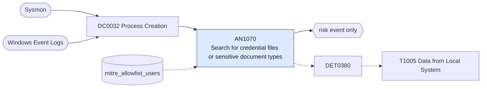

# AN1070 Search for credential files or sensitive document types

[ATT&CK analytic](https://attack.mitre.org/detectionstrategies/DET0380#AN1070) · DET0380 Detection of Local Data Collection Prior to Exfiltration · [T1005 Data from Local System](https://attack.mitre.org/techniques/T1005) · tactics: collection · platforms: Windows

**Content type:** anomaly → risk event only · **Severity:** medium · **Status:** implemented · **Technique prevalence score:** 298

Commands that look for secrets or high-value files on the local system: findstr or Select-String for password strings; dir, where or Get-ChildItem for key, certificate, password-database and RDP files (kdbx, pfx, p12, pem, ppk, id_rsa, rdp, ovpn, unattend.xml).



## What ATT&CK asks for

> Adversaries collecting local files via PowerShell, WMI, or direct file API calls often include recursive file listings, targeted file reads, and temporary file staging.

## What this implementation detects

Commands that look for secrets or high-value files on the local system: findstr or Select-String for password strings; dir, where or Get-ChildItem for key, certificate, password-database and RDP files (kdbx, pfx, p12, pem, ppk, id_rsa, rdp, ovpn, unattend.xml).

**Not covered:** The follow-on file reads and staging writes are not correlated (AN0724 covers staging volume). Searches for ordinary document types are too common to score and are left to hunting.

## Tuning

ATT&CK mutable elements and where each is bound. Edit macros in `local/macros.conf` and lookups in place; do not edit the search.

| Mutable element | ATT&CK guidance | Bound to | Default |
|---|---|---|---|
| TargetFilePathRegex | Allows tuning for file extensions or paths of sensitive data (e.g., *.xls, *.db, *.pdf). | macro `mitre_an1070_patterns` | `((Processes.process_name IN ("findstr.exe", "cmd.exe") Processes.process="*findstr*" Processes.process IN ("*password*", "*passwd*", "*pwd=*", "*credential*", "*connectionstring*")) OR (Processes.process_name IN ("powershell.exe", "pwsh.exe") Processes.process="*select-string*" Processes.process IN ("*password*", "*credential*")) OR Processes.process IN ("*.kdbx*", "*.pfx*", "*.p12*", "*.pem*", "*.ppk*", "*id_rsa*", "*.ovpn*", "*unattend.xml*", "*sysprep.inf*", "*.rdp *") Processes.process IN ("*dir *", "*where *", "*get-childitem*", "*gci *", "*findstr*", "*/s*", "*-recurse*"))` |
| ParentProcessFilter | Used to scope monitoring to suspicious parent/child process trees like PowerShell or WMI spawning file reads. | lookup `mitre_allowlist_users` — Allow-list accounts of backup and certificate-management tooling. |  |

## Splunk

Stanza `[MITRE - AN1070 - Search for credential files or sensitive document types - Rule]` in `DA-ESS-mitre-attack-detections`. Schedule `9-59/15 * * * *`, window `-20m@m` to `-5m@m`. Ships disabled.

```spl
| tstats `mitre_summariesonly` count min(_time) as firstTime max(_time) as lastTime
    from `mitre_dc0032_dm` where `mitre_dc0032_dm_where` `mitre_an1070_patterns`
    by Processes.dest Processes.user Processes.parent_process_name Processes.process_name Processes.process
| `drop_dm_object_name(Processes)`
| search `mitre_not_allowlisted_user`
| `mitre_ctime(firstTime)` | `mitre_ctime(lastTime)`
| `mitre_an1070_filter`
```

Risk: `dest` (system, 40), `user` (user, 40). Threat objects: `process`. Message: Search for credential files or password strings on $dest$ by $user$

Throttle: dest, user for 3600s.

Data components: [DC0032](../data-components/DC0032-process-creation.md).

## Sigma

Rule file: `dist/sigma/rules/an1070_search_for_credential_files_or_sensitive_document_types.yml`.

## Known false positives

- Certificate administration, developers grepping configuration for connection strings.
