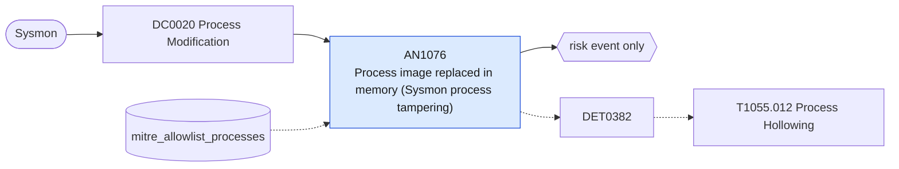

# AN1076 Process image replaced in memory (Sysmon process tampering)

[ATT&CK analytic](https://attack.mitre.org/detectionstrategies/DET0382#AN1076) · DET0382 Detection Strategy for Process Hollowing on Windows · [T1055.012 Process Hollowing](https://attack.mitre.org/techniques/T1055/012) · tactics: stealth, privilege-escalation · platforms: Windows

**Content type:** anomaly → risk event only · **Severity:** high · **Status:** implemented · **Technique prevalence score:** 52

Sysmon 25 (ProcessTampering) reports that a process's mapped image no longer matches the file on disk ("Image is replaced") or was locked in a way used by herpaderping and ghosting. That is the observable end state of process hollowing: the CREATE_SUSPENDED, unmap, write and resume sequence ATT&CK describes.



## What ATT&CK asks for

> Detects adversary use of suspended process creation, using the CREATE_SUSPENDED flag via CreateProcess, followed by unmapping the memory of the child process (NtUnmapViewOfSection) and replacing it with malicious code via VirtualAllocEx/WriteProcessMemory, then SetThreadContext and ResumeThread to begin execution within the hollowed process.

## What this implementation detects

Sysmon 25 (ProcessTampering) reports that a process's mapped image no longer matches the file on disk ("Image is replaced") or was locked in a way used by herpaderping and ghosting. That is the observable end state of process hollowing: the CREATE_SUSPENDED, unmap, write and resume sequence ATT&CK describes.

**Not covered:** Needs Sysmon 13 or later with ProcessTampering enabled. Some packers, JIT-heavy applications and security products trigger it legitimately; the API-level ETW sequence (NtUnmapViewOfSection, SetThreadContext) is not collected.

## Tuning

ATT&CK mutable elements and where each is bound. Edit macros in `local/macros.conf` and lookups in place; do not edit the search.

| Mutable element | ATT&CK guidance | Bound to | Default |
|---|---|---|---|
| HollowedImageNamePattern | Regex to match common decoy executables used for hollowing (e.g., 'svchost.exe', 'notepad.exe') | macro `mitre_an1076_benign_images` | `Image IN ("*\\Program Files\\Microsoft Visual Studio\\*", "*\\Program Files (x86)\\Microsoft Visual Studio\\*", "*\\AppData\\Local\\Programs\\Microsoft VS Code\\*", "*\\Program Files\\WindowsApps\\*", "*\\MsMpEng.exe", "*\\MpCmdRun.exe")` |
| TimeWindow_ProcessCreateToResume | Temporal threshold for unmap/write/execute sequence (e.g., within 5–10 seconds) | filter macro `mitre_an1076_filter` |  |
| SuspendedProcessStartFlag | CreateProcess flag used to identify suspended thread creation | lookup `mitre_allowlist_processes` — Applications confirmed to trigger ProcessTampering benignly. |  |
| MemoryWriteSizeThreshold | Minimum byte size to flag suspicious memory overwrite in hollowed process | filter macro `mitre_an1076_filter` (not bound separately) | `search *` |

## Splunk

Stanza `[MITRE - AN1076 - Process image replaced in memory (Sysmon process tampering) - Rule]` in `DA-ESS-mitre-attack-detections`. Schedule `10-59/15 * * * *`, window `-20m@m` to `-5m@m`. Ships disabled.

```spl
`mitre_dc0020_sysmon` EventCode=25 Type IN ("Image is replaced", "Image is locked for access") NOT `mitre_an1076_benign_images`
| `mitre_normalize_host`
| eval process_name=lower(replace(Image, "^.*\\\\", ""))
| search `mitre_not_allowlisted_process`
| stats count min(_time) as firstTime max(_time) as lastTime values(Type) as tamper_type values(Image) as process by dest user process_name
| `mitre_ctime(firstTime)` | `mitre_ctime(lastTime)`
| `mitre_an1076_filter`
```

Risk: `dest` (system, 60), `user` (user, 40). Threat objects: `process_name`. Message: Process image of $process_name$ tampered on $dest$ ($tamper_type$)

Throttle: dest, process_name for 86400s.

Data components: [DC0020](../data-components/DC0020-process-modification.md).

## Sigma

Rule file: `dist/sigma/rules/an1076_process_image_replaced_in_memory_sysmon_process_tampering.yml`.

## Known false positives

- Developer tools, game launchers, browsers with JIT sandboxes and some security products (allow-list after review).
