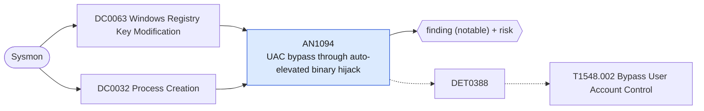

# AN1094 UAC bypass through auto-elevated binary hijack

[ATT&CK analytic](https://attack.mitre.org/detectionstrategies/DET0388#AN1094) · DET0388 Detection Strategy for T1548.002 – Bypass User Account Control (UAC) · [T1548.002 Bypass User Account Control](https://attack.mitre.org/techniques/T1548/002) · tactics: privilege-escalation · platforms: Windows

**Content type:** ttp → finding (notable) + risk · **Severity:** high · **Status:** implemented · **Technique prevalence score:** 76

Either a registry value used by known UAC bypasses is written (ms-settings / mscfile / exefile / Folder shell open command, DelegateExecute, IsolatedCommand, per-user windir or systemroot environment overrides), or an auto-elevating binary (eventvwr, sdclt, fodhelper, computerdefaults, slui, wsreset) spawns a shell or LOLBin. Results list which signals were seen per host.



## What ATT&CK asks for

> Detects a multi-event behavior chain involving UAC bypass attempts via known auto-elevated binaries (e.g., eventvwr.exe, sdclt.exe), unauthorized Registry changes to UAC-related keys, and anomalous process execution with elevated privileges but lacking standard parent-child lineage. Suspicious patterns include invocation of auto-elevated COM objects or manipulation of isolatedCommand Registry entries without consent prompts.

## What this implementation detects

Either a registry value used by known UAC bypasses is written (ms-settings / mscfile / exefile / Folder shell open command, DelegateExecute, IsolatedCommand, per-user windir or systemroot environment overrides), or an auto-elevating binary (eventvwr, sdclt, fodhelper, computerdefaults, slui, wsreset) spawns a shell or LOLBin. Results list which signals were seen per host.

**Not covered:** 4672 privilege assignment, process-access and module-load legs are not correlated. Auto-elevated COM object abuse without these registry keys is not covered.

## Tuning

ATT&CK mutable elements and where each is bound. Edit macros in `local/macros.conf` and lookups in place; do not edit the search.

| Mutable element | ATT&CK guidance | Bound to | Default |
|---|---|---|---|
| TimeWindow | Correlate registry tampering and elevation within a tunable time window (e.g., 30 seconds) to reduce noise from benign admin activity. | filter macro `mitre_an1094_filter` — No window is applied; each signal fires on its own within the search window. |  |
| ElevatedProcessNameList | Tunable list of suspicious elevated binaries (e.g., sdclt.exe, eventvwr.exe, computerdefaults.exe) known to support UAC bypass. | macro `mitre_an1094_autoelevate` | `ParentImage IN ("*\\eventvwr.exe", "*\\sdclt.exe", "*\\fodhelper.exe", "*\\computerdefaults.exe", "*\\slui.exe", "*\\wsreset.exe", "*\\cmstp.exe")` |
| ParentProcessAnomalyThreshold | Define logic for parent-child mismatch (e.g., non-elevated process spawning auto-elevated one) to flag uncommon elevation paths. | filter macro `mitre_an1094_filter` (not bound separately) | `search *` |

## Splunk

Stanza `[MITRE - AN1094 - UAC bypass through auto-elevated binary hijack - Rule]` in `DA-ESS-mitre-attack-detections`. Schedule `7-59/15 * * * *`, window `-20m@m` to `-5m@m`. Ships disabled.

```spl
(`mitre_dc0063_sysmon` EventCode=13 TargetObject IN ("*\\ms-settings\\shell\\open\\command*", "*\\mscfile\\shell\\open\\command*", "*\\exefile\\shell\\open\\command*", "*\\Folder\\shell\\open\\command*", "*\\shell\\open\\command\\DelegateExecute", "*\\shell\\runas\\command\\IsolatedCommand", "HKU\\*\\Environment\\windir", "HKU\\*\\Environment\\systemroot"))
  OR (`mitre_dc0032_sysmon` EventCode=1 `mitre_an1094_autoelevate` Image IN ("*\\cmd.exe", "*\\powershell.exe", "*\\pwsh.exe", "*\\wscript.exe", "*\\cscript.exe", "*\\mshta.exe", "*\\rundll32.exe", "*\\regsvr32.exe"))
| `mitre_normalize_host`
| eval signal=if(EventCode==13, "registry_hijack", "autoelevate_child"), process_name=replace(Image, "^.*\\\\", "")
| stats count min(_time) as firstTime max(_time) as lastTime values(signal) as signals values(TargetObject) as registry_path values(Details) as registry_value_data values(ParentImage) as parent_process values(CommandLine) as process by dest user process_name
| `mitre_ctime(firstTime)` | `mitre_ctime(lastTime)`
| `mitre_an1094_filter`
```

Risk: `dest` (system, 70), `user` (user, 60). Threat objects: `process_name`. Message: UAC bypass behaviour on $dest$ involving $process_name$

Throttle: dest, process_name for 3600s.

Data components: [DC0063](../data-components/DC0063-windows-registry-key-modification.md), [DC0032](../data-components/DC0032-process-creation.md).

## Sigma

Rule file: `dist/sigma/rules/an1094_uac_bypass_through_auto_elevated_binary_hijack.yml`.

## Known false positives

- Rare. Some software installers set per-user shell open commands for their own file classes; the listed classes are not among them.
