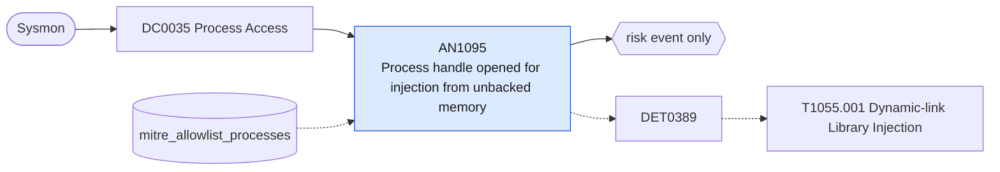

# AN1095 Process handle opened for injection from unbacked memory

[ATT&CK analytic](https://attack.mitre.org/detectionstrategies/DET0389#AN1095) · DET0389 Behavioral Detection of DLL Injection via Windows API · [T1055.001 Dynamic-link Library Injection](https://attack.mitre.org/techniques/T1055/001) · tactics: stealth, privilege-escalation · platforms: Windows

**Content type:** anomaly → risk event only · **Severity:** high · **Status:** implemented · **Technique prevalence score:** 78

Sysmon ProcessAccess (10) into a high-value process with an access mask that allows writing memory and creating threads, where the call stack contains UNKNOWN frames: the opening code runs from memory with no backing module, typical of shellcode and reflectively loaded DLLs preparing to inject.



## What ATT&CK asks for

> Detects DLL injection through correlation of memory allocation and writing to remote process memory (e.g., VirtualAllocEx, WriteProcessMemory), followed by remote thread creation (e.g., CreateRemoteThread) that loads a suspicious or unsigned DLL using LoadLibrary or reflective loading.

## What this implementation detects

Sysmon ProcessAccess (10) into a high-value process with an access mask that allows writing memory and creating threads, where the call stack contains UNKNOWN frames: the opening code runs from memory with no backing module, typical of shellcode and reflectively loaded DLLs preparing to inject.

**Not covered:** The follow-on remote thread (AN1399), named pipes and unusual module loads are not correlated. Needs Sysmon ProcessAccess logging with CallTrace for the listed targets.

## Tuning

ATT&CK mutable elements and where each is bound. Edit macros in `local/macros.conf` and lookups in place; do not edit the search.

| Mutable element | ATT&CK guidance | Bound to | Default |
|---|---|---|---|
| InjectedDLLSignatureStatus | Whether the DLL is unsigned, untrusted, or loaded from a non-standard path | macro `mitre_an1095_access_masks` — Masks including PROCESS_VM_WRITE and/or PROCESS_CREATE_THREAD; signature status of the injected DLL is not visible in this event. | `GrantedAccess IN ("0x1fffff", "0x1f0fff", "0x1f3fff", "0x143a", "0x147a", "0x1478", "0x0438", "0x043a", "0x0028", "0x002a", "0x0020")` |
| TimeWindow | Temporal correlation threshold between memory operations and thread creation | filter macro `mitre_an1095_filter` (not bound separately) | `search *` |
| TargetProcessList | List of sensitive or high-value processes targeted for injection (e.g., explorer.exe, winlogon.exe) | macro `mitre_an1095_targets` | `TargetImage IN ("*\\explorer.exe", "*\\winlogon.exe", "*\\lsass.exe", "*\\svchost.exe", "*\\spoolsv.exe", "*\\services.exe", "*\\dllhost.exe", "*\\rundll32.exe", "*\\notepad.exe", "*\\msedge.exe", "*\\chrome.exe", "*\\firefox.exe")` |
| ParentProcessAnomalyThreshold | Degree of deviation from expected parent-child lineage | lookup `mitre_allowlist_processes` — Security products and JIT runtimes whose stacks contain UNKNOWN frames (process_name column). |  |

## Splunk

Stanza `[MITRE - AN1095 - Process handle opened for injection from unbacked memory - Rule]` in `DA-ESS-mitre-attack-detections`. Schedule `13-59/15 * * * *`, window `-20m@m` to `-5m@m`. Ships disabled.

```spl
`mitre_dc0035_sysmon` EventCode=10 `mitre_an1095_targets` `mitre_an1095_access_masks` CallTrace="*UNKNOWN(*"
| `mitre_normalize_host`
| eval process_name=replace(SourceImage, "^.*\\\\", ""), target_process=replace(TargetImage, "^.*\\\\", ""), user=coalesce(SourceUser, user)
| search `mitre_not_allowlisted_process`
| stats count min(_time) as firstTime max(_time) as lastTime values(GrantedAccess) as granted_access values(target_process) as target_process by dest user SourceImage process_name
| `mitre_ctime(firstTime)` | `mitre_ctime(lastTime)`
| `mitre_an1095_filter`
```

Risk: `dest` (system, 55), `user` (user, 45). Threat objects: `process_name`. Message: $process_name$ on $dest$ opened a high-value process for injection from unbacked memory

Throttle: dest, process_name for 3600s.

Data components: [DC0035](../data-components/DC0035-process-access.md).

## Sigma

Rule file: `dist/sigma/rules/an1095_process_handle_opened_for_injection_from_unbacked_memory.yml`.

## Known false positives

- .NET and JavaScript JIT runtimes and some security products produce UNKNOWN frames; allow-list them by source process.
