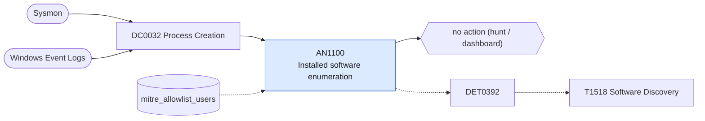

# AN1100 Installed software enumeration

[ATT&CK analytic](https://attack.mitre.org/detectionstrategies/DET0392#AN1100) · DET0392 Multi-Platform Software Discovery Behavior Chain · [T1518 Software Discovery](https://attack.mitre.org/techniques/T1518) · tactics: discovery · platforms: Windows

**Content type:** hunting → no action (hunt / dashboard) · **Severity:** informational · **Status:** implemented · **Technique prevalence score:** 69

Lists queries for installed software: wmic product, Win32_Product, Get-Package, Get-AppxPackage, and registry reads of the Uninstall keys through reg or PowerShell, in ten-minute buckets with the parent.



## What ATT&CK asks for

> Adversary spawns a process or script to enumerate installed software using WMI, registry, or PowerShell, potentially followed by additional discovery or evasion behavior.

## What this implementation detects

Lists queries for installed software: wmic product, Win32_Product, Get-Package, Get-AppxPackage, and registry reads of the Uninstall keys through reg or PowerShell, in ten-minute buckets with the parent.

**Not covered:** Registry reads through APIs are invisible. AN0589 overlaps on reg query of Uninstall. No finding or risk.

## Tuning

ATT&CK mutable elements and where each is bound. Edit macros in `local/macros.conf` and lookups in place; do not edit the search.

| Mutable element | ATT&CK guidance | Bound to | Default |
|---|---|---|---|
| TimeWindow | Detection may be scoped to multiple discovery commands within a short timeframe. | lookup `mitre_allowlist_users` — Software inventory accounts. |  |
| ParentProcess | Tuning based on whether discovery activity stems from suspicious versus approved management tools. | filter macro `mitre_an1100_filter` |  |

## Splunk

Stanza `[MITRE - AN1100 - Installed software enumeration - Rule]` in `DA-ESS-mitre-attack-detections`. Schedule `12-59/15 * * * *`, window `-20m@m` to `-5m@m`. Ships disabled.

```spl
| tstats `mitre_summariesonly` count from `mitre_dc0032_dm` where `mitre_dc0032_dm_where`
    ((Processes.process_name="wmic.exe" Processes.process="*product*")
      OR (Processes.process_name IN ("powershell.exe", "pwsh.exe") Processes.process IN ("*win32_product*", "*get-package*", "*get-appxpackage*", "*\\uninstall\\*"))
      OR (Processes.process_name="reg.exe" Processes.process="*query*" Processes.process="*\\uninstall*"))
    by Processes.dest Processes.user Processes.parent_process_name Processes.process _time span=10m
| `drop_dm_object_name(Processes)`
| search `mitre_not_allowlisted_user`
| stats sum(count) as count dc(process) as distinct_commands values(process) as process by dest user parent_process_name _time
| sort - count
| `mitre_an1100_filter`
```

Data components: [DC0032](../data-components/DC0032-process-creation.md).

## Sigma

Rule file: `dist/sigma/rules/an1100_installed_software_enumeration.yml`.

## Known false positives

- Software inventory and licence-management tools.
