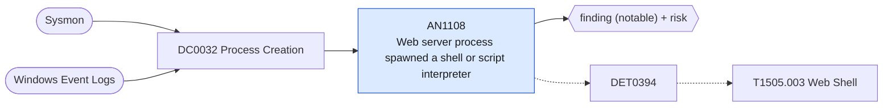

# AN1108 Web server process spawned a shell or script interpreter

[ATT&CK analytic](https://attack.mitre.org/detectionstrategies/DET0394#AN1108) · DET0394 Web Shell Detection via Server Behavior and File Execution Chains · [T1505.003 Web Shell](https://attack.mitre.org/techniques/T1505/003) · tactics: persistence · platforms: Windows

**Content type:** ttp → finding (notable) + risk · **Severity:** high · **Status:** implemented · **Technique prevalence score:** 112

A web server worker (IIS w3wp, Apache, nginx, PHP, Tomcat, Exchange UM worker) starts cmd, PowerShell, a script host or a discovery/LOLBin utility. Legitimate web applications rarely do this; web shells and exploited upload handlers always do.



## What ATT&CK asks for

> Unexpected file creation in web directories followed by web server processes (e.g., w3wp.exe) spawning command shells or script interpreters (e.g., cmd.exe, powershell.exe)

## What this implementation detects

A web server worker (IIS w3wp, Apache, nginx, PHP, Tomcat, Exchange UM worker) starts cmd, PowerShell, a script host or a discovery/LOLBin utility. Legitimate web applications rarely do this; web shells and exploited upload handlers always do.

**Not covered:** File creation in the web root, the associated logon, and the inbound HTTP POST seen by Corelight are not correlated here.

## Tuning

ATT&CK mutable elements and where each is bound. Edit macros in `local/macros.conf` and lookups in place; do not edit the search.

| Mutable element | ATT&CK guidance | Bound to | Default |
|---|---|---|---|
| WebRootPath | Custom web server directory depending on IIS or third-party hosting environment | filter macro `mitre_an1108_filter` — Not used by this implementation; scope by dest in the filter macro if only some servers host web applications. |  |
| ParentProcess | Different server binaries (e.g., php-cgi.exe, apache.exe) that may launch scripts | macro `mitre_an1108_web_servers` | `Processes.parent_process_name IN ("w3wp.exe", "httpd.exe", "nginx.exe", "php-cgi.exe", "php.exe", "tomcat*.exe", "umworkerprocess.exe", "caddy.exe")` |

## Splunk

Stanza `[MITRE - AN1108 - Web server process spawned a shell or script interpreter - Rule]` in `DA-ESS-mitre-attack-detections`. Schedule `1-59/15 * * * *`, window `-20m@m` to `-5m@m`. Ships disabled.

```spl
| tstats `mitre_summariesonly` count min(_time) as firstTime max(_time) as lastTime
    from `mitre_dc0032_dm` where `mitre_dc0032_dm_where` `mitre_an1108_web_servers`
    Processes.process_name IN ("cmd.exe", "powershell.exe", "pwsh.exe", "wscript.exe", "cscript.exe", "mshta.exe", "rundll32.exe", "regsvr32.exe", "certutil.exe", "bitsadmin.exe", "whoami.exe", "net.exe", "net1.exe", "ipconfig.exe", "systeminfo.exe", "tasklist.exe", "nltest.exe", "wmic.exe", "curl.exe", "sh.exe", "bash.exe")
    by Processes.dest Processes.user Processes.parent_process_name Processes.process_name Processes.process
| `drop_dm_object_name(Processes)`
| `mitre_ctime(firstTime)` | `mitre_ctime(lastTime)`
| `mitre_an1108_filter`
```

Risk: `dest` (system, 80). Threat objects: `process_name`. Message: Web server process $parent_process_name$ spawned $process_name$ on $dest$

Throttle: dest, process_name for 3600s.

Data components: [DC0032](../data-components/DC0032-process-creation.md).

## Sigma

Rule file: `dist/sigma/rules/an1108_web_server_process_spawned_a_shell_or_script_interpreter.yml`.

## Known false positives

- Applications that shell out by design (CGI wrappers, some CMS plugins, deployment hooks).
