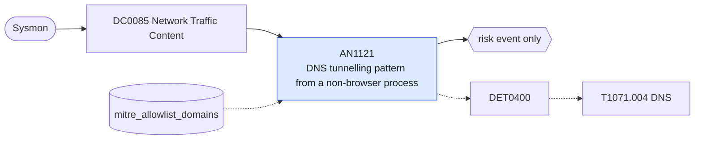

# AN1121 DNS tunnelling pattern from a non-browser process

[ATT&CK analytic](https://attack.mitre.org/detectionstrategies/DET0400#AN1121) · DET0400 Behavioral Detection of DNS Tunneling and Application Layer Abuse · [T1071.004 DNS](https://attack.mitre.org/techniques/T1071/004) · tactics: command-and-control · platforms: Windows

**Content type:** anomaly → risk event only · **Severity:** medium · **Status:** implemented · **Technique prevalence score:** 68

Sysmon DNS query events (EventCode 22) from a process that is not a browser, mail client or svchost, where in ten minutes the process either resolves many distinct names under one parent domain or queries a name with a very long subdomain portion.



## What ATT&CK asks for

> Detects high-frequency or anomalous DNS queries initiated by non-browser, non-system processes (e.g., PowerShell, rundll32, python.exe) used to establish command and control via DNS tunneling.

## What this implementation detects

Sysmon DNS query events (EventCode 22) from a process that is not a browser, mail client or svchost, where in ten minutes the process either resolves many distinct names under one parent domain or queries a name with a very long subdomain portion.

**Not covered:** The network-side view (Corelight dns.log) is AN1124. Parent-domain extraction is the last two labels, which over-groups multi-part public suffixes such as co.uk. Requires Sysmon DnsQuery logging.

## Tuning

ATT&CK mutable elements and where each is bound. Edit macros in `local/macros.conf` and lookups in place; do not edit the search.

| Mutable element | ATT&CK guidance | Bound to | Default |
|---|---|---|---|
| QueryLengthThreshold | Subdomain length for detecting base32/base64-encoded payloads | macro `mitre_an1121_length_threshold` — Characters in the subdomain portion of a single query. | `50` |
| ProcessImageFilter | Flag non-standard executables making DNS queries | lookup `mitre_allowlist_domains` — Parent domains that legitimately use long or numerous names (CDNs, security products, telemetry). |  |
| TimeWindow | Rate of queries in short interval per process | macro `mitre_an1121_query_threshold` — Distinct query names under one parent domain per process per 10 minutes. | `100` |

## Splunk

Stanza `[MITRE - AN1121 - DNS tunnelling pattern from a non-browser process - Rule]` in `DA-ESS-mitre-attack-detections`. Schedule `0-59/15 * * * *`, window `-30m@m` to `-5m@m`. Ships disabled.

```spl
`mitre_dc0085_sysmon` EventCode=22 NOT Image IN ("*\\chrome.exe", "*\\msedge.exe", "*\\msedgewebview2.exe", "*\\firefox.exe", "*\\brave.exe", "*\\opera.exe", "*\\iexplore.exe", "*\\outlook.exe", "*\\teams.exe", "*\\ms-teams.exe", "*\\svchost.exe")
| `mitre_normalize_host`
| eval query=lower(QueryName)
| lookup mitre_allowlist_domains domain as query OUTPUT reason as allow_reason
| where isnull(allow_reason)
| eval labels=split(query, "."), label_count=mvcount(labels), parent_domain=mvjoin(mvindex(labels, -2, -1), "."), subdomain_length=if(label_count > 2, len(query) - len(parent_domain) - 1, 0), process_name=replace(Image, "^.*\\\\", "")
| bin _time span=10m
| stats count min(_time) as firstTime max(_time) as lastTime dc(query) as unique_queries max(subdomain_length) as max_subdomain_length by dest process_name parent_domain _time
| where unique_queries >= `mitre_an1121_query_threshold` OR max_subdomain_length >= `mitre_an1121_length_threshold`
| `mitre_ctime(firstTime)` | `mitre_ctime(lastTime)`
| `mitre_an1121_filter`
```

Risk: `dest` (system, 45). Threat objects: `parent_domain`, `process_name`. Message: $process_name$ on $dest$ shows DNS tunnelling patterns towards $parent_domain$

Throttle: dest, parent_domain for 14400s.

Data components: [DC0085](../data-components/DC0085-network-traffic-content.md).

## Sigma

Rule file: `dist/sigma/rules/an1121_dns_tunnelling_pattern_from_a_non_browser_process.yml`.

The rule matches a single very long query name; the distinct-name rate is a correlation over all DNS queries and is left to the SPL.

## Known false positives

- Security agents and CDNs that encode data in DNS labels (reputation lookups, some AV cloud queries).
