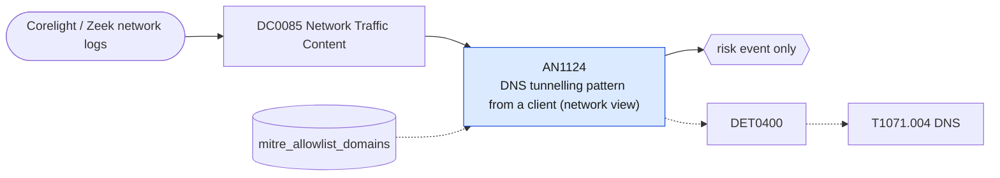

# AN1124 DNS tunnelling pattern from a client (network view)

[ATT&CK analytic](https://attack.mitre.org/detectionstrategies/DET0400#AN1124) · DET0400 Behavioral Detection of DNS Tunneling and Application Layer Abuse · [T1071.004 DNS](https://attack.mitre.org/techniques/T1071/004) · tactics: command-and-control · platforms: Network Devices

**Content type:** anomaly → risk event only · **Severity:** medium · **Status:** implemented · **Technique prevalence score:** 68

Corelight dns.log: in ten minutes one client either queries many distinct names under one parent domain or sends a query with a very long subdomain portion. Reports NXDOMAIN counts and query types for triage.



## What ATT&CK asks for

> Detects clients issuing DNS queries with high volume, long subdomain lengths, encoded payload patterns, or to known malicious infrastructure; indicative of DNS-based C2 channels.

## What this implementation detects

Corelight dns.log: in ten minutes one client either queries many distinct names under one parent domain or sends a query with a very long subdomain portion. Reports NXDOMAIN counts and query types for triage.

**Not covered:** Domain reputation (DomainReputationFeed) is not consulted here; add your threat-intelligence lookup in the filter macro or rely on ES threat matching. Parent-domain extraction is the last two labels.

## Tuning

ATT&CK mutable elements and where each is bound. Edit macros in `local/macros.conf` and lookups in place; do not edit the search.

| Mutable element | ATT&CK guidance | Bound to | Default |
|---|---|---|---|
| DomainReputationFeed | List of suspicious/malicious C2 domains | lookup `mitre_allowlist_domains` — Inverse use; domains known to be benign are excluded. Reputation feeds belong in the filter macro. |  |
| QueryRatePerClient | Tunable burst rate per IP per second | macro `mitre_an1124_query_threshold` — Distinct query names under one parent domain per client per 10 minutes. | `200` |
| QueryLengthThreshold (implementation) *(implementation)* | Characters in the subdomain portion of a single query. | macro `mitre_an1124_length_threshold` | `50` |

## Splunk

Stanza `[MITRE - AN1124 - DNS tunnelling pattern from a client (network view) - Rule]` in `DA-ESS-mitre-attack-detections`. Schedule `11-59/15 * * * *`, window `-30m@m` to `-5m@m`. Ships disabled.

```spl
`mitre_dc0085_corelight` `mitre_st_corelight_dns`
| `mitre_normalize_zeek`
| eval query=lower(query)
| where isnotnull(query) AND NOT like(query, "%.arpa") AND NOT like(query, "%.local")
| lookup mitre_allowlist_domains domain as query OUTPUT reason as allow_reason
| where isnull(allow_reason)
| eval labels=split(query, "."), label_count=mvcount(labels), parent_domain=mvjoin(mvindex(labels, -2, -1), "."), subdomain_length=if(label_count > 2, len(query) - len(parent_domain) - 1, 0)
| bin _time span=10m
| stats count min(_time) as firstTime max(_time) as lastTime dc(query) as unique_queries max(subdomain_length) as max_subdomain_length sum(eval(if(rcode_name=="NXDOMAIN", 1, 0))) as nxdomain_count values(qtype_name) as query_types by src parent_domain _time
| where unique_queries >= `mitre_an1124_query_threshold` OR max_subdomain_length >= `mitre_an1124_length_threshold`
| `mitre_ctime(firstTime)` | `mitre_ctime(lastTime)`
| `mitre_an1124_filter`
```

Risk: `src` (system, 45). Threat objects: `parent_domain`. Message: $src$ shows DNS tunnelling patterns towards $parent_domain$

Throttle: src, parent_domain for 14400s.

Data components: [DC0085](../data-components/DC0085-network-traffic-content.md).

## Sigma

Rule file: `dist/sigma/rules/an1124_dns_tunnelling_pattern_from_a_client_network_view.yml`.

The rule matches a single very long query name; the distinct-name rate is left to the SPL.

## Known false positives

- Internal resolvers forwarding for many clients (the resolver becomes the source), CDNs, and security products using DNS for lookups.
