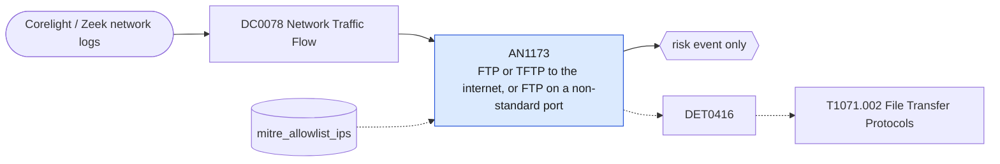

# AN1173 FTP or TFTP to the internet, or FTP on a non-standard port

[ATT&CK analytic](https://attack.mitre.org/detectionstrategies/DET0416#AN1173) · DET0416 Detection of File Transfer Protocol-Based C2 (FTP, FTPS, SMB, TFTP) · [T1071.002 File Transfer Protocols](https://attack.mitre.org/techniques/T1071/002) · tactics: command-and-control · platforms: Network Devices

**Content type:** anomaly → risk event only · **Severity:** medium · **Status:** implemented · **Technique prevalence score:** 36

Corelight conn.log shows an internal host using FTP, FTP data or TFTP with an external server, or a connection that Zeek identifies as FTP on a port other than 21: file transfer protocols used for C2 or staging.



## What ATT&CK asks for

> Detects internal hosts generating large outbound FTP/TFTP/SMB sessions to external IPs, or file transfers using non-standard ports and application mismatches (e.g., FTP over port 80).

## What this implementation detects

Corelight conn.log shows an internal host using FTP, FTP data or TFTP with an external server, or a connection that Zeek identifies as FTP on a port other than 21: file transfer protocols used for C2 or staging.

**Not covered:** SMB to external hosts is not included (it is usually blocked at the perimeter and Palo Alto would log the deny).

## Tuning

ATT&CK mutable elements and where each is bound. Edit macros in `local/macros.conf` and lookups in place; do not edit the search.

| Mutable element | ATT&CK guidance | Bound to | Default |
|---|---|---|---|
| AppLayerProtocolMatch | e.g., FTP/SMB observed over uncommon ports | macro `mitre_an1173_services` | `(service IN ("ftp", "ftp-data", "tftp") OR dest_port IN (20, 21, 69))` |
| OutboundDataRateThreshold | Bytes transferred outside trusted subnets >100MB | lookup `mitre_allowlist_ips` — Hosts allowed to use FTP to the internet (cidr column). |  |

## Splunk

Stanza `[MITRE - AN1173 - FTP or TFTP to the internet, or FTP on a non-standard port - Rule]` in `DA-ESS-mitre-attack-detections`. Schedule `1-59/15 * * * *`, window `-20m@m` to `-5m@m`. Ships disabled.

```spl
`mitre_dc0078_corelight` `mitre_st_corelight_conn`
| `mitre_normalize_zeek`
| search `mitre_an1173_services`
| where NOT `mitre_is_internal(dest)` AND `mitre_is_internal(src)`
| lookup mitre_allowlist_ips cidr AS src OUTPUT reason AS allow_reason
| where isnull(allow_reason)
| eval port_mismatch=if(service=="ftp" AND dest_port!=21, 1, 0)
| stats count min(_time) as firstTime max(_time) as lastTime sum(bytes_out) as bytes_out sum(bytes_in) as bytes_in max(port_mismatch) as port_mismatch values(service) as service values(dest_port) as dest_port by src dest
| `mitre_ctime(firstTime)` | `mitre_ctime(lastTime)`
| `mitre_an1173_filter`
```

Risk: `src` (system, 30). Threat objects: `dest`. Message: $src$ used FTP or TFTP with external host $dest$

Throttle: src, dest for 14400s.

Data components: [DC0078](../data-components/DC0078-network-traffic-flow.md).

## Sigma

Rule file: `dist/sigma/rules/an1173_ftp_or_tftp_to_the_internet_or_ftp_on_a_non_standard_port.yml`.

## Known false positives

- Legacy partner file exchanges over FTP; allow-list the internal hosts that do this.
