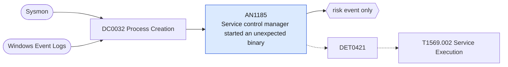

# AN1185 Service control manager started an unexpected binary

[ATT&CK analytic](https://attack.mitre.org/detectionstrategies/DET0421#AN1185) · DET0421 Detection Strategy for System Services Service Execution · [T1569.002 Service Execution](https://attack.mitre.org/techniques/T1569/002) · tactics: execution · platforms: Windows

**Content type:** anomaly → risk event only · **Severity:** medium · **Status:** implemented · **Technique prevalence score:** 95

services.exe starts a command interpreter or script host, or a binary whose path is outside the Windows, Program Files and Defender directories. Transient services created by PsExec, Impacket and sc.exe-based lateral movement look like this.



## What ATT&CK asks for

> Detection focuses on abnormal service executions initiated via service control manager APIs, sc.exe, net.exe, or PsExec creating temporary services. Defenders observe process creation of services.exe spawning non-standard binaries, registry changes in service keys followed by rapid execution, and network connections originating from processes tied to transient services. Correlation across process lineage, registry activity, and service logs provides strong signals of malicious service execution.

## What this implementation detects

services.exe starts a command interpreter or script host, or a binary whose path is outside the Windows, Program Files and Defender directories. Transient services created by PsExec, Impacket and sc.exe-based lateral movement look like this.

**Not covered:** Service-creation events, service-key registry writes and the network connection from the remote host are not correlated; RemoteExecutionHosts is not evaluated.

## Tuning

ATT&CK mutable elements and where each is bound. Edit macros in `local/macros.conf` and lookups in place; do not edit the search.

| Mutable element | ATT&CK guidance | Bound to | Default |
|---|---|---|---|
| ServiceBinaryAllowlist | Known binaries/services expected to be invoked via services.exe | macro `mitre_an1185_expected_paths` — Directories services are expected to run from. Add vendor paths rather than removing the check. | `Processes.process_path IN ("c:\\windows\\system32\\*", "c:\\windows\\syswow64\\*", "c:\\windows\\microsoft.net\\*", "c:\\windows\\servicing\\*", "c:\\windows\\winsxs\\*", "c:\\program files\\*", "c:\\program files (x86)\\*", "c:\\programdata\\microsoft\\windows defender\\*")` |
| ParentProcessCorrelationWindow | Time window for correlating service creation with execution events | filter macro `mitre_an1185_filter` (not bound separately) | `search *` |
| RemoteExecutionHosts | Approved remote hosts that may trigger service execution (e.g., via PsExec) | filter macro `mitre_an1185_filter` (not bound separately) | `search *` |

## Splunk

Stanza `[MITRE - AN1185 - Service control manager started an unexpected binary - Rule]` in `DA-ESS-mitre-attack-detections`. Schedule `3-59/15 * * * *`, window `-20m@m` to `-5m@m`. Ships disabled.

```spl
| tstats `mitre_summariesonly` count min(_time) as firstTime max(_time) as lastTime
    from `mitre_dc0032_dm` where `mitre_dc0032_dm_where` Processes.parent_process_name="services.exe" Processes.process_path="*\\*"
    (Processes.process_name IN ("cmd.exe", "powershell.exe", "pwsh.exe", "rundll32.exe", "regsvr32.exe", "mshta.exe", "wscript.exe", "cscript.exe") OR NOT `mitre_an1185_expected_paths`)
    by Processes.dest Processes.user Processes.process_name Processes.process_path Processes.process
| `drop_dm_object_name(Processes)`
| search `mitre_not_allowlisted_process`
| `mitre_ctime(firstTime)` | `mitre_ctime(lastTime)`
| `mitre_an1185_filter`
```

Risk: `dest` (system, 40). Threat objects: `process_name`. Message: services.exe started $process_name$ on $dest$

Throttle: dest, process_name for 3600s.

Data components: [DC0032](../data-components/DC0032-process-creation.md).

## Sigma

Rule file: `dist/sigma/rules/an1185_service_control_manager_started_an_unexpected_binary.yml`.

## Known false positives

- Services installed outside Program Files, software deployment tools, and services that wrap cmd.exe.
