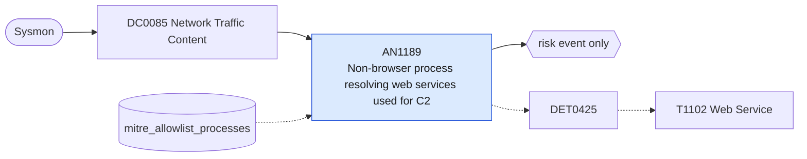

# AN1189 Non-browser process resolving web services used for C2

[ATT&CK analytic](https://attack.mitre.org/detectionstrategies/DET0425#AN1189) · DET0425 Suspicious Use of Web Services for C2 · [T1102 Web Service](https://attack.mitre.org/techniques/T1102) · tactics: command-and-control · platforms: Windows

**Content type:** anomaly → risk event only · **Severity:** medium · **Status:** implemented · **Technique prevalence score:** 71

Sysmon DNS queries (22) for paste sites, code hosting raw content, chat-platform APIs and webhooks, and consumer cloud-storage APIs, made by a process that is not a browser or the vendor's own client. Malware uses these services for C2 and staging because they are trusted and encrypted.



## What ATT&CK asks for

> Detects unusual outbound connections to web services from uncommon processes using SSL/TLS, particularly those exhibiting high outbound data volume or persistence.

## What this implementation detects

Sysmon DNS queries (22) for paste sites, code hosting raw content, chat-platform APIs and webhooks, and consumer cloud-storage APIs, made by a process that is not a browser or the vendor's own client. Malware uses these services for C2 and staging because they are trusted and encrypted.

**Not covered:** Data volume is not measured (Sysmon 22 has no bytes); join with Corelight ssl/conn on the resolved address to add it. Processes that use DoH or a hard-coded IP are invisible.

## Tuning

ATT&CK mutable elements and where each is bound. Edit macros in `local/macros.conf` and lookups in place; do not edit the search.

| Mutable element | ATT&CK guidance | Bound to | Default |
|---|---|---|---|
| ProcessName | To tune for unexpected or uncommon executables initiating network connections | macro `mitre_an1189_expected_clients` | `Image IN ("*\\chrome.exe", "*\\msedge.exe", "*\\firefox.exe", "*\\brave.exe", "*\\opera.exe", "*\\iexplore.exe", "*\\Teams.exe", "*\\ms-teams.exe", "*\\slack.exe", "*\\Discord.exe", "*\\Telegram.exe", "*\\Dropbox.exe", "*\\OneDrive.exe", "*\\outlook.exe", "*\\olk.exe", "*\\git-remote-https.exe", "*\\Code.exe", "*\\GoogleDriveFS.exe", "*\\msedgewebview2.exe", "*\\svchost.exe")` |
| DataTransferThreshold | Volume of outbound data in short time window (e.g., >1MB in <5 min) | filter macro `mitre_an1189_filter` — Volume is not available from Sysmon; tune by process here. |  |
| TimeWindow | Look for connections persisting outside of normal business hours | lookup `mitre_allowlist_processes` — Approved automation (backup agents, CI runners) using these APIs. |  |
| DomainCategory *(implementation)* |  | macro `mitre_an1189_web_services` | `QueryName IN ("pastebin.com", "*.pastebin.com", "paste.ee", "hastebin.com", "rentry.co", "ghostbin.*", "raw.githubusercontent.com", "gist.githubusercontent.com", "*.gitlab.io", "api.telegram.org", "discord.com", "discordapp.com", "cdn.discordapp.com", "hooks.slack.com", "api.dropboxapi.com", "content.dropboxapi.com", "graph.microsoft.com", "*.ngrok.io", "*.ngrok-free.app", "*.trycloudflare.com", "api.notion.com", "api.trello.com", "*.workers.dev", "transfer.sh", "file.io", "*.webhook.site", "script.google.com", "docs.google.com", "drive.google.com")` |

## Splunk

Stanza `[MITRE - AN1189 - Non-browser process resolving web services used for C2 - Rule]` in `DA-ESS-mitre-attack-detections`. Schedule `5-59/15 * * * *`, window `-20m@m` to `-5m@m`. Ships disabled.

```spl
`mitre_dc0085_sysmon` EventCode=22 `mitre_an1189_web_services` NOT `mitre_an1189_expected_clients`
| `mitre_normalize_host`
| eval process_name=lower(replace(Image, "^.*\\\\", "")), query=lower(QueryName)
| search `mitre_not_allowlisted_process`
| stats count min(_time) as firstTime max(_time) as lastTime values(query) as query values(Image) as process by dest user process_name
| `mitre_ctime(firstTime)` | `mitre_ctime(lastTime)`
| `mitre_an1189_filter`
```

Risk: `dest` (system, 35). Threat objects: `query`, `process_name`. Message: $process_name$ on $dest$ resolved web services used for C2 ($query$)

Throttle: dest, process_name for 86400s.

Data components: [DC0085](../data-components/DC0085-network-traffic-content.md).

## Sigma

Rule file: `dist/sigma/rules/an1189_non_browser_process_resolving_web_services_used_for_c2.yml`.

## Known false positives

- Developer tools, scripting runtimes and CLI clients (git, python, node, curl) used legitimately against these APIs.
