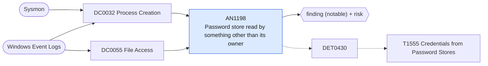

# AN1198 Password store read by something other than its owner

[ATT&CK analytic](https://attack.mitre.org/detectionstrategies/DET0430#AN1198) · DET0430 Detect Credentials Access from Password Stores · [T1555 Credentials from Password Stores](https://attack.mitre.org/techniques/T1555) · tactics: credential-access · platforms: Windows

**Content type:** ttp → finding (notable) + risk · **Severity:** high · **Status:** implemented · **Technique prevalence score:** 58

Windows Credential Manager and vault enumeration (vaultcmd /list, cmdkey /list, keymgr KRShowKeyMgr, the PasswordVault class, Get-StoredCredential), a command line naming browser credential databases (Login Data, logins.json, key4.db), or, with SACLs, a Security 4663 read of a browser credential database, the Local State key file or the Credentials and Vault folders by a process that is not the browser or the OS.



## What ATT&CK asks for

> Monitors suspicious access to password stores such as LSASS, DPAPI, Windows Credential Manager, or browser credential databases. Detects anomalous process-to-process access (e.g., Mimikatz accessing LSASS) and correlation of credential store file reads with execution of non-standard processes.

## What this implementation detects

Windows Credential Manager and vault enumeration (vaultcmd /list, cmdkey /list, keymgr KRShowKeyMgr, the PasswordVault class, Get-StoredCredential), a command line naming browser credential databases (Login Data, logins.json, key4.db), or, with SACLs, a Security 4663 read of a browser credential database, the Local State key file or the Credentials and Vault folders by a process that is not the browser or the OS.

**Not covered:** LSASS memory access is AN1030 and AN1095. The 4663 leg needs object-access auditing and SACLs on the browser profile and Credentials folders; without them only the command leg fires.

## Tuning

ATT&CK mutable elements and where each is bound. Edit macros in `local/macros.conf` and lookups in place; do not edit the search.

| Mutable element | ATT&CK guidance | Bound to | Default |
|---|---|---|---|
| TargetProcesses | List of sensitive processes to monitor (e.g., lsass.exe, svchost.exe) | macro `mitre_an1198_store_files` | `ObjectName IN ("*\\User Data\\*\\Login Data*", "*\\User Data\\Local State", "*\\Mozilla\\Firefox\\Profiles\\*\\logins.json", "*\\Mozilla\\Firefox\\Profiles\\*\\key4.db", "*\\AppData\\*\\Microsoft\\Credentials\\*", "*\\AppData\\*\\Microsoft\\Vault\\*")` |
| KeywordPatterns | Regex for suspicious command-line arguments such as 'dpapi', 'credman', 'mimikatz' | macro `mitre_an1198_commands` | `((Image="*\\vaultcmd.exe" CommandLine="*/list*") OR (Image="*\\cmdkey.exe" CommandLine IN ("*/l*", "*-l*")) OR CommandLine IN ("*keymgr.dll*KRShowKeyMgr*", "*Security.Credentials.PasswordVault*", "*Get-StoredCredential*", "*\\Login Data*", "*logins.json*", "*key4.db*", "*\\Local State*", "*\\Microsoft\\Credentials\\*", "*\\Microsoft\\Vault\\*"))` |
| ExpectedReaders *(implementation)* |  | macro `mitre_an1198_expected_readers` | `ProcessName IN ("*\\chrome.exe", "*\\msedge.exe", "*\\firefox.exe", "*\\brave.exe", "*\\opera.exe", "*\\vivaldi.exe", "*\\lsass.exe", "*\\svchost.exe", "*\\MsMpEng.exe", "*\\SearchProtocolHost.exe", "*\\SearchIndexer.exe", "*\\explorer.exe", "*\\msedgewebview2.exe")` |

## Splunk

Stanza `[MITRE - AN1198 - Password store read by something other than its owner - Rule]` in `DA-ESS-mitre-attack-detections`. Schedule `13-59/15 * * * *`, window `-20m@m` to `-5m@m`. Ships disabled.

```spl
(`mitre_dc0032_sysmon` EventCode=1 `mitre_an1198_commands`)
OR (`mitre_dc0055_wineventlog` EventCode=4663 `mitre_an1198_store_files` NOT `mitre_an1198_expected_readers`)
| `mitre_normalize_host`
| eval process_name=lower(replace(coalesce(Image, ProcessName), "^.*\\\\", "")), signal=if(EventCode==4663, "read ".ObjectName, CommandLine)
| search `mitre_not_allowlisted_process`
| stats count min(_time) as firstTime max(_time) as lastTime values(signal) as signal values(process_name) as process_name by dest user
| eval signal=mvindex(signal, 0, 9)
| `mitre_ctime(firstTime)` | `mitre_ctime(lastTime)`
| `mitre_an1198_filter`
```

Risk: `dest` (system, 50), `user` (user, 60). Threat objects: `process_name`. Message: Password store accessed on $dest$ by $user$ via $process_name$

Throttle: dest, user for 86400s.

Data components: [DC0032](../data-components/DC0032-process-creation.md), [DC0055](../data-components/DC0055-file-access.md).

## Sigma

Rule file: `dist/sigma/rules/an1198_password_store_read_by_something_other_than_its_owner.yml`.

## Known false positives

- Password-manager import tools and browser migration; administrators listing saved credentials with cmdkey.
