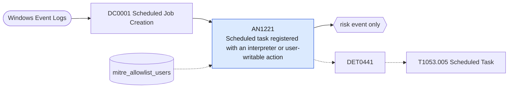

# AN1221 Scheduled task registered with an interpreter or user-writable action

[ATT&CK analytic](https://attack.mitre.org/detectionstrategies/DET0441#AN1221) · DET0441 Detection of Suspicious Scheduled Task Creation and Execution on Windows · [T1053.005 Scheduled Task](https://attack.mitre.org/techniques/T1053/005) · tactics: execution, persistence, privilege-escalation · platforms: Windows

**Content type:** anomaly → risk event only · **Severity:** medium · **Status:** implemented · **Technique prevalence score:** 260

A scheduled task is created (Security 4698) whose XML definition runs a script interpreter or proxy execution utility, or a binary from AppData, Users\Public, Temp or ProgramData, or carries an encoded command.



## What ATT&CK asks for

> Detects the creation, modification, or deletion of scheduled tasks through Task Scheduler, WMI, PowerShell, or API-based methods followed by execution from svchost.exe or taskeng.exe. Includes detection of hidden or anomalous scheduled tasks, especially those created under SYSTEM or suspicious user contexts.

## What this implementation detects

A scheduled task is created (Security 4698) whose XML definition runs a script interpreter or proxy execution utility, or a binary from AppData, Users\Public, Temp or ProgramData, or carries an encoded command.

**Not covered:** Task modification (4702), the task file and TaskCache registry writes, and execution of the task action are not correlated. TaskNamePattern and CommandLineEntropyThreshold are not evaluated.

## Tuning

ATT&CK mutable elements and where each is bound. Edit macros in `local/macros.conf` and lookups in place; do not edit the search.

| Mutable element | ATT&CK guidance | Bound to | Default |
|---|---|---|---|
| TimeWindow | Defines threshold for grouping task creation and associated execution within suspicious time proximity. | filter macro `mitre_an1221_filter` (not bound separately) | `search *` |
| UserContext | Filters based on non-standard user accounts or execution under SYSTEM when not typical for the environment. | lookup `mitre_allowlist_users` — Deployment and patching accounts that register tasks. |  |
| TaskNamePattern | Allows defenders to flag obfuscated, randomized, or suspicious task names outside normal conventions. | macro `mitre_an1221_suspicious_actions` — Matches the task XML. Do not add http:// patterns; every task definition contains the schema namespace URL. | `TaskContent IN ("*\\AppData\\*", "*\\Users\\Public\\*", "*\\Windows\\Temp\\*", "*\\ProgramData\\*", "*powershell*", "*pwsh*", "*cmd.exe*", "*wscript*", "*cscript*", "*mshta*", "*rundll32*", "*regsvr32*", "*frombase64*", "* -enc *", "*-encodedcommand*")` |
| CommandLineEntropyThreshold | Flags tasks executing heavily obfuscated PowerShell or binary blobs via base64 or encoding. | filter macro `mitre_an1221_filter` (not bound separately) | `search *` |

## Splunk

Stanza `[MITRE - AN1221 - Scheduled task registered with an interpreter or user-writable action - Rule]` in `DA-ESS-mitre-attack-detections`. Schedule `7-59/15 * * * *`, window `-20m@m` to `-5m@m`. Ships disabled.

```spl
`mitre_dc0001_wineventlog` EventCode=4698 `mitre_an1221_suspicious_actions`
| `mitre_normalize_host`
| eval task_name=TaskName
| search `mitre_not_allowlisted_user`
| stats count min(_time) as firstTime max(_time) as lastTime values(TaskContent) as task_content by dest user task_name
| `mitre_ctime(firstTime)` | `mitre_ctime(lastTime)`
| `mitre_an1221_filter`
```

Risk: `dest` (system, 35), `user` (user, 35). Threat objects: `task_name`. Message: Suspicious scheduled task $task_name$ created on $dest$ by $user$

Throttle: dest, task_name for 86400s.

Data components: [DC0001](../data-components/DC0001-scheduled-job-creation.md).

## Sigma

Rule file: `dist/sigma/rules/an1221_scheduled_task_registered_with_an_interpreter_or_user_writab.yml`.

## Known false positives

- Software updaters and management agents register PowerShell or cmd based tasks; add the creating account to mitre_allowlist_users.
