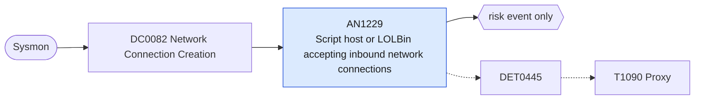

# AN1229 Script host or LOLBin accepting inbound network connections

[ATT&CK analytic](https://attack.mitre.org/detectionstrategies/DET0445#AN1229) · DET0445 Detection of Proxy Infrastructure Setup and Traffic Bridging · [T1090 Proxy](https://attack.mitre.org/techniques/T1090) · tactics: command-and-control · platforms: Windows

**Content type:** anomaly → risk event only · **Severity:** high · **Status:** implemented · **Technique prevalence score:** 108

Sysmon network connection events (3) with Initiated=false, meaning the process accepted an inbound connection, where the process is a script interpreter, shell or proxy-execution utility. A host that relays traffic for an attacker (SOCKS or port-forward implants in PowerShell or rundll32) has to listen; these processes almost never do.



## What ATT&CK asks for

> Suspicious process spawning (e.g., `rundll32`, `svchost`, `powershell`, or `netsh`) followed by network connection creation to internal hosts or uncommon external endpoints on high or non-standard ports.

## What this implementation detects

Sysmon network connection events (3) with Initiated=false, meaning the process accepted an inbound connection, where the process is a script interpreter, shell or proxy-execution utility. A host that relays traffic for an attacker (SOCKS or port-forward implants in PowerShell or rundll32) has to listen; these processes almost never do.

**Not covered:** netsh portproxy forwarding is AN1483; listeners in custom binaries are not covered.

## Tuning

ATT&CK mutable elements and where each is bound. Edit macros in `local/macros.conf` and lookups in place; do not edit the search.

| Mutable element | ATT&CK guidance | Bound to | Default |
|---|---|---|---|
| ParentProcessName | Legitimate system processes that may rarely spawn network-capable child processes (e.g., `rundll32`, `svchost`). | macro `mitre_an1229_listeners` | `Image IN ("*\\powershell.exe", "*\\pwsh.exe", "*\\cmd.exe", "*\\rundll32.exe", "*\\regsvr32.exe", "*\\mshta.exe", "*\\wscript.exe", "*\\cscript.exe", "*\\msbuild.exe", "*\\installutil.exe", "*\\certutil.exe", "*\\notepad.exe", "*\\dllhost.exe")` |
| DestinationPort | Watch for high-numbered ports or well-known proxy ports like 1080, 8080, 4444. | filter macro `mitre_an1229_filter` |  |
| TimeWindow | Capture unusual spikes in outbound connections over a short period. | filter macro `mitre_an1229_filter` |  |

## Splunk

Stanza `[MITRE - AN1229 - Script host or LOLBin accepting inbound network connections - Rule]` in `DA-ESS-mitre-attack-detections`. Schedule `9-59/15 * * * *`, window `-20m@m` to `-5m@m`. Ships disabled.

```spl
`mitre_dc0082_sysmon` EventCode=3 Initiated=false `mitre_an1229_listeners`
| `mitre_normalize_host`
| eval process_name=replace(Image, "^.*\\\\", ""), src=SourceIp, listen_port=DestinationPort
| where NOT match(SourceIp, "^(127\.|::1)")
| stats count min(_time) as firstTime max(_time) as lastTime dc(src) as distinct_clients values(src) as src values(listen_port) as listen_port by dest user process_name
| `mitre_ctime(firstTime)` | `mitre_ctime(lastTime)`
| `mitre_an1229_filter`
```

Risk: `dest` (system, 55), `user` (user, 40). Threat objects: `process_name`. Message: $process_name$ on $dest$ accepted inbound connections

Throttle: dest, process_name for 14400s.

Data components: [DC0082](../data-components/DC0082-network-connection-creation.md).

## Sigma

Rule file: `dist/sigma/rules/an1229_script_host_or_lolbin_accepting_inbound_network_connections.yml`.

## Known false positives

- PowerShell remoting endpoints are wsmprovhost, not powershell, so they do not match; developer test servers run from scripts.
