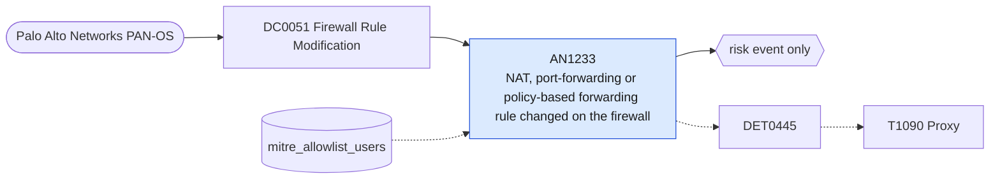

# AN1233 NAT, port-forwarding or policy-based forwarding rule changed on the firewall

[ATT&CK analytic](https://attack.mitre.org/detectionstrategies/DET0445#AN1233) · DET0445 Detection of Proxy Infrastructure Setup and Traffic Bridging · [T1090 Proxy](https://attack.mitre.org/techniques/T1090) · tactics: command-and-control · platforms: Network Devices

**Content type:** anomaly → risk event only · **Severity:** medium · **Status:** implemented · **Technique prevalence score:** 108

A Palo Alto configuration log entry where a NAT rule, policy-based forwarding rule, tunnel or proxy object is added or modified by an administrator who is not on the allow-list. New forwarding rules are how a compromised firewall is turned into a traffic relay.



## What ATT&CK asks for

> Dynamic or static port forwarding rules added to route traffic through an internal host, or configuration changes to proxy firewall rules not aligned with baselined policy.

## What this implementation detects

A Palo Alto configuration log entry where a NAT rule, policy-based forwarding rule, tunnel or proxy object is added or modified by an administrator who is not on the allow-list. New forwarding rules are how a compromised firewall is turned into a traffic relay.

**Not covered:** The change in flow volume through the new rule (FlowVolumeDelta) and interface-level CLI commands are not correlated. Covers the firewall only.

## Tuning

ATT&CK mutable elements and where each is bound. Edit macros in `local/macros.conf` and lookups in place; do not edit the search.

| Mutable element | ATT&CK guidance | Bound to | Default |
|---|---|---|---|
| RuleType | Focus on new allow/permit rules with dynamic NAT or port forwarders. | macro `mitre_an1233_rule_paths` | `path IN ("*nat*rules*", "*rulebase*nat*", "*pbf*rules*", "*rulebase*pbf*", "*tunnel*", "*proxy*", "*network*virtual-router*")` |
| ChangeUser | Flag any non-admins initiating proxy config changes. | lookup `mitre_allowlist_users` — Firewall administrators expected to change forwarding rules. |  |
| FlowVolumeDelta | Detect sharp changes in bi-directional traffic patterns. | filter macro `mitre_an1233_filter` (not bound separately) | `search *` |

## Splunk

Stanza `[MITRE - AN1233 - NAT, port-forwarding or policy-based forwarding rule changed on the firewall - Rule]` in `DA-ESS-mitre-attack-detections`. Schedule `1-59/15 * * * *`, window `-20m@m` to `-5m@m`. Ships disabled.

```spl
`mitre_dc0051_palo_alto` `mitre_st_palo_alto_config` cmd IN ("set", "edit", "add", "clone", "move", "rename") `mitre_an1233_rule_paths`
| `mitre_normalize_pan`
| eval dest=coalesce(dvc_name, dvc, host), config_path=path
| search `mitre_not_allowlisted_user`
| stats count min(_time) as firstTime max(_time) as lastTime values(cmd) as config_action values(config_path) as config_path values(client) as client by dest user
| `mitre_ctime(firstTime)` | `mitre_ctime(lastTime)`
| `mitre_an1233_filter`
```

Risk: `dest` (system, 40), `user` (user, 40). Message: Forwarding or NAT configuration changed on firewall $dest$ by $user$

Throttle: dest, user for 3600s.

Data components: [DC0051](../data-components/DC0051-firewall-rule-modification.md).

## Sigma

Rule file: `dist/sigma/rules/an1233_nat_port_forwarding_or_policy_based_forwarding_rule_changed_.yml`.

## Known false positives

- Routine network changes; add the network team's admin accounts to mitre_allowlist_users.
