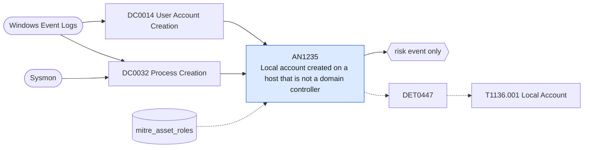

# AN1235 Local account created on a host that is not a domain controller

[ATT&CK analytic](https://attack.mitre.org/detectionstrategies/DET0447#AN1235) · DET0447 T1136.001 Detection Strategy - Local Account Creation Across Platforms · [T1136.001 Local Account](https://attack.mitre.org/techniques/T1136/001) · tactics: persistence · platforms: Windows

**Content type:** anomaly → risk event only · **Severity:** medium · **Status:** implemented · **Technique prevalence score:** 49

Security event 4720 (user account created) on a host not listed as a domain controller, which means a local SAM account. When Sysmon saw the command that created it (net user /add, New-LocalUser, wmic useraccount create) it is reported alongside.



## What ATT&CK asks for

> Adversary uses built-in tools like 'net user /add', PowerShell, or WMI to create a local user. Sequence: Account creation event (4720) follows process creation of a suspicious executable (e.g., powershell.exe or net.exe).

## What this implementation detects

Security event 4720 (user account created) on a host not listed as a domain controller, which means a local SAM account. When Sysmon saw the command that created it (net user /add, New-LocalUser, wmic useraccount create) it is reported alongside.

**Not covered:** Accounts created through the API without a command line show only the 4720 half.

## Tuning

ATT&CK mutable elements and where each is bound. Edit macros in `local/macros.conf` and lookups in place; do not edit the search.

| Mutable element | ATT&CK guidance | Bound to | Default |
|---|---|---|---|
| ParentProcessName | Attackers may use cmd.exe, wscript.exe, or renamed binaries to evade detection | macro `mitre_an1235_commands` | `((Image IN ("*\\net.exe", "*\\net1.exe") CommandLine="* user *" CommandLine="*/ad*") OR CommandLine="*New-LocalUser*" OR (Image="*\\wmic.exe" CommandLine="*useraccount*create*"))` |
| TimeWindow | Define time threshold between process start and user creation event (e.g., 5s–2m) | filter macro `mitre_an1235_filter` — Command and event are matched within the search range on the same host. |  |
| UserContext | Correlate if process runs under SYSTEM, Administrator, or untrusted account | lookup `mitre_asset_roles` — Hosts with role=domain_controller are excluded through mitre_hosts_with_role(domain_controller). |  |

## Splunk

Stanza `[MITRE - AN1235 - Local account created on a host that is not a domain controller - Rule]` in `DA-ESS-mitre-attack-detections`. Schedule `2-59/15 * * * *`, window `-20m@m` to `-5m@m`. Ships disabled.

```spl
(`mitre_dc0014_wineventlog` EventCode=4720) OR (`mitre_dc0032_sysmon` EventCode=1 `mitre_an1235_commands`)
| `mitre_normalize_host`
| search NOT `mitre_hosts_with_role(domain_controller)`
| eval new_account=if(EventCode==4720, TargetUserName, null()), creator=if(EventCode==4720, SubjectUserName, user), command=if(EventCode==1, CommandLine, null())
| stats count min(_time) as firstTime max(_time) as lastTime values(new_account) as new_account values(creator) as user values(command) as process by dest
| where isnotnull(new_account)
| `mitre_ctime(firstTime)` | `mitre_ctime(lastTime)`
| `mitre_an1235_filter`
```

Risk: `dest` (system, 45), `user` (user, 40). Threat objects: `new_account`. Message: Local account $new_account$ created on $dest$ by $user$

Throttle: dest, new_account for 86400s.

Data components: [DC0014](../data-components/DC0014-user-account-creation.md), [DC0032](../data-components/DC0032-process-creation.md).

## Sigma

Rule file: `dist/sigma/rules/an1235_local_account_created_on_a_host_that_is_not_a_domain_control.yml`.

## Known false positives

- Imaging and provisioning that create a local support account; LAPS-style tooling.
