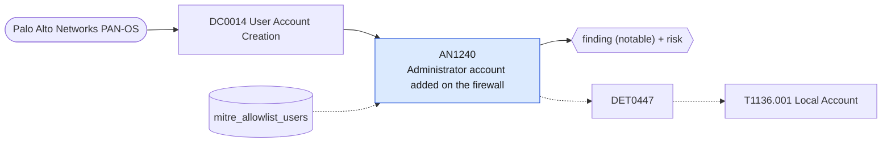

# AN1240 Administrator account added on the firewall

[ATT&CK analytic](https://attack.mitre.org/detectionstrategies/DET0447#AN1240) · DET0447 T1136.001 Detection Strategy - Local Account Creation Across Platforms · [T1136.001 Local Account](https://attack.mitre.org/techniques/T1136/001) · tactics: persistence · platforms: Network Devices

**Content type:** ttp → finding (notable) + risk · **Severity:** medium · **Status:** implemented · **Technique prevalence score:** 49

A Palo Alto configuration change adds or clones an entry under the management administrator users (mgt-config users), or under a shared administrator role, outside the accounts allowed to manage administrators.



## What ATT&CK asks for

> Account created via CLI using 'username' command or REST API. Detectable through AAA logging or CLI history telemetry.

## What this implementation detects

A Palo Alto configuration change adds or clones an entry under the management administrator users (mgt-config users), or under a shared administrator role, outside the accounts allowed to manage administrators.

**Not covered:** The new account's role cannot be read from the change because the current add-on drops the change detail fields. Routers and switches need the netdev_syslog feed.

## Tuning

ATT&CK mutable elements and where each is bound. Edit macros in `local/macros.conf` and lookups in place; do not edit the search.

| Mutable element | ATT&CK guidance | Bound to | Default |
|---|---|---|---|
| PrivilegeLevel | Some devices allow unprivileged user creation—adjust based on role risk | macro `mitre_an1240_paths` | `path IN ("*mgt-config*users*", "*mgt-config*password-complexity*", "*admin-role*")` |
| RemoteSessionFlag | Creation via Telnet, SSH, or serial console affects detection priority | lookup `mitre_allowlist_users` — Administrators allowed to manage firewall accounts. |  |

## Splunk

Stanza `[MITRE - AN1240 - Administrator account added on the firewall - Rule]` in `DA-ESS-mitre-attack-detections`. Schedule `6-59/15 * * * *`, window `-20m@m` to `-5m@m`. Ships disabled.

```spl
`mitre_dc0014_palo_alto` `mitre_st_palo_alto_config` cmd IN ("set", "add", "clone", "edit") `mitre_an1240_paths`
| `mitre_normalize_pan`
| eval dest=coalesce(dvc_name, dest, host), config_path=path
| search `mitre_not_allowlisted_user`
| stats count min(_time) as firstTime max(_time) as lastTime values(cmd) as config_action values(config_path) as config_path values(client) as client by dest user
| `mitre_ctime(firstTime)` | `mitre_ctime(lastTime)`
| `mitre_an1240_filter`
```

Risk: `dest` (system, 50), `user` (user, 50). Message: Administrator account change on firewall $dest$ by $user$

Throttle: dest, user for 3600s.

Data components: [DC0014](../data-components/DC0014-user-account-creation.md).

## Sigma

Rule file: `dist/sigma/rules/an1240_administrator_account_added_on_the_firewall.yml`.

## Known false positives

- Onboarding of new firewall administrators; Panorama template pushes.
