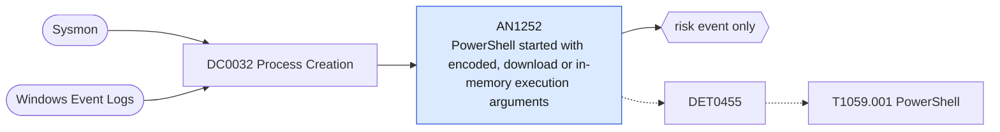

# AN1252 PowerShell started with encoded, download or in-memory execution arguments

[ATT&CK analytic](https://attack.mitre.org/detectionstrategies/DET0455#AN1252) · DET0455 Abuse of PowerShell for Arbitrary Execution · [T1059.001 PowerShell](https://attack.mitre.org/techniques/T1059/001) · tactics: execution · platforms: Windows

**Content type:** anomaly → risk event only · **Severity:** medium · **Status:** implemented · **Technique prevalence score:** 341

powershell.exe or pwsh.exe is started with an encoded command, a download cradle, Invoke-Expression, reflective assembly loading, or a hidden no-profile combination on the command line.



## What ATT&CK asks for

> Detects behavioral chains where PowerShell is launched with encoded commands, unusual parent processes, or suspicious modules loaded, potentially followed by network connections or child process spawning. Supports detection of both direct (powershell.exe) and indirect (.NET automation) invocations.

## What this implementation detects

powershell.exe or pwsh.exe is started with an encoded command, a download cradle, Invoke-Expression, reflective assembly loading, or a hidden no-profile combination on the command line.

**Not covered:** Script block content (4104), engine start events (400/403), module loads and unusual-parent logic are not part of this search. Obfuscated arguments that avoid these strings are covered by AN1394.

## Tuning

ATT&CK mutable elements and where each is bound. Edit macros in `local/macros.conf` and lookups in place; do not edit the search.

| Mutable element | ATT&CK guidance | Bound to | Default |
|---|---|---|---|
| CommandLinePattern | Regex pattern for encoded, obfuscated, or hidden PowerShell arguments (e.g., '-enc', '-nop'). | macro `mitre_an1252_suspicious_args` | `Processes.process IN ("* -enc *", "* -ec *", "* -en *", "*-encodedcommand*", "* -e jab*", "* -e sqb*", "* -e aqb*", "* -e cwb*", "*frombase64string*", "*downloadstring*", "*downloadfile*", "*downloaddata*", "*net.webclient*", "*invoke-webrequest*", "*invoke-expression*", "*iex(*", "*iex (*", "* iex *", "*reflection.assembly*load*", "*-nop*-w*hidden*", "*invoke-mimikatz*", "*invoke-shellcode*")` |
| ParentProcessName | Filter based on abnormal parents like Excel, WinWord, or mshta spawning PowerShell. | filter macro `mitre_an1252_filter` — Exclude management agents by parent_process_name, e.g. search NOT parent_process_name IN ("ccmexec.exe", "senseir.exe"). |  |
| TimeWindow | Scope detection to off-hours, lateral movement timeframes, or non-maintenance windows. | filter macro `mitre_an1252_filter` (not bound separately) | `search *` |
| LoadedModuleList | Tuneable to monitor rare or never-before-seen .NET assemblies tied to PowerShell abuse. | filter macro `mitre_an1252_filter` (not bound separately) | `search *` |
| ScriptBlockLengthThreshold | Adjustable threshold for length of script blocks logged by Event ID 4104 (useful for filtering noise). | filter macro `mitre_an1252_filter` (not bound separately) | `search *` |

## Splunk

Stanza `[MITRE - AN1252 - PowerShell started with encoded, download or in-memory execution arguments - Rule]` in `DA-ESS-mitre-attack-detections`. Schedule `7-59/15 * * * *`, window `-20m@m` to `-5m@m`. Ships disabled.

```spl
| tstats `mitre_summariesonly` count min(_time) as firstTime max(_time) as lastTime
    from `mitre_dc0032_dm` where `mitre_dc0032_dm_where` Processes.process_name IN ("powershell.exe", "pwsh.exe", "powershell_ise.exe") `mitre_an1252_suspicious_args`
    by Processes.dest Processes.user Processes.parent_process_name Processes.process_name Processes.process
| `drop_dm_object_name(Processes)`
| `mitre_ctime(firstTime)` | `mitre_ctime(lastTime)`
| `mitre_an1252_filter`
```

Risk: `dest` (system, 35), `user` (user, 35). Threat objects: `process`, `parent_process_name`. Message: Suspicious PowerShell arguments on $dest$ by $user$

Throttle: dest, user, process for 3600s.

Data components: [DC0032](../data-components/DC0032-process-creation.md).

## Sigma

Rule file: `dist/sigma/rules/an1252_powershell_started_with_encoded_download_or_in_memory_execut.yml`.

## Known false positives

- Endpoint management, monitoring and installer frameworks routinely use -EncodedCommand and web requests.
