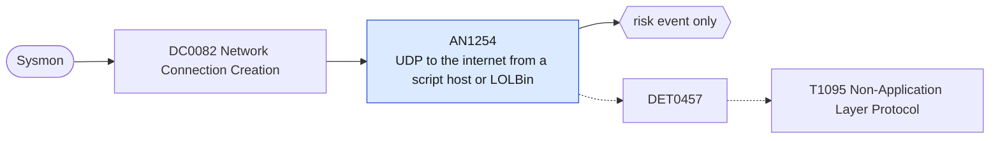

# AN1254 UDP to the internet from a script host or LOLBin

[ATT&CK analytic](https://attack.mitre.org/detectionstrategies/DET0457#AN1254) · DET0457 Detection of Non-Application Layer Protocols for C2 · [T1095 Non-Application Layer Protocol](https://attack.mitre.org/techniques/T1095) · tactics: command-and-control · platforms: Windows

**Content type:** anomaly → risk event only · **Severity:** medium · **Status:** implemented · **Technique prevalence score:** 130

Sysmon network connections (3) using UDP from script interpreters, Office applications or proxy-execution utilities to external addresses on ports other than DNS and NTP. Non-application layer C2 often rides UDP because proxies never see it.



## What ATT&CK asks for

> Anomalous use of ICMP or UDP by non-network service processes for data exfiltration or remote control, especially if traffic bypasses proxy infrastructure or shows unusual flow patterns.

## What this implementation detects

Sysmon network connections (3) using UDP from script interpreters, Office applications or proxy-execution utilities to external addresses on ports other than DNS and NTP. Non-application layer C2 often rides UDP because proxies never see it.

**Not covered:** Sysmon does not log ICMP; ICMP tunnelling is seen on the network side by AN1258. QUIC (UDP 443) from browsers is excluded by process.

## Tuning

ATT&CK mutable elements and where each is bound. Edit macros in `local/macros.conf` and lookups in place; do not edit the search.

| Mutable element | ATT&CK guidance | Bound to | Default |
|---|---|---|---|
| ProcessContextAllowList | Processes normally allowed to use ICMP/UDP (e.g., ping.exe, DNS resolver). | macro `mitre_an1254_processes` | `Image IN ("*\\powershell.exe", "*\\pwsh.exe", "*\\cmd.exe", "*\\wscript.exe", "*\\cscript.exe", "*\\mshta.exe", "*\\rundll32.exe", "*\\regsvr32.exe", "*\\msbuild.exe", "*\\installutil.exe", "*\\winword.exe", "*\\excel.exe", "*\\powerpnt.exe", "*\\notepad.exe", "*\\dllhost.exe")` |
| ByteTransferAnomalyThreshold | Suspicion if client sends much more data than it receives (e.g., >90%). | filter macro `mitre_an1254_filter` |  |
| ProtocolUsageBaseline | Baseline which protocols are normal per host or segment (ICMP, UDP, etc.). | macro `mitre_an1254_ignored_ports` — Matched with NOT. | `DestinationPort IN (53, 123, 137, 138, 1900, 5353, 5355)` |

## Splunk

Stanza `[MITRE - AN1254 - UDP to the internet from a script host or LOLBin - Rule]` in `DA-ESS-mitre-attack-detections`. Schedule `8-59/15 * * * *`, window `-20m@m` to `-5m@m`. Ships disabled.

```spl
`mitre_dc0082_sysmon` EventCode=3 Protocol=udp `mitre_an1254_processes` NOT `mitre_an1254_ignored_ports`
| `mitre_normalize_host`
| where NOT `mitre_is_internal(DestinationIp)`
| eval process_name=replace(Image, "^.*\\\\", ""), dest_ip=DestinationIp, dest_port=DestinationPort
| stats count min(_time) as firstTime max(_time) as lastTime values(dest_port) as dest_port by dest user process_name dest_ip
| `mitre_ctime(firstTime)` | `mitre_ctime(lastTime)`
| `mitre_an1254_filter`
```

Risk: `dest` (system, 35), `user` (user, 25). Threat objects: `dest_ip`, `process_name`. Message: $process_name$ on $dest$ sent UDP to $dest_ip$

Throttle: dest, process_name, dest_ip for 14400s.

Data components: [DC0082](../data-components/DC0082-network-connection-creation.md).

## Sigma

Rule file: `dist/sigma/rules/an1254_udp_to_the_internet_from_a_script_host_or_lolbin.yml`.

## Known false positives

- Office real-time collaboration and media features; scripts that query time or SNMP services.
