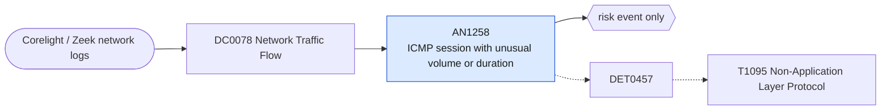

# AN1258 ICMP session with unusual volume or duration

[ATT&CK analytic](https://attack.mitre.org/detectionstrategies/DET0457#AN1258) · DET0457 Detection of Non-Application Layer Protocols for C2 · [T1095 Non-Application Layer Protocol](https://attack.mitre.org/techniques/T1095) · tactics: command-and-control · platforms: Network Devices

**Content type:** anomaly → risk event only · **Severity:** medium · **Status:** implemented · **Technique prevalence score:** 130

Corelight conn.log ICMP flows between a pair of hosts whose combined payload bytes or longest flow duration within the hour exceed thresholds. Normal ping is small and short; ICMP tunnels carry sustained data.



## What ATT&CK asks for

> Non-standard port/protocol pairings or low-entropy ICMP traffic resembling tunneling patterns (e.g., fixed-size pings with delays).

## What this implementation detects

Corelight conn.log ICMP flows between a pair of hosts whose combined payload bytes or longest flow duration within the hour exceed thresholds. Normal ping is small and short; ICMP tunnels carry sustained data.

**Not covered:** Payload entropy is not available in conn.log and is not evaluated. UDP on non-standard ports is not included. The firewall view (Palo Alto traffic for app=ping/icmp) can be added through the Network Traffic Flow umbrella macro.

## Tuning

ATT&CK mutable elements and where each is bound. Edit macros in `local/macros.conf` and lookups in place; do not edit the search.

| Mutable element | ATT&CK guidance | Bound to | Default |
|---|---|---|---|
| ProtocolEntropyThreshold | ICMP/UDP packet content entropy filter to identify encoded payloads. | macro `mitre_an1258_bytes_threshold` — Entropy is not measurable here; total ICMP bytes per host pair per hour is used instead. | `100000` |
| SessionDurationThreshold | Long ICMP/UDP sessions beyond expected limits (e.g., >5min). | macro `mitre_an1258_duration_threshold` — Seconds. | `300` |

## Splunk

Stanza `[MITRE - AN1258 - ICMP session with unusual volume or duration - Rule]` in `DA-ESS-mitre-attack-detections`. Schedule `11 * * * *`, window `-65m@m` to `-5m@m`. Ships disabled.

```spl
`mitre_dc0078_corelight` `mitre_st_corelight_conn` proto=icmp
| `mitre_normalize_zeek`
| stats count min(_time) as firstTime max(_time) as lastTime sum(bytes_out) as bytes_out sum(bytes_in) as bytes_in max(duration) as max_duration by src dest
| eval total_bytes=coalesce(bytes_out, 0) + coalesce(bytes_in, 0)
| where total_bytes >= `mitre_an1258_bytes_threshold` OR max_duration >= `mitre_an1258_duration_threshold`
| search `mitre_not_allowlisted_dest`
| `mitre_ctime(firstTime)` | `mitre_ctime(lastTime)`
| `mitre_an1258_filter`
```

Risk: `src` (system, 40). Threat objects: `dest`. Message: Unusual ICMP volume or duration between $src$ and $dest$

Throttle: src, dest for 14400s.

Data components: [DC0078](../data-components/DC0078-network-traffic-flow.md).

## Sigma

Rule file: `dist/sigma/rules/an1258_icmp_session_with_unusual_volume_or_duration.yml`.

Sigma can express the long-duration condition only; byte aggregation per host pair is left to the SPL.

## Known false positives

- Monitoring systems that ping continuously, path MTU discovery, traceroute-heavy troubleshooting.
