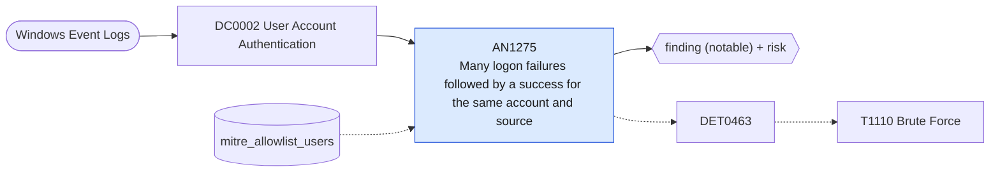

# AN1275 Many logon failures followed by a success for the same account and source

[ATT&CK analytic](https://attack.mitre.org/detectionstrategies/DET0463#AN1275) · DET0463 Brute Force Authentication Failures with Multi-Platform Log Correlation · [T1110 Brute Force](https://attack.mitre.org/techniques/T1110) · tactics: credential-access · platforms: Windows

**Content type:** ttp → finding (notable) + risk · **Severity:** medium · **Status:** implemented · **Technique prevalence score:** 45

For one account and source address on one host, Windows Security shows many failed logons (4625) and then a successful logon (4624) within the hour: a password guessed rather than mistyped.



## What ATT&CK asks for

> High volume of failed logon attempts followed by a successful one from a suspicious user, host, or timeframe

## What this implementation detects

For one account and source address on one host, Windows Security shows many failed logons (4625) and then a successful logon (4624) within the hour: a password guessed rather than mistyped.

**Not covered:** NTLM validation events (4776) carry no source address and are not joined; failures spread across many hosts are AN0590-style fan-out, not this.

## Tuning

ATT&CK mutable elements and where each is bound. Edit macros in `local/macros.conf` and lookups in place; do not edit the search.

| Mutable element | ATT&CK guidance | Bound to | Default |
|---|---|---|---|
| TimeWindow | Adjustable window to correlate failed logons, e.g., 5-10 minutes | filter macro `mitre_an1275_filter` — The window is the search range (65 minutes). |  |
| UserContext | Define scope of monitored users (e.g., service accounts, admins) | lookup `mitre_allowlist_users` |  |
| FailureThreshold | Count of failed logons before raising an alert (e.g., 10-15) | macro `mitre_an1275_threshold` — Failures before the success, per account, source and host per hour. | `10` |

## Splunk

Stanza `[MITRE - AN1275 - Many logon failures followed by a success for the same account and source - Rule]` in `DA-ESS-mitre-attack-detections`. Schedule `5-59/15 * * * *`, window `-65m@m` to `-5m@m`. Ships disabled.

```spl
`mitre_dc0002_wineventlog` EventCode IN (4624, 4625) NOT TargetUserName="*$"
| `mitre_normalize_host`
| eval user=TargetUserName, src=if(IpAddress IN ("-", "::1", "127.0.0.1"), WorkstationName, IpAddress), fail_time=if(EventCode==4625, _time, null()), success_time=if(EventCode==4624, _time, null())
| search `mitre_not_allowlisted_user`
| stats count(fail_time) as failures min(fail_time) as firstTime max(fail_time) as last_failure max(success_time) as lastTime by dest user src
| where failures >= `mitre_an1275_threshold` AND isnotnull(lastTime) AND lastTime > firstTime
| `mitre_ctime(firstTime)` | `mitre_ctime(lastTime)`
| `mitre_an1275_filter`
```

Risk: `user` (user, 60), `dest` (system, 40). Threat objects: `src`. Message: $user$ logged on to $dest$ from $src$ after $failures$ failures

Throttle: dest, user, src for 3600s.

Data components: [DC0002](../data-components/DC0002-user-account-authentication.md).

## Sigma

Rule file: `dist/sigma/rules/an1275_many_logon_failures_followed_by_a_success_for_the_same_accou.yml` (base rule plus a correlation rule).

Sigma counts the failures; the following success is required only in the Splunk search.

## Known false positives

- A user who forgot a changed password and eventually typed it; mapped drives retrying cached credentials.
