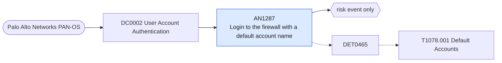

# AN1287 Login to the firewall with a default account name

[ATT&CK analytic](https://attack.mitre.org/detectionstrategies/DET0465#AN1287) · DET0465 Detection of Default Account Abuse Across Platforms · [T1078.001 Default Accounts](https://attack.mitre.org/techniques/T1078/001) · tactics: stealth, persistence, privilege-escalation, initial-access · platforms: Network Devices

**Content type:** anomaly → risk event only · **Severity:** medium · **Status:** implemented · **Technique prevalence score:** 12

A successful administrator login to a Palo Alto firewall (system log "logged in" or auth-success) using a vendor default account name such as admin. Named accounts should replace the default, so its use is either legacy practice or someone who knows the default.



## What ATT&CK asks for

> Login activity from default admin credentials (e.g., 'admin', 'cisco') on routers, firewalls, and switches.

## What this implementation detects

A successful administrator login to a Palo Alto firewall (system log "logged in" or auth-success) using a vendor default account name such as admin. Named accounts should replace the default, so its use is either legacy practice or someone who knows the default.

**Not covered:** Whether the default password is still set cannot be seen from logs. Routers and switches need the netdev_syslog feed.

## Tuning

ATT&CK mutable elements and where each is bound. Edit macros in `local/macros.conf` and lookups in place; do not edit the search.

| Mutable element | ATT&CK guidance | Bound to | Default |
|---|---|---|---|
| Username | Default usernames vary by vendor; defenders should adapt logic to their specific appliance list. | macro `mitre_an1287_default_accounts` | `user IN ("admin", "administrator", "root", "cisco", "panadmin", "netscreen", "manager")` |
| InterfaceType | Telnet and HTTP-based access to network devices should be blocked and monitored if enabled. | filter macro `mitre_an1287_filter` |  |

## Splunk

Stanza `[MITRE - AN1287 - Login to the firewall with a default account name - Rule]` in `DA-ESS-mitre-attack-detections`. Schedule `13-59/15 * * * *`, window `-20m@m` to `-5m@m`. Ships disabled.

```spl
`mitre_dc0002_palo_alto` `mitre_st_palo_alto_system`
| `mitre_normalize_pan_system`
| where (pan_subtype=="auth" AND pan_event_id=="auth-success") OR match(description, "(?i)logged in")
| search `mitre_an1287_default_accounts`
| stats count min(_time) as firstTime max(_time) as lastTime values(src) as src values(description) as description by dvc user
| rename dvc as dest
| `mitre_ctime(firstTime)` | `mitre_ctime(lastTime)`
| `mitre_an1287_filter`
```

Risk: `dest` (system, 30), `user` (user, 30). Threat objects: `src`. Message: Default account $user$ logged in to firewall $dest$

Throttle: dest, user for 86400s.

Data components: [DC0002](../data-components/DC0002-user-account-authentication.md).

## Sigma

Rule file: `dist/sigma/rules/an1287_login_to_the_firewall_with_a_default_account_name.yml`.

## Known false positives

- Teams that still administer with the built-in admin account; rename or disable it rather than excluding it.
