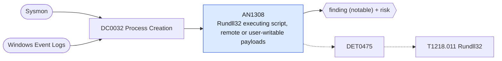

# AN1308 Rundll32 executing script, remote or user-writable payloads

[ATT&CK analytic](https://attack.mitre.org/detectionstrategies/DET0475#AN1308) · DET0475 Detection Strategy for T1218.011 Rundll32 Abuse · [T1218.011 Rundll32](https://attack.mitre.org/techniques/T1218/011) · tactics: stealth · platforms: Windows

**Content type:** ttp → finding (notable) + risk · **Severity:** medium · **Status:** implemented · **Technique prevalence score:** 137

rundll32.exe is started with a javascript:/vbscript: moniker, mshtml RunHTMLApplication, a URL, or a DLL or CPL that lives in a user-writable directory (Users, ProgramData, Temp, AppData, Public).



## What ATT&CK asks for

> Detects rundll32.exe invoked with atypical arguments (.dll, .cpl, javascript:, mshtml). DLLs not normally loaded by rundll32 are mapped into memory. Control_RunDLL or RunHTMLApplication invoked. Suspicious DLLs or scripts accessed from disk or network. Rundll32 reaches out to external domains (e.g., fetching .sct or .hta).

## What this implementation detects

rundll32.exe is started with a javascript:/vbscript: moniker, mshtml RunHTMLApplication, a URL, or a DLL or CPL that lives in a user-writable directory (Users, ProgramData, Temp, AppData, Public).

**Not covered:** Module loads, file creation and network connections by rundll32 are not correlated; an AllowedDLLs baseline is approximated by path only.

## Tuning

ATT&CK mutable elements and where each is bound. Edit macros in `local/macros.conf` and lookups in place; do not edit the search.

| Mutable element | ATT&CK guidance | Bound to | Default |
|---|---|---|---|
| TimeWindow | Correlating rundll32 invocation with DLL load or network activity within X seconds. | filter macro `mitre_an1308_filter` (not bound separately) | `search *` |
| ParentProcessFilter | Limit detection to suspicious parent processes (e.g., explorer.exe, office apps) vs. trusted installers. | filter macro `mitre_an1308_filter` |  |
| AllowedDLLs | Baseline list of legitimate DLLs frequently executed by rundll32 in the environment. | macro `mitre_an1308_suspicious_args` — Remove a path here only if software you trust is installed there; prefer an exclusion in the filter macro. | `Processes.process IN ("*javascript:*", "*vbscript:*", "*runhtmlapplication*", "*http://*", "*https://*", "*\\users\\public\\*", "*\\appdata\\*", "*\\programdata\\*", "*\\windows\\temp\\*", "*\\perflogs\\*", "*\\downloads\\*")` |
| ExternalIPRange | Scope of external IP ranges considered anomalous for rundll32 network connections. | filter macro `mitre_an1308_filter` (not bound separately) | `search *` |

## Splunk

Stanza `[MITRE - AN1308 - Rundll32 executing script, remote or user-writable payloads - Rule]` in `DA-ESS-mitre-attack-detections`. Schedule `13-59/15 * * * *`, window `-20m@m` to `-5m@m`. Ships disabled.

```spl
| tstats `mitre_summariesonly` count min(_time) as firstTime max(_time) as lastTime
    from `mitre_dc0032_dm` where `mitre_dc0032_dm_where` Processes.process_name="rundll32.exe" `mitre_an1308_suspicious_args`
    by Processes.dest Processes.user Processes.parent_process_name Processes.process_name Processes.process
| `drop_dm_object_name(Processes)`
| `mitre_ctime(firstTime)` | `mitre_ctime(lastTime)`
| `mitre_an1308_filter`
```

Risk: `dest` (system, 50), `user` (user, 50). Threat objects: `process`. Message: Suspicious rundll32 invocation on $dest$ by $user$

Throttle: dest, process for 3600s.

Data components: [DC0032](../data-components/DC0032-process-creation.md).

## Sigma

Rule file: `dist/sigma/rules/an1308_rundll32_executing_script_remote_or_user_writable_payloads.yml`.

## Known false positives

- Per-user installed software (collaboration clients, printer utilities) that registers DLLs under AppData or ProgramData.
