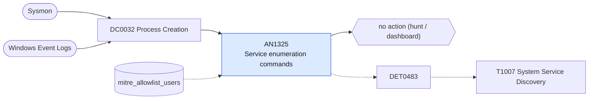

# AN1325 Service enumeration commands

[ATT&CK analytic](https://attack.mitre.org/detectionstrategies/DET0483#AN1325) · DET0483 Detection of System Service Discovery Commands Across OS Platforms · [T1007 System Service Discovery](https://attack.mitre.org/techniques/T1007) · tactics: discovery · platforms: Windows

**Content type:** hunting → no action (hunt / dashboard) · **Severity:** informational · **Status:** implemented · **Technique prevalence score:** 88

Lists sc query/queryex/qc, tasklist /svc, net start with no service name, wmic service and Get-Service / Get-CimInstance Win32_Service, with parent process, in ten-minute buckets.



## What ATT&CK asks for

> Enumeration of services via native CLI tools (e.g., `sc query`, `tasklist /svc`, `net start`) or API calls via PowerShell and WMI.

## What this implementation detects

Lists sc query/queryex/qc, tasklist /svc, net start with no service name, wmic service and Get-Service / Get-CimInstance Win32_Service, with parent process, in ten-minute buckets.

**Not covered:** Service enumeration through APIs and remote sc \\host queries are not separated out. No finding or risk.

## Tuning

ATT&CK mutable elements and where each is bound. Edit macros in `local/macros.conf` and lookups in place; do not edit the search.

| Mutable element | ATT&CK guidance | Bound to | Default |
|---|---|---|---|
| ProcessName | Can be tuned to specific binaries used for service enumeration (e.g., `sc.exe`, `tasklist.exe`). | filter macro `mitre_an1325_filter` |  |
| CommandLineMatch | Filters for variations like `sc query`, `net start`, `Get-Service`. | filter macro `mitre_an1325_filter` |  |
| ParentProcess | Used to suppress known admin scripts or automation jobs. | lookup `mitre_allowlist_users` — Allow-list the accounts that run admin scripts rather than parents, which are usually cmd or PowerShell. |  |

## Splunk

Stanza `[MITRE - AN1325 - Service enumeration commands - Rule]` in `DA-ESS-mitre-attack-detections`. Schedule `6-59/15 * * * *`, window `-20m@m` to `-5m@m`. Ships disabled.

```spl
| tstats `mitre_summariesonly` count from `mitre_dc0032_dm` where `mitre_dc0032_dm_where`
    ((Processes.process_name="sc.exe" Processes.process IN ("* query*", "* qc *"))
      OR (Processes.process_name="tasklist.exe" Processes.process="*/svc*")
      OR (Processes.process_name IN ("net.exe", "net1.exe") Processes.process IN ("*net start", "*net1 start", "*net.exe start", "*net1.exe start"))
      OR (Processes.process_name="wmic.exe" Processes.process="*service*")
      OR (Processes.process_name IN ("powershell.exe", "pwsh.exe") Processes.process IN ("*get-service*", "*win32_service*")))
    by Processes.dest Processes.user Processes.parent_process_name Processes.process _time span=10m
| `drop_dm_object_name(Processes)`
| search `mitre_not_allowlisted_user`
| stats sum(count) as count dc(process) as distinct_commands values(process) as process by dest user parent_process_name _time
| sort - count
| `mitre_an1325_filter`
```

Data components: [DC0032](../data-components/DC0032-process-creation.md).

## Sigma

Rule file: `dist/sigma/rules/an1325_service_enumeration_commands.yml`.

## Known false positives

- Monitoring, patching and inventory tooling.
