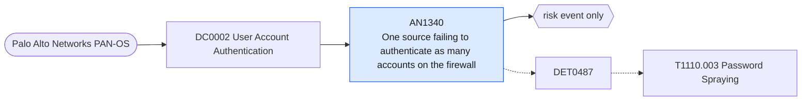

# AN1340 One source failing to authenticate as many accounts on the firewall

[ATT&CK analytic](https://attack.mitre.org/detectionstrategies/DET0487#AN1340) · DET0487 Distributed Password Spraying via Authentication Failures Across Multiple Accounts · [T1110.003 Password Spraying](https://attack.mitre.org/techniques/T1110/003) · tactics: credential-access · platforms: Network Devices

**Content type:** anomaly → risk event only · **Severity:** high · **Status:** implemented · **Technique prevalence score:** 34

Palo Alto auth-fail system events from one source address for several distinct accounts within ten minutes: password spraying against the management interface or an authentication profile.



## What ATT&CK asks for

> Authentication failure logs on routers/switches showing repeated use of default or common passwords across multiple accounts

## What this implementation detects

Palo Alto auth-fail system events from one source address for several distinct accounts within ten minutes: password spraying against the management interface or an authentication profile.

**Not covered:** Sources are parsed from the event description on older add-on versions; if neither the add-on nor the description provides a source, the event is skipped. Routers and switches need the netdev_syslog feed.

## Tuning

ATT&CK mutable elements and where each is bound. Edit macros in `local/macros.conf` and lookups in place; do not edit the search.

| Mutable element | ATT&CK guidance | Bound to | Default |
|---|---|---|---|
| AuthFailureBurst | Cluster of failed attempts in short period indicating spray | macro `mitre_an1340_threshold` — Distinct accounts failing from one source per 10 minutes. | `5` |
| InterfaceFilter | Limit detection to console/SSH vs web UI interfaces | filter macro `mitre_an1340_filter` |  |

## Splunk

Stanza `[MITRE - AN1340 - One source failing to authenticate as many accounts on the firewall - Rule]` in `DA-ESS-mitre-attack-detections`. Schedule `1-59/15 * * * *`, window `-20m@m` to `-5m@m`. Ships disabled.

```spl
`mitre_dc0002_palo_alto` `mitre_st_palo_alto_system`
| `mitre_normalize_pan_system`
| where pan_subtype=="auth" AND pan_event_id=="auth-fail" AND isnotnull(src)
| bin _time span=10m
| stats count as failures dc(user) as distinct_users values(user) as user min(_time) as firstTime max(_time) as lastTime by dvc src _time
| where distinct_users >= `mitre_an1340_threshold`
| rename dvc as dest
| eval user=mvindex(user, 0, 19)
| `mitre_ctime(firstTime)` | `mitre_ctime(lastTime)`
| `mitre_an1340_filter`
```

Risk: `dest` (system, 40). Threat objects: `src`. Message: $src$ failed to log in to firewall $dest$ as $distinct_users$ accounts

Throttle: dest, src for 3600s.

Data components: [DC0002](../data-components/DC0002-user-account-authentication.md).

## Sigma

Rule file: `dist/sigma/rules/an1340_one_source_failing_to_authenticate_as_many_accounts_on_the_f.yml` (base rule plus a correlation rule).

## Known false positives

- A shared jump host with several administrators mistyping passwords.
