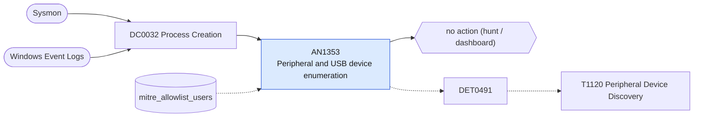

# AN1353 Peripheral and USB device enumeration

[ATT&CK analytic](https://attack.mitre.org/detectionstrategies/DET0491#AN1353) · DET0491 Peripheral Device Enumeration via System Utilities and API Calls · [T1120 Peripheral Device Discovery](https://attack.mitre.org/techniques/T1120) · tactics: discovery · platforms: Windows

**Content type:** hunting → no action (hunt / dashboard) · **Severity:** informational · **Status:** implemented · **Technique prevalence score:** 69

Lists enumeration of attached devices: Get-PnpDevice, Win32_PnPEntity, Win32_USBControllerDevice, pnputil /enum-devices, devcon, and reg query of USBSTOR or Enum\USB, in ten-minute buckets.



## What ATT&CK asks for

> Suspicious enumeration of attached peripherals via WMI, PowerShell, or low-level API calls potentially chained with removable device interactions.

## What this implementation detects

Lists enumeration of attached devices: Get-PnpDevice, Win32_PnPEntity, Win32_USBControllerDevice, pnputil /enum-devices, devcon, and reg query of USBSTOR or Enum\USB, in ten-minute buckets.

**Not covered:** API-level enumeration (SetupDi calls) has no command line; process access is not used. No finding or risk.

## Tuning

ATT&CK mutable elements and where each is bound. Edit macros in `local/macros.conf` and lookups in place; do not edit the search.

| Mutable element | ATT&CK guidance | Bound to | Default |
|---|---|---|---|
| CommandLineRegex | Regex patterns for device enumeration utilities (e.g., 'Get-PnpDevice', 'wmic path Win32_USBController') | filter macro `mitre_an1353_filter` |  |
| TimeWindow | Time threshold for grouping device discovery with follow-on access or manipulation | filter macro `mitre_an1353_filter` |  |
| UserContext | Filter privileged or service accounts known to legitimately execute enumeration scripts | lookup `mitre_allowlist_users` |  |

## Splunk

Stanza `[MITRE - AN1353 - Peripheral and USB device enumeration - Rule]` in `DA-ESS-mitre-attack-detections`. Schedule `12-59/15 * * * *`, window `-20m@m` to `-5m@m`. Ships disabled.

```spl
| tstats `mitre_summariesonly` count from `mitre_dc0032_dm` where `mitre_dc0032_dm_where`
    ((Processes.process_name IN ("powershell.exe", "pwsh.exe") Processes.process IN ("*get-pnpdevice*", "*win32_pnpentity*", "*win32_usbcontrollerdevice*", "*win32_usbhub*"))
      OR (Processes.process_name="pnputil.exe" Processes.process="*enum-devices*")
      OR Processes.process_name="devcon.exe"
      OR (Processes.process_name="reg.exe" Processes.process="*query*" Processes.process IN ("*usbstor*", "*enum\\usb*"))
      OR (Processes.process_name="wmic.exe" Processes.process IN ("*pnpentity*", "*usbcontroller*")))
    by Processes.dest Processes.user Processes.parent_process_name Processes.process _time span=10m
| `drop_dm_object_name(Processes)`
| search `mitre_not_allowlisted_user`
| stats sum(count) as count dc(process) as distinct_commands values(process) as process by dest user parent_process_name _time
| sort - count
| `mitre_an1353_filter`
```

Data components: [DC0032](../data-components/DC0032-process-creation.md).

## Sigma

Rule file: `dist/sigma/rules/an1353_peripheral_and_usb_device_enumeration.yml`.

## Known false positives

- Device-management and inventory tooling, help-desk diagnostics.
