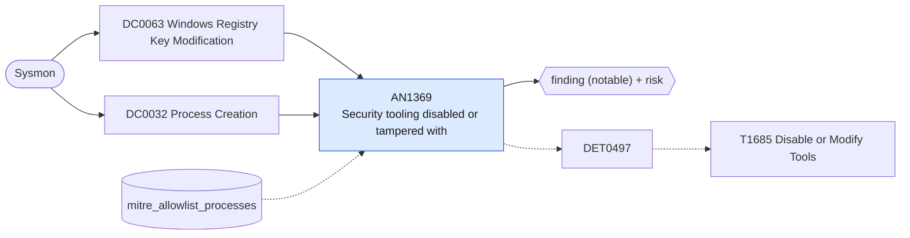

# AN1369 Security tooling disabled or tampered with

[ATT&CK analytic](https://attack.mitre.org/detectionstrategies/DET0497#AN1369) · DET0497 Detection of Defense Impairment through Disabled or Modified Tools across OS Platforms. · [T1685 Disable or Modify Tools](https://attack.mitre.org/techniques/T1685) · tactics: defense-impairment · platforms: Windows

**Content type:** ttp → finding (notable) + risk · **Severity:** high · **Status:** implemented · **Technique prevalence score:** 173

Registry values that turn off Microsoft Defender protections, add Defender exclusions, or change the start type of security services are written; or sc/net/taskkill/fltmc/PowerShell is used to stop, delete, disable or unload security services and drivers (Defender, Sysmon, Trellix, Splunk forwarder).



## What ATT&CK asks for

> Detection of adversary behavior that disables or modifies security tools, including killing AV/EDR processes, stopping services, altering Sysmon registry keys, or tampering with exclusion lists. Defenders observe process/service termination, registry modification, and abnormal absence of expected telemetry.

## What this implementation detects

Registry values that turn off Microsoft Defender protections, add Defender exclusions, or change the start type of security services are written; or sc/net/taskkill/fltmc/PowerShell is used to stop, delete, disable or unload security services and drivers (Defender, Sysmon, Trellix, Splunk forwarder).

**Not covered:** Termination of security processes by API (Sysmon EventCode 5 does not record the killer) and the resulting absence of telemetry are not detected here; pair with a data-check on Host Status.

## Tuning

ATT&CK mutable elements and where each is bound. Edit macros in `local/macros.conf` and lookups in place; do not edit the search.

| Mutable element | ATT&CK guidance | Bound to | Default |
|---|---|---|---|
| ProcessNameExclusions | List of expected administrative tools/processes to prevent false positives. | lookup `mitre_allowlist_processes` — Management tooling that legitimately reconfigures security products. |  |
| TimeWindow | Defines correlation window linking process termination, registry edits, and service stoppage. | filter macro `mitre_an1369_filter` (not bound separately) | `search *` |
| ServiceNames | Customizable list of security service names per enterprise deployment. | macro `mitre_an1369_security_services` — Service, driver and process names of your security stack. Trellix names vary by product version. | `CommandLine IN ("*windefend*", "*wdnissvc*", "*mpssvc*", "*sysmon*", "*mfemms*", "*mfefire*", "*mfevtp*", "*macmnsvc*", "*masvc*", "*mcshield*", "*mfetp*", "*splunkforwarder*", "*splunkd*")` |

## Splunk

Stanza `[MITRE - AN1369 - Security tooling disabled or tampered with - Rule]` in `DA-ESS-mitre-attack-detections`. Schedule `10-59/15 * * * *`, window `-20m@m` to `-5m@m`. Ships disabled.

```spl
(`mitre_dc0063_sysmon` EventCode=13 TargetObject IN ("*\\Windows Defender\\DisableAntiSpyware", "*\\Windows Defender\\DisableAntiVirus", "*\\Real-Time Protection\\Disable*", "*\\Windows Defender\\Exclusions\\*", "*\\Windows Defender\\Features\\TamperProtection", "*\\Services\\WinDefend\\Start", "*\\Services\\Sysmon*\\Start", "*\\Services\\mfe*\\Start", "*\\Services\\SplunkForwarder\\Start"))
  OR (`mitre_dc0032_sysmon` EventCode=1 ((Image IN ("*\\sc.exe", "*\\net.exe", "*\\net1.exe", "*\\taskkill.exe", "*\\fltmc.exe") CommandLine IN ("* stop *", "* delete *", "*disabled*", "*/im *", "* unload *") `mitre_an1369_security_services`) OR CommandLine IN ("*Set-MpPreference*-Disable*", "*Add-MpPreference*-Exclusion*", "*Uninstall-WindowsFeature*Windows-Defender*")))
| `mitre_normalize_host`
| eval signal=if(EventCode==13, "registry_tamper", "service_or_process_tamper"), process_name=replace(Image, "^.*\\\\", "")
| search `mitre_not_allowlisted_process`
| stats count min(_time) as firstTime max(_time) as lastTime values(signal) as signals values(TargetObject) as registry_path values(Details) as registry_value_data values(CommandLine) as process by dest user process_name
| `mitre_ctime(firstTime)` | `mitre_ctime(lastTime)`
| `mitre_an1369_filter`
```

Risk: `dest` (system, 70), `user` (user, 60). Threat objects: `process_name`. Message: Security tooling tampered with on $dest$ by $process_name$

Throttle: dest, process_name for 3600s.

Data components: [DC0063](../data-components/DC0063-windows-registry-key-modification.md), [DC0032](../data-components/DC0032-process-creation.md).

## Sigma

Rule file: `dist/sigma/rules/an1369_security_tooling_disabled_or_tampered_with.yml`.

## Known false positives

- Product upgrades and migrations, group policy or management agents writing Defender policy, administrators adding exclusions.
