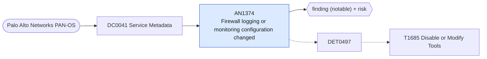

# AN1374 Firewall logging or monitoring configuration changed

[ATT&CK analytic](https://attack.mitre.org/detectionstrategies/DET0497#AN1374) · DET0497 Detection of Defense Impairment through Disabled or Modified Tools across OS Platforms. · [T1685 Disable or Modify Tools](https://attack.mitre.org/techniques/T1685) · tactics: defense-impairment · platforms: Network Devices

**Content type:** ttp → finding (notable) + risk · **Severity:** medium · **Status:** implemented · **Technique prevalence score:** 173

A Palo Alto configuration log entry where an administrator deletes, sets or edits an object under the logging and monitoring parts of the configuration: log settings, syslog, SNMP trap or e-mail server profiles, and log-forwarding profiles. Deleting or redirecting these reduces visibility.



## What ATT&CK asks for

> Detects disabling AAA, syslog, SNMP traps, ACL logging, or security features on routers/switches/firewalls; correlates privileged login followed by configuration commit reducing visibility.

## What this implementation detects

A Palo Alto configuration log entry where an administrator deletes, sets or edits an object under the logging and monitoring parts of the configuration: log settings, syslog, SNMP trap or e-mail server profiles, and log-forwarding profiles. Deleting or redirecting these reduces visibility.

**Not covered:** Comparison against a reference configuration (ConfigBaseline) is not implemented, and removal of a log-forwarding profile from an individual security rule is only caught if the rule path names the profile. Covers the firewall only; routers and switches need the netdev_syslog feed.

## Tuning

ATT&CK mutable elements and where each is bound. Edit macros in `local/macros.conf` and lookups in place; do not edit the search.

| Mutable element | ATT&CK guidance | Bound to | Default |
|---|---|---|---|
| ConfigBaseline | Reference configuration state for detecting unauthorized modifications. | macro `mitre_an1374_visibility_paths` — Configuration paths treated as visibility-relevant. | `path IN ("*log-settings*", "*syslog*", "*snmptrap*", "*log-forwarding*", "*log-collector*", "*email*server*", "*logging-service*")` |

## Splunk

Stanza `[MITRE - AN1374 - Firewall logging or monitoring configuration changed - Rule]` in `DA-ESS-mitre-attack-detections`. Schedule `9-59/15 * * * *`, window `-20m@m` to `-5m@m`. Ships disabled.

```spl
`mitre_dc0041_palo_alto` `mitre_st_palo_alto_config` cmd IN ("delete", "set", "edit", "rename", "move") `mitre_an1374_visibility_paths`
| `mitre_normalize_pan`
| eval dest=coalesce(dvc_name, dvc, host), config_path=path
| search `mitre_not_allowlisted_user`
| stats count min(_time) as firstTime max(_time) as lastTime values(cmd) as config_action values(config_path) as config_path values(client) as client by dest user
| `mitre_ctime(firstTime)` | `mitre_ctime(lastTime)`
| `mitre_an1374_filter`
```

Risk: `dest` (system, 60), `user` (user, 50). Message: Logging configuration changed on firewall $dest$ by $user$

Throttle: dest, user for 3600s.

Data components: [DC0041](../data-components/DC0041-service-metadata.md).

## Sigma

Rule file: `dist/sigma/rules/an1374_firewall_logging_or_monitoring_configuration_changed.yml`.

## Known false positives

- Planned changes to log collectors or SIEM destinations; Panorama template pushes.
